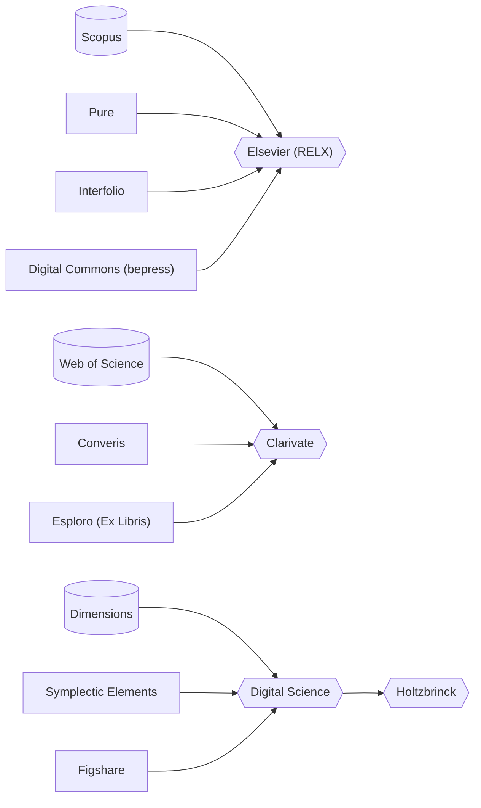

# Open Ecosystem Explorer — Technical Specification

**Status:** Draft v0.6 — implemented, and checked against the code and content in November 2026 (169 entities, 357 edges, 21 predicates; validation, typecheck, unit, e2e and accessibility suites pass). Not deployed yet: hosting is an open decision (§12, Q7).
**Format reference:** [`Data-Observatory/repository-crisis-scorecards-assesment`](https://github.com/Data-Observatory/repository-crisis-scorecards-assesment) `specs.md` — structure and rigour only. None of its content, scoring engine, or question bank carries over.
**Content source of truth:** *Manual breve del ecosistema de información de investigación*, Rodrigo Roa López de Heredia, Data Observatory, September 2026 (internal memo, Spanish). Appendix A is derived from it; memo sections are cited as **[M§n]**. Every factual claim taken from the memo has been checked against a primary source; corrections and their sources are logged in **A.4**, and the corrected value is what the spec states.
**Sections marked 🟡 are still open for the owner's decision.** All are enumerated in §12.

---

## 1. Overview & Goals

A **static, read-only, browsable knowledge map** of the research-information ecosystem: identifiers, registration agencies, indexes, institutional systems, regional infrastructure, standards, communities and coalitions — and the relationships between them.

**Scope:** a map of open science, open data and good data practice, and of the open software and licences they depend on. (Site name: *Open Ecosystem Explorer* / *Explorador del ecosistema abierto*.)

Individual entities are already catalogued elsewhere (re3data, FAIRsharing, ROR, OpenDOAR). What is poorly served is the **edge set**: who issues which identifier, who owns which index, which repository implements which schema, who governs what. This site makes the edge set legible.

The memo's practical rule [M§1] — *"cuando alguien mencione un nombre nuevo, pregúntese en qué capa está y quién lo gobierna"* — is the site's organising principle and drives two decisions: `layer` is a first-class facet (§5.1), and ownership/governance is a first-class relation (§5.3).

### Goals

- **G1 — Show the graph, not the list.** Every view is relationship-first.
- **G2 — Curated data as version-controlled plain text**, reviewable in a pull-request diff by a non-developer, and editable by an LLM coding agent without a human retyping YAML (§8.4).
- **G3 — Correctness enforced at build time.** A build *fails* — not warns — on a dangling reference, duplicate ID, out-of-vocabulary predicate, or domain/range violation.
- **G4 — Legible at every zoom level.** No hairball. The default view shows about 15 nodes; a selection shows a bounded set of neighbours, and the rest is one click away (§6).
- **G5 — Picture-optional accessibility.** Every node is a link and every relation is also a sentence; nothing is map-only (§9).
- **G6 — Simple to operate.** Static output, no server, no database, no runtime API calls (the one third-party request is the opt-out analytics container, A7); builds in well under a minute.
- **G7 — Provenance-bearing.** Every non-obvious assertion carries a source.
- **G8 — Data reusable independently of the site**, published as JSON/CSV.
- **G9 — Multilingual from day one.** Spanish and English ship in v1; a third language is prose files plus one config line, never a schema change (§5.7, §7.2).

**Non-goal summary:** no scoring, no assessment, no form, no user input, no account, no submission workflow. The reference project was ~90% scoring engine; none of that surface exists here.

---

## 2. Non-Goals / Out of Scope (v1)

| # | Excluded | Rationale |
|---|---|---|
| N1 | Scoring, ratings, maturity levels, rankings | The site describes; it does not evaluate. |
| N2 | Any form, questionnaire, or self-assessment | Explicit user decision: pure explorer. |
| N3 | Accounts, authentication, personalisation | No server, no need. |
| N4 | In-app content submission or editing | Contributions arrive as pull requests (§8). A "suggest an edit" link to a pre-filled issue becomes possible once the repository is public — a link, not a form. |
| N5 | Runtime harvesting from re3data / FAIRsharing / OpenAIRE / ROR APIs | v1 is a curated snapshot. External identifiers are stored so a future sync job stays possible (Q9). |
| N6 | Server-side rendering, databases, serverless functions | Static output only. |
| N7 | Full-text search over external documents | Search covers on-site fields only. |
| N8 | ~~Multilingual content~~ **— no longer excluded.** Spanish (default) and English ship in v1; the locale list is open (§5.7). What *is* excluded is machine translation, translation-workflow tooling, and locale-negotiating redirects (there is no server). | Q10 resolved. |
| N9 | `Person` entities | GDPR surface, high maintenance, low analytical value. Individuals appear only as prose. |
| N10 | Temporal/animated graph playback | `since`/`until` are captured; no UI in v1. |
| N11 | Automated graph analytics (centrality, community detection) | Build-time counts only. Note this excludes *computed* analytics, not the hand-written analyses of §5.6. |
| N12 | Comments, annotations, discussion | Use the GitHub repository. |
| N13 | Print/PDF report generation | The data downloads (CSV, JSON) are the reuse path; the map has no image export. |
| N14 | Bulk import / ETL from any upstream register | Content is curated once and edited incrementally (§8.3). Confirmed by Q2. |
| N15 | Open education, open hardware and open government (transparency, civic tech) | Outside the current scope (open science, open data, good data practice, and the open software and licences they depend on). Out of scope for now; revisit later. |

---

## 3. Content Authoring & Curation Policy

- **C1 — One fact, one place.** An attribute is stated in its entity's file and nowhere else. Derived facts (inverse relations, neighbour counts, `layer`, type totals) are computed at build time; a hand-written derived fact is a build error.
- **C2 — Every relation is authored once, in one canonical direction**, fixed by the predicate table (A.2). Authoring the inverse form is a build error (I7).
- **C3 — Descriptive, not evaluative.** No quality adjectives. `summary` states what a thing *is* and *does*. Status is factual (`active` / `deprecated` / `superseded`), never qualitative. This applies to the fault-line analyses (§5.6) too: they state structural facts (who owns what, what is downloadable), not verdicts.
- **C4 — Provenance required.** Every entity carries ≥1 `sources` entry with URL and `accessed` date. Relations whose truth is not self-evident from the target's homepage carry their own source.
- **C5 — Freshness tracked.** Every entity carries `lastReviewed`. The build warns at >18 months (I26); the entity page and the footer show the review dates.
- **C6 — Controlled vocabularies are closed.** Entity types, layers, predicates, tags, disciplines and statuses live in `src/content/vocab/*.yaml`. Adding a term requires a separate PR touching only vocabulary files.
- **C7 — Neutral inclusion criteria** (Q4): the entity (a) has a stable public URL, (b) is referenced by ≥1 other entity in the graph *or* is a recognised registry, standards body or coalition, (c) is not a single project's internal tooling, and (d) falls within the stated scope (§1): open science, open data, good data practice, or the open software and licences they depend on, not open education, open hardware or open government (N15).
- **C8 — No personal data** (N9).
- **C9 — Corrections are first-class.** `CONTRIBUTING.md` says how to propose one and `CHANGELOG.md` records dataset changes. 🟡 A per-entity "suggest a correction" link to a pre-filled issue needs a public repository and is not built (`docs/known-issues.md`).
- **C10 — Structural facts are never duplicated per language.** IDs, types, relations, external identifiers and dates exist once, in the locale-independent facts file. Only prose is translated (§5.7). A translation can therefore be stale, but it can never disagree with the graph.

---

## 4. Tech Stack & Project Structure

### 4.1 Stack: SvelteKit (static) + TypeScript strict + Zod

| Layer | Choice | Version |
|---|---|---|
| Site framework | SvelteKit with `@sveltejs/adapter-static`, every page prerendered; Svelte 5, runes only | 2.x / 5.x |
| Language | TypeScript, `strict`, `noUncheckedIndexedAccess` | 6.x |
| Content layer | Plain `fs` loaders over the YAML files (`src/content/*.ts`), at build time only | none |
| Schema validation | Zod + custom graph invariants (`src/lib/invariants/`) | 3.x |
| Map and graph pictures | Svelte-native SVG (`src/lib/explorer/`, §7.0); positions from a hand composition, a ring, and the build-time `src/generated/graph-layout.json` | none |
| Styling | Tailwind CSS 4, self-hosted Inter and Space Grotesk | 4.x |
| UI strings | Paraglide (`messages/<locale>.json`, URL strategy) | 2.x |
| Tests | Vitest (unit and invariants), Playwright + axe-core (e2e and accessibility) | — |
| Runtime | Node 22 LTS, npm; static output in `build/`; hosting undecided (Q7) | — |

### 4.2 Why this stack

"Simpler website" means **what ships to the browser**, not the absence of a build step: hand-maintaining hundreds of cross-linked pages would be more complexity and would make G3 impossible. The site is a prerendered static build whose pages work without JavaScript; JavaScript adds the map, filters, search and the analytics notice.

- **SvelteKit** shares the stack of the other Data Observatory sites (tooling, i18n, tests, deployment practice) and gives one reactive island, the map, the state it needs (selection, story step, mode, all in the URL) without a second framework. `adapter-static` prerenders every route, so there is no server (N6).
- **Astro** was used for the first versions of the site and replaced in November 2026 for those two reasons. It remains in git history.
- **Not a graph database or a client-side graph library:** a few hundred KB of JSON fits in memory (G6, N6); the map is plain SVG plus a pure scene function.
- **Not plain HTML:** no build step means no validation, so a dangling reference would reach users instead of CI (fails G3), and inverse relations would have to be hand-maintained in both directions (violates C1).

### 4.3 Project structure

```
├── specs.md  README.md  CHANGELOG.md  CONTRIBUTING.md  LICENSE  LICENSE-DATA  LICENSE-FONTS
├── package.json  tsconfig.json  vite.config.ts  playwright.config.ts  vitest.config.ts
├── docs/  architecture.md (routes, map design) · analytics.md · known-issues.md
├── prompts/  add-entity.md (the §8.4 template, kept next to the schema it references)
├── .nvmrc  .vscode/settings.json (JSON Schemas for the YAML content)
├── messages/  es.json en.json            # UI strings (Paraglide)
├── schema/    generated JSON Schemas
├── scripts/   validate.ts · generate-schema.ts · layout-graph.ts · review.ts · watch-validate.ts · postbuild.mjs
├── static/    consent-loader.js · favicon.svg · 404.html
├── src/
│   ├── content/entities/        # ONE FACTS FILE PER ENTITY, flat, <id>.yaml — no prose body
│   ├── content/i18n/<locale>/   # <id>.yaml translated prose (body is a field), + views/ (§5.7)
│   ├── content/views/ stories/  # saved queries (§5.6) and the guided stories
│   ├── content/vocab/           # entity-types.yaml (incl. the type→layer map), predicates.yaml, predicate-families.yaml,
│   │                            # tags.yaml, disciplines.yaml, statuses.yaml — per-locale labels
│   ├── content/*.ts             # fs loaders and indexes (build time only)
│   ├── i18n/locales.ts          # the open locale list
│   ├── generated/               # graph-layout.json (committed, checked by layout:check)
│   ├── routes/                  # SvelteKit routes, `[locale=locale]/…` plus the locale-free data files
│   └── lib/
│       ├── model/ graph/ i18n/ invariants/ views/ stories/ export/   # PURE TypeScript — rule A1
│       ├── map/                 # anchors.ts · layout.ts (build-time positions) · color-distance.ts
│       ├── markdown/            # tiny renderer for CONTRIBUTING.md and the prompt shown on About
│       ├── explorer/            # the map: scene, geometry, compose, URL state, Svelte components
│       ├── components/          # shared Svelte components (consent notice, chips, links)
│       ├── consent/             # analytics consent logic (docs/analytics.md)
│       └── server/              # build-time site/map/feed payloads (uses fs)
└── tests/  unit/ · e2e/ · fixtures/
```

### 4.4 Non-negotiable architectural rules

- **A1 — The model code is pure.** `src/lib/{model,graph,i18n,invariants,views,stories,export}` import no framework, no DOM, no `fetch`, no filesystem, no `import.meta.env`. Consequence: the graph, view-query, i18n-resolution and invariant layers are unit-testable in plain Node, and `scripts/validate.ts` runs without booting the site. File access lives in `src/content/` and `src/lib/server/`, both build-time only.
- **A2 — Map scenes are pure functions.** `src/lib/explorer/scene.ts` and its helpers turn a graph payload, a selection and a mode into positioned nodes and edges; the Svelte components only draw them. Scenes are unit-tested without a browser.
- **A3 — Layout is deterministic and built before the browser.** Positions of the full corpus come from `scripts/layout-graph.ts` (seeded, sorted by stable keys) into `src/generated/graph-layout.json`, checked by `npm run layout:check` in the build. The browser runs no force simulation. All iteration is sorted by a stable key (`id`, then predicate, then target `id`), so identical content gives identical output.
- **A4 — Content is the single source of truth.** No entity name, count, label or relation appears as a literal in a component, page or stylesheet. No UI string is hardcoded either: chrome text comes from `messages/<locale>.json`, vocabulary labels from the vocab files. The exceptions are code, by design: the anchor set (`src/lib/map/anchors.ts`) and its hand composition (`src/lib/explorer/compose.ts`); a test fails if they disagree.
- **A5 — The `GraphIndex` is built once and frozen**, then passed down. Components never recompute neighbours or re-derive inverses. The index is locale-independent; locale is applied at render time.
- **A6 — Pages work without JavaScript.** Content, links, glossary, entity pages (with their static mini-graph), story step lists and the map as a picture of links all render server-side; JavaScript only adds the interactive map, filters, search and the analytics notice. No byte budget is enforced yet: measure before setting one.
- **A7 — No third-party network at runtime, except opt-out analytics.** No CDN fonts, no browser API calls. The one exception is Google Tag Manager (container `GTM-M9NXQLBC`), loaded by `static/consent-loader.js`: on by default, announced in a notice, off for good once the visitor turns it off (stored choice `oee-consent`; see `docs/analytics.md`). With analytics off the site makes no third-party request.
- **A8 — Validation runs first.** `npm run build` invokes `npm run validate` and `npm run layout:check`; failure exits non-zero and produces no output.
- **A9 — Adding a locale touches no schema and no component.** It is one entry in `src/i18n/locales.ts`, one `messages/<code>.json`, the Paraglide locale list in `project.inlang/settings.json`, one label per vocabulary term, and prose files. Anything that would need a code change to support a third language is a design defect (§5.7).

---

## 5. Content Data Model

Field names and enum members are concrete proposals derived from the source memo (Appendix A) and from the corrections in A.4. The overall shape — entities + typed directed relations + provenance — is the recommendation.

### 5.1 Core entity, `type` and the derived `layer`

`type` says what a thing is; `layer` says where it sits in the memo's stack [M§1]. **`layer` is derived, not authored**: it is declared once per type in `vocab/entity-types.yaml` and computed into `GraphIndex.byLayer`. Authoring it in an entity file is a build error (C1, I23). The five cross-cutting types (`standard`, `community`, `coalition`, `policy`, `organization`) map to the layer `cross-cutting` — the memo describes them as *"atravesando todo… tres cosas que no son software"* [M§1] — and render as a band rather than a stack row. The thirteenth type, `concept` (an idea or term: *persistent identifier*, *open access*, *metadata*, *FAIR principles*, *repository*), maps to its own layer `concept`, rendered after the band. `cross-cutting` and `concept` form the non-stack group (`CrossCuttingLayer` in `types.ts`). Layer derivation: `vocab/entity-types.yaml` gives each type its `layer`, and `buildIndex` fills `byLayer` and `stats.byLayer` with **every** layer key (zero when empty).

```ts
/** Unique across ALL types. /^[a-z0-9]+(?:-[a-z0-9]+)*$/, 2..64 chars, == filename stem. */
export type EntityId = string;
/** The 21 predicates of Appendix A.2, which is the single definition of each. */
export type PredicateId = 'issues' | 'implements' | … | 'applies-to' | 'is-a' | 'related-to';

/** M§2–M§6. Derived from `type`, never authored. `regional` is the memo's own "capa
 *  regional": supra-institutional infrastructure operating across institutions and
 *  countries — a scope, not a geographic tag (that is `geography[]`). */
export type Layer = 'identifier' | 'agency' | 'index' | 'institutional-system' | 'regional';
export type CrossCuttingLayer = 'cross-cutting' | 'concept';   // the non-stack group

/** Definitions, subtype fields and examples per type: Appendix A.1. */
export type EntityType =
  | 'identifier' | 'agency' | 'index' | 'cris' | 'repository'
  | 'aggregator' | 'publishing-platform'                        // layered
  | 'standard' | 'community' | 'coalition' | 'policy' | 'organization'   // layer: cross-cutting
  | 'concept';                                                        // layer: concept

export type Status = 'active' | 'deprecated' | 'superseded' | 'planned' | 'unknown';
export type Confidence = 'asserted' | 'reported' | 'inferred';
/** The memo's second question — "quién lo gobierna" [M§1]. Required on every entity. */
export type Governance = 'commercial' | 'nonprofit' | 'community'
  | 'intergovernmental' | 'public-agency' | 'academic' | 'unknown'
  | 'not-applicable';   // concepts only: an idea has no governing body
/** Progressive disclosure tier; omitted => 'extended' (`DEFAULT_PROMINENCE`, read via `prominenceOf`). */
export type Prominence = 'core' | 'extended' | 'detail';
/** Separate from `governance`, which is what makes M§5's central distinction
 *  ("contenido abierto no es lo mismo que infraestructura abierta") queryable. */
export type OutputLicence = 'open' | 'partly-open' | 'closed' | 'not-applicable';
export type Codebase = 'open-source' | 'proprietary' | 'mixed' | 'not-applicable';

export interface Source { url: string; title?: string; accessed: string; note?: string }

export interface Relation {
  predicate: PredicateId;   // canonical direction only (I7)
  target: EntityId;         // must resolve (I3)
  note?: string;            // ≤140 chars — edge tooltip / table cell; translatable (§5.7)
  since?: string; until?: string;  // YYYY | YYYY-MM | YYYY-MM-DD; `until` renders dashed + grey
  confidence?: Confidence;  // default 'asserted'; otherwise ≥1 source required (I15)
  sources?: Source[];
  verified?: { date: string; url: string };  // WARN-gated on governance predicates (I32)
}

/** All optional; all format-validated against per-field regexes (I18). */
export interface ExternalIds {
  ror?: string; doi?: string; wikidata?: string; re3data?: string;
  fairsharing?: string; openaire?: string; spdx?: string; isni?: string;
}

/** THE FACTS FILE. Locale-independent in its entirety — see §5.7 and C10. */
export interface EntityBase {
  id: EntityId;                 // == filename stem
  type: EntityType;             // layer is derived from this, never authored
  name: string;                 // 2..80 chars, official name; per-locale override allowed (§5.7)
  aka?: string[];               // aliases/acronyms, ≤8, indexed for search
  url: string;                  // canonical https homepage
  identifiers?: ExternalIds;
  status: Status; governance: Governance;        // governance REQUIRED — M§1
  outputLicence?: OutputLicence; codebase?: Codebase;
  since?: string; until?: string;
  prominence?: Prominence;      // core = default view · extended (default) = on expand/search · detail = entity page / expert only
  tags: string[];               // ≥1, from vocab/tags.yaml
  disciplines?: string[]; geography?: string[];  // FORD; ISO 3166-1 alpha-2 / eu / latam / global
  relations: Relation[];        // outgoing, canonical direction only
  sources: Source[];            // ≥1 (I15)
  lastReviewed: string;         // YYYY-MM-DD
  isolated?: true;              // explicit opt-out of the no-orphans rule (I11)
  note?: string;                // explains `isolated` (I11) or why a commercial entity has no `owned-by` (I22)
  // This file has no `body` field (I31). `summary` and prose live in the i18n files.
}
```

### 5.2 Type-specific fields

`Entity` is a discriminated union on `type` over the thirteen interfaces below (`XxxEntity extends EntityBase`). Each field set is what the memo says is worth knowing about that kind of thing; **bold = required**, `?` = optional.

| Type | Fields |
|---|---|
| `identifier` [M§2] | **`identifies`**: object · person · organization · activity · sample · bibliographic · `isoStandard?` (`ISO 23527:2022` for RAiD, A.4) · `resolverUrl?` |
| `agency` [M§3] | **`registers`**: (publication · dataset · software · report · platform · sample · person)[] · **`feeModel`**: membership · per-object · free · mixed · unknown · `consortiumModel?: boolean` (DataCite's national-consortium model) · `waiverProgramme?: string` (Crossref GEM — 93 eligible countries as of 2026-09, Chile not among them; A.4) |
| `index` [M§4] | **`indexKind`**: bibliographic · citation · registry · directory · **`selectivity`**: editorial-board · algorithmic · inclusive · **`inclusionCriteria`**: published · partially-published · opaque · **`bulkDownload`**: full · partial · none · `coverageObjects?: string[]` · `coverageLanguages?: string[]` (ISO 639-1 or `multilingual`) · `knownGaps?: string` (≤200 chars, factual). The last four are exactly the memo's four tests for an index; `indexKind` distinguishes a citation index from a registry of infrastructure (re3data, OpenDOAR, FAIRsharing), which answer the same four questions with very different answers. |
| `cris` [M§5] | **`crisKind`**: commercial · open-source · national |
| `repository` [M§5] | **`repositoryKind`**: software-platform · hosted-service · institutional-instance · `certifications?`: (coretrustseal · wds · nestor-seal · iso-16363 · none)[] · `persistentIdScheme?: EntityId[]` (resolves to `identifier` entities, I21) · `accessModel?`: open · restricted · mixed · embargoed |
| `aggregator` [M§6] | **`aggregatorKind`**: harvesting-network · linking-service · federation · **`harvestProtocols`**: EntityId[] (resolves to `standard` entities — OAI-PMH, COAR Notify, ResourceSync) · `memberCountries?: string[]` · `objectScope?`: (article · thesis · dataset · journal)[] · `recordCount?: number` (requires a dated source) |
| `publishing-platform` [M§6] | **`platformKind`**: journal-programme · preprint-server · books-programme · **`fullTextHosted`**: boolean · **`admissionCriteria`**: published · partially-published · opaque · `markupStandard?: EntityId[]` (resolves to `standard` entities — JATS and its dialects) · `nationalCollections?: string[]` · `titleCount?: number` (requires a dated source) |
| `standard` [M§7] | **`standardKind`**: principles · metadata-schema · protocol · certification-criteria · framework · governance-criteria · serialisation · `specVersion?` · `specUrl?` · `machineReadable?: boolean` (ships an XSD / JSON-Schema / SHACL / OpenAPI artefact) · `requiresOpenness?: boolean` — `true` when conformance requires openness (the Open Definition), `false` when it does not (DataCite Metadata Schema, Creative Commons licences). Principles that are not conformance-tested (FAIR, CARE, TRUST, POSI) are `concept`s, not standards (owner decision, 2026-11-13). |
| `community` [M§8] | **`communityKind`**: standards-body · technical-community · certification-body · confederation · `openMembership?: boolean` · `nationalChapters?: string[]` (e.g. CODATA Chile) |
| `coalition` [M§8] | **`coalitionKind`**: declaration · reform-movement · funding-initiative · network · `signatoryCount?: number` · `workingGroups?: string[]` (e.g. Barcelona Declaration WG4) |
| `policy` | **`policyKind`**: law · mandate · guideline · funder-requirement · strategy · recommendation · **`jurisdiction`**: string[] · **`bindingness`**: binding · conditional · advisory · `effectiveDate?` |
| `organization` | **`orgKind`**: company · nonprofit · foundation · university · research-institute · government-agency · intergovernmental · library · `country?` (ISO 3166-1 alpha-2) |
| `concept` | *(no type-specific fields; no `*Kind`)* — `governance` is `not-applicable`, `url` is the canonical reference page (e.g. the Wikipedia article), `identifiers.wikidata` is the only external id worth storing. Concrete things point at their concepts with `is-a` (a kind of) or `related-to` (operates or addresses it); concepts nest with `is-a` (subtype) and `part-of`. Guiding principles without conformance testing (FAIR, CARE, TRUST, POSI) are concepts. |

**What was dropped from v0.1 and why.** The old `tool` / `infrastructure` types are gone. Their boundary ("software you can run" vs "a service run for you") was the model's weakest join, and the memo does not draw it — it lists DSpace, Dataverse, InvenioRDM, Zenodo and Figshare in one breath [M§5]. That distinction now lives inside `repositoryKind` (`software-platform` vs `hosted-service`), where it is a field value rather than a categorisation decision. The `*Kind` fields are shown in the attribute table under "Details" on the entity page and are in the downloads.

**What was added in v0.5: `concept`, `is-a`, `related-to`, `prominence`, predicate `family`.** A newcomer starts from ideas (*what is a persistent identifier?*), not from infrastructure, and the graph had no node for the idea. `concept` is a new type in its own layer; `is-a` (below) attaches every other type to it. `prominence` (`core` · `extended` · `detail`, default `extended`) is authored per entity and drives progressive disclosure in the UI; it never affects validation. Predicates gained a display `family` (A.2). The type and the predicates were first declared before they had instances, carrying `pending: true` in their vocab file, which exempts an entry from I12 until its first instance exists (I12 then warns if the flag is left behind). The concept layer is populated now (31 concepts) and no entry is pending.

**What was added in v0.3 and why: `publishing-platform`.** See the Q1(a) decision in §12 and the reasoning in A.1. In short: SciELO and Redalyc host, mark up and publish the full text they expose, under their own admission criteria; OpenAIRE and LA Referencia harvest metadata for content they never hold. Those are different machines with different failure modes, and `aggregatorKind: publishing-platform` was hiding that inside a field.

### 5.3 Predicate metadata, and `owned-by` as a first-class relation

`vocab/predicates.yaml` declares per predicate: `family` (display group, `vocab/predicate-families.yaml`, ≤5, I35), `pending?`, `label`, `inverseLabel`, `domain`, `range`, `symmetric`, `acyclic`, `sameTypeOnly`, `crossTypePairs` and `maxOutDegree`. Full table in **A.2**.

```ts
export interface PredicateDef {
  id: PredicateId;
  family: PredicateFamilyId;  // display group (A.2)
  pending?: boolean;          // exempt from I12 until its first edge (unused today)
  label: LocaleMap;           // active voice, drawn on the edge: { es: 'es propiedad de', en: 'owned by' }
  inverseLabel: LocaleMap;    // passive, shown on the target's page
  domain: EntityType[]; range: EntityType[];
  symmetric: boolean; acyclic: boolean; sameTypeOnly: boolean;
  crossTypePairs?: [EntityType, EntityType][]; // narrow, explicit escape hatch from sameTypeOnly (I8) — not a range override, so typos are still caught. Currently only `interoperates-with`: `[cris, index]` and `[index, publishing-platform]`.
  maxOutDegree?: number;      // soft cap; exceeded => I28 warning (the map shows the most relevant neighbours, the page lists all)
}
```

**Canonical direction (C2).** Every predicate is authored from the entity being described toward the anchor it depends on, conforms to, or belongs to. `figshare owned-by digital-science` is authored in `figshare.yaml`; `digital-science owns figshare` is never written and is a build error (I7). Inverses are derived at build time and rendered under `inverseLabel`. The reason is operational: adding an entity must be a **one-file pull request**, with no edits to five other files and no diff a reviewer has to reassemble.

**`owned-by` earns its own predicate**, distinct from `governed-by` (a formal governance body), `operated-by` (who runs it day to day) and `developed-by` (who writes the code). It means *corporate control of the product's roadmap and continuity* — the memo's own criterion, *"el criterio correcto no es la licencia del archivo, es quién gobierna la plataforma"* [M§5]. Range is restricted to `organization` with `orgKind: company` (I19).

It is the highest-value edge in the dataset, because rendering its subgraph turns the memo's second fault line — vertical integration [M§9] — from a paragraph into a picture. The version below uses the ownership facts verified in **A.4**, not the memo's shorter list; three of these edges (Interfolio, Digital Commons, Esploro) are not in the memo at all and make the pattern sharper:



Three parents, one edge type, and the concentration is visible without commentary: Elsevier and Digital Science each own an index, a CRIS and a repository platform; Clarivate an index and two CRIS. It needs no new machinery: the `owned-by` sentences appear on every entity page and in the downloads, and the `vertical-integration` view (§5.6) lists them by owner. The claim is narrow — a picture of ownership, not an argument about it — but it is the clearest single thing the data model buys.

### 5.4 The derived index

```ts
export interface GraphEdge {           // one directed, resolved, deduplicated edge
  from: EntityId; to: EntityId; predicate: PredicateId;
  note?: string; since?: string; until?: string;
  confidence: Confidence; sources: Source[];
  derived: boolean;                    // true only on the synthesised inverse view
}

export interface GraphIndex {          // all members readonly; deep-frozen in dev
  entities: ReadonlyMap<EntityId, Entity>;
  byType: ReadonlyMap<EntityType, readonly EntityId[]>;               // sorted by name
  byLayer: ReadonlyMap<Layer | CrossCuttingLayer, readonly EntityId[]>; // derived, §5.1
  edges: readonly GraphEdge[];                                        // canonical, sorted
  outgoing: ReadonlyMap<EntityId, readonly GraphEdge[]>;
  incoming: ReadonlyMap<EntityId, readonly GraphEdge[]>;              // derived inverse view
  degree: ReadonlyMap<EntityId, { in: number; out: number }>;
  predicates: ReadonlyMap<PredicateId, PredicateDef>;
  components: readonly (readonly EntityId[])[];                       // weakly connected
  prose: ReadonlyMap<LocaleCode, ReadonlyMap<EntityId, ResolvedProse>>;  // §5.7
  stats: EntityStats;   // entityCount, edgeCount, maxDegree, generatedAt, byType, byLayer, byPredicate,
                        // orphans, translationCoverage per locale
}
```

`buildIndex(entities, prose, predicates, typeLayerMap): GraphIndex` is pure, deterministic, and the only place inverses, layers and prose fallbacks are resolved (A3, A5).

### 5.5 Build-time invariants

Each rule is a pure predicate in `src/lib/invariants/rules.ts`, exercised against real content and adversarial fixtures by `tests/unit/invariants/`, and run by `npm run validate` (which `npm run build` runs first, A8). **ERROR fails the build with a message naming file, field and offending value. WARN prints and continues.** Message quality is a requirement, not a nicety — see §8.4(b).

| # | Level | Invariant |
|---|---|---|
| I1 | ERROR | `id` matches `/^[a-z0-9]+(?:-[a-z0-9]+)*$/`, 2–64 chars, equals the filename stem. |
| I2 | ERROR | `id` is unique across **all** entity types. No type-scoped namespacing. |
| I3 | ERROR | No dangling references: every `relations[].target` resolves. |
| I4 | ERROR | No self-loops. |
| I5 | ERROR | No duplicate triples `(id, predicate, target)`. |
| I6 | ERROR | `predicate` ∈ `vocab/predicates.yaml`. Closed vocabulary. |
| I7 | ERROR | Canonical direction only. An inverse-form predicate (`owns`, `issued-by`, `implemented-by`, …) is rejected with a message naming the canonical form and the file it belongs in. |
| I8 | ERROR | Domain/range: `subject.type ∈ predicate.domain`, `target.type ∈ predicate.range`; where `sameTypeOnly`, also `subject.type === target.type`. |
| I9 | ERROR | Symmetric predicates authored once per unordered pair, on the lexicographically smaller `id`. |
| I10 | ERROR | Acyclic predicates form a DAG (`part-of`, `supersedes`, `profile-of`, `depends-on`, `owned-by`, `member-of`). Error prints the cycle path. |
| I11 | ERROR | No orphans: in-degree + out-degree ≥ 1 unless `isolated: true` with an explanatory `note`. |
| I12 | ERROR | Every declared `EntityType` has ≥1 instance and every declared predicate ≥1 edge. Unused vocabulary is removed or populated. An entry flagged `pending: true` (none at present: `concept`, `is-a` and `related-to` shed the flag once the concept layer was populated; the synthetic test fixtures re-apply it) is exempt until its first instance; a WARN is raised if the flag is then left behind. |
| I13 | ERROR | Every `tags[]`, `disciplines[]`, `status`, `governance` value exists in the corresponding vocab file. |
| I14 | ERROR | `summary` (in each locale file) is 40–200 chars, single-line, no Markdown syntax, not identical to `name`. |
| I15 | ERROR | `sources.length ≥ 1`; every `Source.url` is `https:`; `accessed` is a valid ISO date not in the future. Relations with `confidence !== 'asserted'` carry ≥1 source. |
| I16 | ERROR | `codebase: open-source` requires a licence-bearing `sourceUrl` or an explanatory note; SPDX identifiers validated against `spdx-license-ids`. |
| I17 | ERROR | `url` and all `Source.url` are syntactically valid absolute `https:` URLs. (Reachability checked weekly, non-blocking — §11.) |
| I18 | ERROR | Populated `identifiers.*` match their format regexes (§5.1). |
| I19 | ERROR | **`owned-by` targets an `organization` with `orgKind: company`.** Ownership by a non-company is `governed-by` or `operated-by`, not `owned-by`. |
| I20 | ERROR | `since` ≤ `until` where both present; valid partial ISO dates; neither >1 year in the future. |
| I21 | ERROR | EntityId-valued subtype fields resolve to an entity of the required type: `persistentIdScheme[] → identifier`, `harvestProtocols[] → standard`, `markupStandard[] → standard`. |
| I22 | ERROR | `governance: commercial` requires ≥1 outgoing `owned-by` edge, or a `note` on the entity explaining why none is recorded. Enforces the memo's central question at authoring time. |
| I23 | ERROR | `layer` is never present in an entity file — it is derived (§5.1, C1). |
| I24 | ERROR | Every `View.query` (§5.6) resolves against the current graph; `kind: 'explicit'` entity IDs must exist. |
| I25 | ERROR | A `View.query` resolving to zero entities is an error, not an empty page. |
| I26 | WARN | `lastReviewed` older than 18 months (the date itself is shown on the entity page). |
| I27 | WARN | An `identifier` entity with no inbound `issues` edge. |
| I28 | WARN | An entity authors more relations of one predicate than its `maxOutDegree` (the map shows the most relevant neighbours and "show more" for the rest; the page lists all); or the graph has >1 weakly connected component (prints each component's size and members). |
| I29 | ERROR | **Every entity and every view has a prose file in the default locale**, with a valid `summary`. A facts file without `content/i18n/<default>/<id>.yaml` fails the build (§5.7). |
| I30 | WARN / ERROR | **WARN** per missing non-default-locale prose file, aggregated as one line per locale (`en: 12 of 78 entities untranslated`) — or, when the strict-i18n switch `REQUIRE_FULL_I18N` is on (the default), **ERROR** per missing file, reported on the entity's own file (see the note below the table). **ERROR** if a locale file declares a field outside the translatable set, if a `relationNotes` key does not resolve to a relation authored in the facts file, or if `shortName` is longer than the name or set in some locales but not others. |
| I31 | ERROR | An entity facts file carries prose (`body`, `summary` or `description`). Prose exists only in `content/i18n/**` (C10) (`npm run validate` reads the raw YAML for these keys). |
| I32 | WARN | Every edge of a governance predicate (`owned-by`, `governed-by`, `operated-by`, `developed-by`, `funded-by`) carries `relations[].verified: { date, url }` recording the primary source it was checked against. Added post-launch to make a relation-completeness audit scoped and trackable ("how many governance edges are unverified?"), independent of `confidence`/`sources` (I15), which gate on non-default confidence, not on governance predicates specifically. |
| I33 | WARN | Completeness floor: every `repository`/`index`/`aggregator`/`publishing-platform` has ≥1 of `{operated-by, developed-by, governed-by}`; every `standard` has ≥1 of `{developed-by, governed-by}`. An empty set here is far more often a research gap than a genuine fact. |
| I34 | WARN | Heuristic: an entity's `note`, `relations[].note` or `sources[].note` text mentions another entity by name (or `aka`, ≥3 chars, word-boundary match) with no relation connecting the two in either direction. Facts are sometimes written down in prose and never authored as an edge — this catches the pattern without blocking the build (noisy-tolerant by design). |
| I35 | ERROR | Every predicate declares a `family` present in `vocab/predicate-families.yaml` (display grouping, at most five families). |

`npm run validate` prints `N entities, M edges, X errors, Y warnings, translation coverage per locale` and groups errors by file. Exit codes: `0` clean, `1` errors, `2` runner crash.

**Strict i18n (`REQUIRE_FULL_I18N`).** The owner's target is 100% prose in every locale, and it has been reached (169 entities in `es` and `en`), so strict mode is on: the constant `REQUIRE_FULL_I18N` in `src/lib/invariants/config.ts` is `true`, and each missing prose file is an ERROR on the entity's facts file (`no 'en' prose file …`) that fails `npm run build`. The environment variable of the same name overrides the constant per run (`REQUIRE_FULL_I18N=0 npm run validate` downgrades the gap to one aggregated WARN per locale, for example while adding a third language). `tests/unit/invariants/concept-and-modes.test.ts` covers both modes.

### 5.6 Views: the memo's five fault lines as saved queries — CONFIRMED for v1

[M§9] lists five structural fault lines. Four are, in graph terms, **queries over fields the model already carries**; the fifth is prose. Rather than invent a `fault-line` entity type — which would put non-things into the node set and corrupt degree counts, orphan detection and every picture — they live in a second content collection, `src/content/views/`: a declarative query plus provenance, with the analysis prose in the locale files. Views are never nodes and never have edges.

```ts
export interface View {              // prose (title/question/body) lives in content/i18n/<locale>/views/<id>.yaml
  id: string;
  query: ViewQuery;
  sources: Source[]; lastReviewed: string;
}
// per-locale file supplies: title, question (≤200 chars — what the view answers), body prose

/** Deliberately tiny and closed — three forms, no expression language. */
export type ViewQuery =
  | { kind: 'entities'; where: Record<string, string | string[]>[] }
  | { kind: 'predicate'; predicate: PredicateId; groupBy?: 'target' | 'source' }
  | { kind: 'explicit'; entities: EntityId[] };
```

| Fault line [M§9] | View | Query |
|---|---|---|
| 1 — open content vs open governance | `open-content-closed-governance` | `entities` where `outputLicence: open` ∧ `governance: commercial` |
| 2 — vertical integration | `vertical-integration` | `predicate: owned-by`, `groupBy: target` |
| 3 — cost of exit | `cost-of-exit` | `explicit` — not query-expressible; a curated set plus prose on identifiers as the lever |
| 4 — coverage bias | `index-coverage` | `entities` where `type: index` ∧ `indexKind: bibliographic|citation`; its table adds the columns `coverageLanguages`, `coverageObjects`, `bulkDownload` and `inclusionCriteria` |
| 5 — AI and training data | — | Prose only, no entity set. Not a view in v1. |

**Why v1 rather than deferred.** It costs one Zod schema, one small resolver (`src/lib/views/query.ts`) and one route template; the page, table and export code are reused unchanged. It also puts a load-bearing check on the schema: if fault line 1 cannot be expressed as a query, `governance` and `outputLicence` are not doing their job. The risk is the query language growing into a project; the mitigation is that it is closed at three forms and an empty result is a build error (I25).

### 5.7 Multi-locale content: shared facts, per-locale prose

**The problem to avoid.** The obvious approach — one complete file per entity per language — duplicates `relations`, `type`, `identifiers` and `status` into every locale, where they immediately begin to drift. A Spanish file saying `owned-by: digital-science` and an English file that lost the edge in translation would produce two different graphs from one dataset. A stale translation is a small problem; a locale-dependent graph is a fatal one. Hence C10.

**The model: one facts file, N prose files.** `src/content/entities/figshare.yaml` holds facts and relations with no prose and no `summary` (I31); `src/content/i18n/es/figshare.yaml` is required as the default locale (I29); `src/content/i18n/en/figshare.yaml` is required as well while strict i18n is on (I30; see §5.5); a new locale adds only more files of the second kind. Every prose file is a single, plain YAML document — there is no frontmatter/body split — and the prose text itself is just the `body` field, written as a YAML block scalar; it is never compiled as Markdown (rendered verbatim), so it is plain text, not a mini Markdown document.

```yaml
# src/content/i18n/en/figshare.yaml — the complete translatable surface. Nothing else is allowed (I30).
summary: Commercial repository that publishes content under open licences and mints DataCite DOIs for every record.
name: Figshare                 # optional override; omit unless the official name differs by language
shortName: Figshare            # optional, <=24 chars, the map label; set in every locale or in none (I30)
aka: [figshare]                # optional
relationNotes:                 # optional; keys are "<predicate>@<target>" and must resolve (I30)
  owned-by@digital-science: Owned by Digital Science; roadmap and continuity are decided by the parent company.
localNote: ...                 # optional; <=30 words; the 'Local context' callout on the entity page. Only for a locally specific fact about a global entity (concepts: the Chile/LatAm angle)
body: |-
  Figshare publishes content under open licences and issues DOIs; its governance,
  roadmap and continuity are decided by a company. The distinction is the point.
```

**The locale list is data, not code.** `src/i18n/locales.ts` is the single declaration; the Zod locale enum, the routing config, the language switcher, the `hreflang` alternates and the sitemap all read from it (A9).

```ts
export const locales = [
  { code: 'es', label: 'Español', dir: 'ltr', default: true },
  { code: 'en', label: 'English', dir: 'ltr' },
] as const;                     // a third language is one more line here + prose files. No schema change.
export type LocaleCode = typeof locales[number]['code'];
```

**Default locale: `es`.** Three reasons, in order of weight. (1) The seed content is Spanish and the curator writes Spanish; the default is the locale I29 makes mandatory, and making the mandatory language one the curator does not draft in would block every new entity on a translation. (2) Fallback direction matters: an untranslated page falls back to the default, and falling back to the language an assertion was actually verified in is safer than falling back to a translation of it. (3) The memo's editorial argument — the regional layer, the LatAm gap one layer below publications [M§6] — addresses a Spanish-reading audience first. English is not second-class for this: `/en/` is a complete site, is what `hreflang` and the sitemap advertise, and is expected to reach full coverage. The choice is about which language is *required*, not which is *served*.

**Fallback behaviour.** `resolveProse(id, locale)` returns `{ prose, localeUsed, fallback: boolean }`. When a non-default locale is requested and missing, the page renders default-locale prose inside a `lang="es"` wrapper, preceded by a notice ("This entry is not yet translated into English; showing the Spanish original"). With strict i18n on the notice is dormant: every entry is translated. **Everything locale-independent still renders in full:** the attribute table, the relation sentences, the mini-graph, the external identifiers, the sources. Those were never language-dependent, and withholding them because prose is missing would be the wrong trade.

**Vocabulary, chrome and the map.** Each term in `vocab/*.yaml` carries `label: { es: …, en: … }` and an optional `definition` map, co-located with the term so a new vocabulary entry cannot ship label-less; UI chrome lives in `messages/<locale>.json`. Both are covered by a locale-completeness test (§11) rather than an invariant, because a missing UI string is a rendering defect, not a data defect. The map is consequently per-locale: node labels come from `name` or `shortName` (locale-independent unless overridden) but relation sentences and captions do not, so the scene takes the resolved labels for the page locale.

---

## 6. Graph presentation

*Rewritten November 2026. The first versions drew build-time Mermaid diagrams and a Cytoscape.js map; both are gone. The interactive map and the entity mini-graph are described in §7.0; this section keeps the principles and the legibility rules.*

### 6.1 Principle

**The graph is shown as a small picture plus sentences; the picture never carries information alone.** The map (home page) and the entity mini-graph are plain SVG drawn by one renderer (`src/lib/explorer/`) from pure scenes (A2). Every node is a link to its entity page, every relation is also written as a sentence (`DOI es un tipo de Identificador persistente`) on the entity page and in the map card, and the full edge set is in the downloads (§7). So the picture works without JavaScript, prints, and can be read by a screen reader.

### 6.2 Scale and modes

The corpus is 169 entities and 357 edges at the time of writing (confirmed range 50–300, Q3). Showing it all at once is not readable, so:

| Mode | What is drawn | Positions |
|---|---|---|
| **Start** (default) | the anchors of `src/lib/map/anchors.ts` (15), grouped in four themes | hand composition (`compose.ts`), landscape and portrait |
| **Focus** (a node selected) | the node and its most relevant neighbours: 8 on a ring (6 on phones), the rest behind "show N more" | fixed-radius ring (`geometry.ts`) |
| **Story** | the path of a guided story revealed step by step | radial tree (`story.ts`) |
| **Expert** (`?modo=experto`) | the whole corpus, with filters and a table view | build-time layout (`graph-layout.json`) |

### 6.3 Legibility rules

- **Few things at once.** The default view has about 15 nodes and no legend; neighbours are capped per selection (above); the card lists all of them as sentences.
- **Shape and colour encode the node family** (five families, `nodeFamilyOf`), never colour alone (WCAG 1.4.1). Three sizes mark where to start reading (entry point, theme hub, member), not hierarchy: open science, open data and open access share the largest.
- **No edge labels on the canvas.** The card shows the sentence; hovering or focusing it highlights its edge.
- **Inactive entities** (`status` ∈ {deprecated, superseded}) and `inferred` relations are drawn dashed or reduced, never by colour alone.
- **I28** warns when an entity authors more relations of one predicate than `maxOutDegree`; the page still lists all of them.

### 6.4 Interaction

- **State is the URL** (`?n=`, `?historia=&paso=`, `?modo=experto`), so every view is linkable; selections are history entries.
- **Search:** `/` opens a palette over name, short name, aliases and summary of every entry, plus the stories, from a per-locale prebuilt index.
- **Pan and zoom** (expert mode) have button equivalents; a plain wheel keeps scrolling the page. Drag is never the only way (WCAG 2.5.7).
- **Reduced motion:** `prefers-reduced-motion: reduce` makes every change immediate.
- **Export:** the data downloads (`/data/graph.json`, CSV) are the reuse path. The map has no image export (N13).

---

## 7. Pages / Navigation

### 7.0 The map explorer (SvelteKit site, home page)

The map lives on `/{loc}/`.

- **Starting view.** The anchors of `src/lib/map/anchors.ts`, hand-composed (`src/lib/explorer/compose.ts`): open science in the centre, the four themes around it with a small-caps caption each, three node sizes (entry point, theme hub, member; size marks where to start reading, not hierarchy: open science, open data and open access share the largest), every anchor connected, a "start here" tag on the centre, the story question chips above the map.
- **Selection** (`?n=<id>`). The node keeps its place, its neighbours move onto a ring of fixed radius (the 8 most relevant, 6 on phones; "show N more" puts all of them on two side arcs), everything else leaves. A card lists the relations as sentences grouped by predicate family; a sentence highlights its edge on hover or focus and selects the other node on click. The camera centres the node in the area the card leaves free. A breadcrumb trail of the last five nodes; selections are history entries.
- **Stories** (`?historia=<id>&paso=<n>`). A question chip plays its story: nodes appear step by step in a fixed radial layout, the step's edges are highlighted, a caption bar shows the sentence with previous / next (arrow keys too). Nothing autoplays. `/{loc}/stories/<id>/` is the same content as an ordered list.
- **Full screen.** A button on the map frame fills the viewport (Fullscreen API, with a fixed overlay as the fallback); Escape leaves it and returns focus to the button. The frame itself is up to 1600 px wide on large screens.
- **Expert mode** (`?modo=experto`, remembered in `localStorage`). The whole corpus at the positions of `src/generated/graph-layout.json`, filters by entity type and predicate family, a table view, pan and zoom, labels by zoom.
- **Search.** `/` opens a palette over entries (name, short name, aliases, summary) and stories.
- **Encoding.** Five node families (`nodeFamilyOf`) with a shape and a colour each; one accent colour; no legend, no edge labels on the canvas, labels from `shortName` when present.
- **Motion.** One 280 ms ease-out transition for camera and nodes together; none under `prefers-reduced-motion`. No simulation runs in the browser (A3).
- **Accessibility.** Every node is a link to its entity page (the map works as a picture of links without JavaScript); the canvas is one tab stop, arrow keys move between nodes, Enter selects, Escape steps back; selections are announced in a live region. On phones the page is list-first: a 38vh map strip above the themes, the card or the story caption.
- **Entity page.** A static 1-hop mini-graph drawn with the same renderer, laid out at build time.

Every content route is locale-prefixed (§7.2). `{loc}` below stands for a code from `src/i18n/locales.ts`.

| Route | Purpose | Without JavaScript |
|---|---|---|
| `/` | **Language gateway only.** Links to each language, `hreflang` alternates and an immediate meta refresh to the default locale. No content of its own. | works |
| `/{loc}/` | **Explorar.** Title, one-line scope, the story question chips and the map explorer (§7.0). Query state: `?n=<id>`, `?historia=<id>&paso=<n>`, `?modo=experto` (`&vista=lista`, `&tipo=`, `&rel=`). Entry and relation counts with links to the glossary and the questions. | The map is a static picture whose nodes link to their entity pages; the chips link to the step-list pages. |
| `/{loc}/glossary/` | **Glosario.** Every entity, A-Z, with a text filter and entity-type chips (`?q=`, `?type=`). The site-wide accessible equivalent of the map. | Full list; the filter controls are hidden. |
| `/{loc}/entity/[id]/` | **The core page.** Type, one-sentence definition, local note, the 1-hop mini-graph, relations as sentences grouped for reading (the predicate families, with `related-to` as its own last group), external links (official site, Wikipedia via the Wikidata QID, Wikidata, ROR), and everything else in a collapsed "Details" (aliases, description, attribute table, tags, sources, last review, raw JSON). An untranslated entry shows the fallback notice (§5.7). | works (`<details>` is native, the mini-graph is static SVG) |
| `/{loc}/views/` | **Preguntas.** The guided stories (as chips) and the fault-line views (§5.6). | works |
| `/{loc}/views/[id]/` | One view: prose, the resolved query as sentences or a table, sources. | works |
| `/{loc}/stories/[id]/` | One story as an ordered list of steps with the entities each step brings in, and a "play on the map" link (hidden without JavaScript). The no-JavaScript and screen-reader form of a story. | works |
| `/{loc}/about/` | **Acerca de.** Scope, how to read the map, the data model (types, predicate families, predicates, invariants generated from `rules.ts`), downloads, how to contribute (rendered `CONTRIBUTING.md` and the §8.4 prompt template), latest changelog headings. Anchors: `#scope`, `#reading`, `#model`, `#downloads`, `#contribute`, `#changelog`. | works |
| `/{loc}/changelog/` | The full `CHANGELOG.md`. | works |
| `/data/graph.json`, `/data/entities.csv`, `/data/relations.csv`, `/entity/[id].json` | Exports, **locale-free**, carrying all locales' prose in a `prose: { es: …, en: … }` map. Stable, documented shape; per-entity JSON includes derived inverses. | — |
| `/search-index-{loc}.json` | Per-locale search index (name, aliases, summary per entity), kept for external consumers. | — |
| `/404.html`, `/sitemap.xml`, `/robots.txt`, `/{loc}/feed.xml` | Static not-found page linking to both homes and glossaries; sitemap listing every locale with `hreflang` alternates; one feed per locale carrying dataset changes. | — |

Every page URL ends in a slash (`trailingSlash: 'always'`) and is prerendered (`@sveltejs/adapter-static`). The primary navigation has four items: Explorar, Glosario, Preguntas, Acerca de.

**Global chrome:** skip-to-content link; a pill header with the four nav items (Explorar, Glosario, Preguntas, Acerca de) and the **language switcher**; the analytics notice above the header on a first visit; a footer with the licence, links to the data downloads, how to contribute, the changelog and the RSS feed, the date of the latest data review and the analytics settings control.

### 7.1 Progressive disclosure

Confirmed (Q4): one site for all audiences with adjustable depth, not audience-specific pages. Depth is shown in two places, always server-rendered:

| Level | Where | Contains |
|---|---|---|
| **Simple** (default) | home map, entity page top | the anchors and story chips; on an entity page: name, type, one-sentence definition, local note, the mini-graph, relations as sentences grouped by predicate family, external links |
| **Technical** (opt-in) | `?modo=experto` on the map; the collapsed "Details" on an entity page | the whole corpus with filters and a table view; aliases, description, the attribute table, tags, sources with accessed dates, last review, raw JSON link |

- "Details" is a native `<details>`, so with JavaScript disabled everything is in the DOM, one click away. Expert mode is remembered in `localStorage` (inside try/catch) and is also reachable by URL.
- Levels are **strictly additive** — no fact appears at two levels.

### 7.2 Locale routing and the language switcher

**URL shape: path prefix for every locale, including the default.** `/es/entity/doi` and `/en/entity/doi`, implemented as an explicit `[locale=locale]` route segment (a param matcher over `src/i18n/locales.ts`) and Paraglide's URL strategy, with `es` the base locale and every locale prefixed.

Why not the alternatives. **A query parameter** (`/entity/doi?lang=en`) is not a distinct resource: static hosting serves one file per path, so a fully static build cannot vary on the query string, and search engines and caches treat the two languages as one page. **A subdomain** needs DNS and certificate work per language, which contradicts adding a language by adding files (A9), and is entangled with the still-open Q7. **An unprefixed default** (`/entity/doi` = Spanish, `/en/entity/doi` = English) saves five characters and costs URL stability: if the default locale ever changes, or a third language is added and the "neutral" root becomes ambiguous, every existing Spanish URL either breaks or lies about its language. Symmetric prefixes mean adding a locale never touches an existing URL.

**No locale negotiation, and a switcher that is markup.** There is no server (N6), so `Accept-Language` is never read and no redirect is computed at request time; `/` is a static gateway page (see the route table). The switcher in the global chrome is a plain server-rendered `<ul>` of `<a href>` — one link per locale, each pointing at *the same page in that locale*, computed at build time from the current route's parameters, with `hreflang` and `lang` on each link and `aria-current="true"` on the current one. It works with JavaScript disabled because it is not a control. Where the target locale has no prose for that entity the link still resolves and the page renders with the fallback notice (§5.7) rather than 404ing (which matters when a locale is added before its prose is complete: with `REQUIRE_FULL_I18N` off, I30 is a warning, not an error). Every page also emits `<link rel="alternate" hreflang>` per locale plus `x-default` pointing at `/`, and `<html lang>` / `dir` from the locale record.

---

## 8. Content Authoring Format & Workflow

### 8.1 One plain-YAML document per file, everywhere

The reference project used JSON + Zod. This project uses YAML, for reasons specific to G2 — both a non-developer and an LLM agent must be able to add an entity by pull request. YAML supports `#` comments, which curated data needs; its failure mode is indentation (highlighted by editors) rather than a trailing comma; and diffs are line-oriented, so adding a relation is a one-line change — which also makes an agent's edit reviewable. JSON's stricter grammar buys nothing here because every field is validated by Zod plus the invariants regardless of serialisation — and YAML's footguns are closed by the schema (no field accepts a bare boolean where a string is expected, so the Norway problem cannot occur; `specVersion` is `z.string()`, so an unquoted `4.5` is rejected with a message telling the author to quote it). `graph.json` remains the distribution format; YAML is only the authoring format.

Every content file — facts, prose, views, vocab — is the *same* format: a single YAML document, no `---`-delimited frontmatter/body split. A facts file has no body at all (it never had one — I31); a prose file's description text is simply its `body` field, written as a YAML block scalar (`body: |`). That text is never compiled as Markdown — it is injected verbatim — so it is plain prose, not a Markdown document with a `.md` extension pretending to be one. Collapsing everything to one format and one extension (`.yaml`) also means editor tooling (`yaml-language-server`, via the `redhat.vscode-yaml` extension) actually applies: that extension activates on the `.yaml`/`.yml` language mode only, never on Markdown, so keeping prose in `.md` files would have silently defeated the schema-driven autocomplete described in §8.4(d) — one format avoids that trap rather than trading it for a second convention.

`vocab/*.yaml`, `views/*.yaml` and `i18n/**/*.yaml` all follow the same convention: pure YAML, one document per file.

### 8.2 File format

`src/content/entities/<id>.yaml` — filename **is** the ID (I1). Required fields are `type`, `name`, `url`, `status`, `governance`, `tags`, `relations`, `sources`, `lastReviewed`, plus the required subtype fields of §5.2; everything else is optional. There is no `body` field (I31). `summary` and prose go in `src/content/i18n/<locale>/<id>.yaml`, required for the default locale (I29). Worked examples: Appendix B.1.

### 8.3 Where the content comes from — CONFIRMED (Q2)

**There is no import pipeline and none is planned (N14).** The memo, plus the additions logged in `CHANGELOG.md` (A.1b), is the seed content. It is converted to entity files **once**, by an LLM agent working from the frozen schema, and is thereafter maintained by hand-directed incremental edits. Nothing is synced from re3data, ROR, OpenAIRE or any other upstream register; external identifiers are stored (§5.1) only so that a future sync stays *possible*, which is a different commitment from planning one.

Two consequences the rest of the spec depends on. First, the entity set is expected to be **stable and slowly growing** — new actors appear occasionally; the taxonomy should not need to move. Second, and more important, **the edge set is where the ongoing work is.** Most future changes are relations added to existing entities as someone notices a connection, not new nodes. That is exactly the change an agent makes well and a build-time invariant checks well, and it is why §5.5 spends its budget on relation correctness (I3–I10, I19, I21, I22) rather than on field-level pedantry.

### 8.4 The authoring workflow: an LLM agent edits, the validator is the safety net, a human merges

The expected author of a change is **an LLM coding agent given the schema and the vocabulary**, not a person hand-typing YAML. The workflow is designed around that, and three things have to hold for it to be reliable.

**(a) Validation must be fast and must be run by the agent, not only by CI.** `npm run validate` is a thin Node entry point over `src/lib/invariants/run.ts`: it reads the content globs, parses YAML, runs the Zod schemas and I1–I35, and exits. It does **not** build the site, launch a browser or typecheck the components. Target: **under 3 seconds** on the full content set (about 0.7 s today), so an agent can run it after every single edit and treat the exit code as ground truth. It is a hard requirement, not a performance aspiration: an agent that has to wait 45 s for a full build will batch its edits and lose the ability to attribute an error to the edit that caused it. `npm run validate -- --file src/content/entities/scielo.yaml` scopes graph-local checks to one file for the same reason. The instruction to the agent is therefore concrete: *edit one file, run validate, fix, repeat; do not open a PR with a non-zero exit code.*

**(b) Error messages are a machine-readable interface and are specified as such.** Every ERROR emits file path, field path (dotted, with array index), the offending value, the rule ID, and — this is the part that matters — **the correction**, drawn from the same vocabulary files that produced the failure. A raw Zod message is not acceptable output. Concretely:

```
ERROR I7  src/content/entities/scielo.yaml  relations[1].predicate
  Unknown predicate 'implemented-by'. It is the INVERSE label of 'implements'. Got: "implemented-by"
  Relations are authored in the canonical direction only (C2): write 'implements' in the file of the entity that implements the target — not the inverse in this file. Inverses are derived at build time; you never author them.
  Valid predicates with domain 'publishing-platform': certified-by, complies-with, depends-on, developed-by, funded-by, governed-by, implements, indexes, interoperates-with, is-a, member-of, operated-by, owned-by, part-of, related-to, supersedes.

ERROR I8  src/content/entities/scielo.yaml  relations[0]
  Domain violation: 'issues' requires subject.type in [agency]; 'scielo' is a publishing-platform.
  Did you mean 'depends-on'? See A.2.
```

Each names the rule, the fix, and the closed set of legal alternatives, which is what lets an agent self-correct without a human round trip. The `--json` flag emits the same records as structured output. A test asserts that every ERROR-level rule in `rules.ts` carries a `hint` builder, so a new rule cannot ship with a bare message.

**(c) The prompt template is a file in the repository.** `prompts/add-entity.md` is the maintained copy, rendered on the About page (`#contribute`), so it is versioned alongside the schema it describes and cannot rot silently. This spec deliberately does not duplicate its text. In short it tells the agent to read §5.1–5.2, A.2 and the vocabularies, to write the facts file and both prose files, to author relations in the canonical direction only, to cite a real source for every entity, to run `npm run validate` (and `npm run layout:generate` after any edge change) and fix every ERROR before stopping, and not to add vocabulary terms or the inverse of a relation.

**(d) Review stays human.** The gate does not move: it is validate → typecheck → unit and invariant tests → build → axe-core, all blocking, and a person merges. 🟡 No CI is configured yet (there is no remote); until then the same commands are run locally (see `CONTRIBUTING.md`). What changes is what the reviewer is reading for. Schema conformance, dangling references, direction and vocabulary are already guaranteed by the time the diff exists, so review is about the things a validator cannot see: is the `summary` descriptive rather than evaluative (C3), is the source the right source, is the relation *true*, and is the entity in scope (C7). A JSON Schema generated from the Zod schemas (`npm run schema:generate`, into `schema/entity.schema.json` and `schema/prose.schema.json`) and wired to `yaml-language-server` via `.vscode/settings.json` gives the same autocomplete and inline errors to a human editor and to an agent that reads LSP diagnostics — this only works because content files are plain `.yaml` (§8.1): `yaml-language-server` activates on that extension, never on Markdown. Issue templates for non-Git users and a scaffolding command are not built.

---

## 9. Accessibility

**Target: WCAG 2.2 Level AA on every route, in every locale, verified in CI.**

### 9.1 The map problem, and the hard requirement

A node-and-edge picture is a known accessibility weak point: to a screen reader it is an unordered pile of shapes conveying no relationships, a keyboard user has no traversal, and it reflows badly under zoom.

**Therefore: no information is map-only.**

- **A9.1** — Every node on the map and mini-graph is a real `<a>` to its entity page, in the server-rendered DOM. Without JavaScript the map is a static picture of links.
- **A9.2** — Every relation is available as a sentence on the entity page and in the map card, and the complete set is in the downloads and the expert-mode table view. The picture is never the only representation, and never a lossy subset: neighbours hidden behind "show N more" are all in the card.
- **A9.3** — The map canvas is one tab stop; arrow keys move between nodes, Enter selects, Escape steps back, `/` opens search; selections are announced in a live region.
- **A9.4** — Guided stories exist as an ordered list of steps on `/{loc}/stories/<id>/`, the form for screen readers and no-JavaScript.
- **A9.5** — On phones the page is list-first: the themes appear as rows, with the map as a strip above them.
- **A9.6** — Because node family is carried by shape and colour (§6.3), the card and the lists name each entry's type in text.

### 9.2 General conformance

| Criterion | Commitment |
|---|---|
| 1.4.3 / 1.4.11 Contrast | ≥4.5:1 text, ≥3:1 UI and graphical objects — including every map node fill/stroke pair and every edge against its background. The site ships a light theme only. Contrast is checked by axe in the e2e suite. |
| 1.4.1 Use of Colour | Node family is shape + colour, and the type is named in text in the card and lists. Nothing is colour-alone (§6.3). |
| 1.4.4 / 1.4.10 / 1.4.12 Resize, Reflow, Spacing | 200% zoom and 320 CSS px with no horizontal scroll; tables scroll in their own `overflow-x: auto` container, the body never does; no fixed-height text containers. |
| 2.1.1 / 2.1.2 Keyboard | Everything operable by keyboard, no traps. Map nodes are anchors, focusable by default. The language switcher is a list of links. |
| 2.4.1 / 2.4.7 / 2.4.11 | Skip link on every page; visible 2 px focus ring at ≥3:1; sticky-header offset so focus is never obscured. |
| 2.5.7 / 2.5.8 | Pan/zoom (expert mode) has button equivalents; all targets ≥24×24 CSS px, including map node hit areas. |
| 3.1.1 / 3.1.2 Language | `<html lang>` and `dir` from the locale record (§5.7). `lang` on every passage in another language — which is now systematic, not incidental: fallback prose is wrapped in `lang="es"` inside an English page, and entity names in a third language (SciELO, Redalyc, LA Referencia, ANID) are marked wherever they appear. |
| 3.2.3 / 3.2.4 / 4.1.2 / 4.1.3 | Identical nav order and component labels site-wide and across locales; semantic HTML first; `aria-live="polite"` for filter result counts. |
| 2.3.3 Animation | `prefers-reduced-motion` honoured (§6.4). |
| 3.2.5 On Request | The `/` gateway uses an immediate (0-second) meta refresh with visible language links as the manual alternative; no delayed refresh anywhere (F40/F41). |

### 9.3 Verification

- `axe-core` via Playwright (`tests/e2e/`) on the home page in each map state (start, card, story, expert, full screen, search), the glossary, an entity page, the questions page, a story page and About, **for every locale; zero violations is a blocking gate.** The 390 px layout is checked for horizontal overflow in the same suite.
- Manual keyboard-only and screen-reader (NVDA or VoiceOver) pass before each release, recorded in `CHANGELOG.md`.
- Automated check that every route renders usefully with JavaScript disabled, including the language switcher.

---

## 10. Deployment

Not deployed yet. Everything below the target is a recommendation for when the owner decides (Q7).

- **Target:** static output in `build/` (`@sveltejs/adapter-static`). Hosting is undecided (Q7): the sister sites deploy to AWS (S3 and CloudFront through CDK), which is the likely route. No server, no functions, no database (N6, G6).
- **Build:** `npm ci && npm run build` on Node 22. `npm run build` validates the content and the layout first (A8), then prerenders about 370 HTML files (169 entities × 2 locales plus lists, stories and views) in about 12 seconds.
- **Config:** `SITE_URL` (absolute URLs in sitemap, feeds, canonical and hreflang links) and `BASE_PATH` (sub-path hosting) are build-time environment variables, never hardcoded; the locale list is read from `src/i18n/locales.ts`, so a project-page base path, a custom domain and a new language all work unedited. 🟡 Custom domain is Q7.
- **Analytics:** Google Tag Manager is on by default with an opt-out notice (A7). Before going live the owner must check the points listed in `docs/analytics.md` (Consent Mode in the container, cookie domain, privacy text, EU/UK ePrivacy).
- **Trigger (proposed):** push to `main` deploys; PRs build and validate but do not deploy. Per-PR previews are recommended once external contributors arrive: a reviewer seeing the rendered page catches editorial problems a YAML diff hides, which matters more now that the diff's author is usually an agent (§8.4d).
- **Caching (proposed):** fingerprinted assets `immutable, max-age=31536000`; HTML `max-age=0, must-revalidate` so corrections propagate immediately.
- **Failure mode:** a failing validate, layout check or test blocks the build, so bad data cannot replace good data; the previous deploy stays live.
- **Versioning:** `/data/graph.json` carries a `generatedAt` stamp and the footer shows the date of the latest data review; Git history and `CHANGELOG.md` are the dataset version (Q6). A numbered dataset release is not built.

---

## 11. Testing Strategy

| Layer | Tool | Scope | Gate |
|---|---|---|---|
| **Content invariants** | Vitest + `rules.ts` | I1–I35 against **real** content. The project's primary correctness guarantee. | Blocking |
| **Error-message quality** | Vitest | Every ERROR rule produces a message naming file, field, value, rule ID and a correction; every rule has a `hint` builder (§8.4b). Snapshot-tested on adversarial fixtures. | Blocking |
| **Graph unit tests** | Vitest | `buildIndex`, inverse derivation, layer derivation, `neighbours(depth)`, cycle detection, components, degree. Adversarial fixtures: cycles, duplicate triples, symmetric double-authoring, domain violations, deep `part-of`. | Blocking, **100% line + branch on `src/lib/graph/**` and `src/lib/invariants/**`** (`npm run test:coverage`) |
| **i18n resolution** | Vitest | `resolveProse` returns the requested locale when present, the default with `fallback: true` when absent, and never falls back for locale-independent fields; `relationNotes` keys bind to real relations; adding a fictional locale to the fixture config requires no schema change. | Blocking |
| **Locale completeness** | Vitest | Every vocabulary term and UI string has a label in every declared locale. | Blocking |
| **View queries** | Vitest | Each `ViewQuery` form resolves to the expected entity set on a fixture graph; empty results error (I25). | Blocking |
| **Map scenes and layout** | Vitest | Pure scene, ring, camera, story and URL logic (`tests/unit/explorer/`); anchors and their composition; the committed build-time layout is current and deterministic. Guards A2 and A3. | Blocking |
| **Schema tests** | Vitest + Zod | Each subtype accepts a valid minimal record and rejects each required-field omission and format violation with the expected message. | Blocking |
| **Type checking** | `svelte-check` | Strict, `noUncheckedIndexedAccess`. | Blocking |
| **Rendering / e2e** | Playwright | Relation groups render; map nodes are links and click-through lands correctly and stays in-locale; the switcher round-trips between locales on the same entity; the fallback notice appears exactly when prose is missing; filters update count and URL; no-JS smoke pass. | Blocking |
| **Accessibility** | Playwright + axe-core | §9.3 route set × locales, zero violations. | Blocking |
| **Build** | SvelteKit | Production build completes; the prerender fails on a broken internal link in any locale. | Blocking |
| **External link health** | `lychee`, weekly | All `url` and `Source.url` resolve; opens a single tracking issue. 🟡 Not configured (needs CI). | **Non-blocking** — third-party outages must not break our builds. |
| **Visual regression** | Playwright screenshots | Recommended once visual design settles. | Non-blocking |

**Fixtures.** `tests/fixtures/` holds a synthetic graph covering all 12 populated entity types and 19 populated predicates (concept, `is-a` and `related-to` are exercised by `tests/unit/invariants/concept-and-modes.test.ts`), all 3 view-query forms and 3 locales (one of them deliberately incomplete), with invalid variants per invariant. Unit and snapshot tests use fixtures; invariant tests run against real content.

---

## 12. Open Items

**Q1 — Memo-derived taxonomy, `layer`, `owned-by`, and views. ✅ CONFIRMED (v0.3), resolved by research rather than by asking.**

- **(a) 12 types, 5 layers, layer derived from type** (the thirteenth type, `concept`, was added later, §5.1). Two sub-decisions, both on evidence:
  - **`cris` stays a separate type from `repository`.** A CRIS is an administrative register of research *activity* — projects, awards, staff, output metadata, assessment reporting — with its own international interchange model, CERIF, maintained by euroCRIS as an EU recommendation to member states; a repository is a deposit-and-preservation service for research *objects*, with PIDs, access models and trust certification. The diagnostic fields do not overlap at all (§5.2), and where the two converge institutionally it is by *integration* between two systems, not by being one. Folding CRIS into `repositoryKind` would put `certifications`, `persistentIdScheme` and `accessModel` on things that have none of them. Sources: [euroCRIS / CERIF](https://eurocris.org/services/main-features-cerif), [DCC on CERIF](https://www.dcc.ac.uk/resources/metadata-standards/cerif-common-european-research-information-format).
  - **`aggregator` splits; SciELO and Redalyc become `publishing-platform`.** The memo is right about the *layer* and wrong about the *type*. OpenAIRE and LA Referencia harvest metadata under common guidelines for content they do not hold — LA Referencia describes itself as harvesting from national nodes which themselves harvest from institutional repositories, on the OpenAIRE guidelines since 2016. SciELO describes itself as a *cooperative electronic publishing model and programme*, running sixteen national journal collections plus Preprints, Data and Books, with its own selection methodology and markup toolchain; Redalyc is a UAEM platform whose Marcalyc tool marks journals up in JATS XML and publishes them. Hosting full text, applying admission criteria and doing the typesetting are a different set of questions to ask an entity, so they get a different type with a different field set — not an `aggregatorKind` value hiding them. Both types stay in the `regional` layer, which the memo defines by scope rather than mechanism, so its grouping survives where it was right. The rejected alternative — one type plus a `regional: true` flag — fails because `geography[]` already carries region, and the flag would encode *where* an entity operates in the field meant to say *what it is*. Sources: [SciELO](https://www.scielo.org/en/about-scielo/program-publication-model-and-scielo-network/), [LA Referencia guidelines](http://www.lareferencia.info/en/services/directrices), [OpenAIRE/LA Referencia/COAR](https://www.openaire.eu/la-referencia-openaire-and-coar-committed-to-a-shared-vision-of-a-global-network-of-repositories), [Redalyc](https://www.redalyc.org/).
- **(b) `owned-by` stays a distinct predicate**, and the worked example now uses verified ownership (A.4): Scopus, Pure, Interfolio and Digital Commons under Elsevier (RELX); Web of Science, Converis and Esploro under Clarivate; Dimensions, Symplectic Elements and Figshare under Digital Science, wholly owned by Holtzbrinck, which also holds ~53% of Springer Nature. Elsevier and Digital Science each own an index *and* a CRIS *and* a repository platform; Clarivate an index and two CRIS — a stronger version of the memo's point than the memo makes. `governance` + `outputLicence` + `codebase` stay as specified.
- **(c) Fault lines as views in v1** — unchanged from the prior draft, §5.6.

**Q2 — Content pipeline. ✅ CONFIRMED: no import, LLM-agent-assisted incremental curation.** Specified in §8.3 and §8.4, with N14 added. The seed content is converted once by an agent from the frozen schema; thereafter the user directs an LLM agent to edit YAML directly, and the schema plus I1–I35 is the safety net. Entity files remain one-file-per-change and a human merges every PR.

**Q3 — Scale. ✅ CONFIRMED: 50–300 entities** (169 entities and 357 edges at the time of writing, about 2 relations per entity). The map caps (§6) are the knob if density grows.

**Q4 — Audience. ✅ CONFIRMED: all audiences via progressive disclosure**, specified in §7.1. Public-facing, so C7 applies at full strength. The shipped form is two reading modes (newcomer default, expert mode) plus the entity page's collapsed "Details" (§7).

**Q10 — Languages. ✅ CONFIRMED: multi-locale from day one, open-ended list.** Architecture in §5.7 (shared facts file + one prose file per entity per locale; `locales.ts` as the single open list; `es` default with documented reasoning; I29 hard error / I30 warning; fallback renders default prose with a notice and keeps all facts and the mini-graph) and §7.2 (symmetric `/{locale}/…` prefixes, static `/` gateway, no negotiation, switcher as plain links). N8 rewritten.

**Q5 — Licence. ✅ CONFIRMED: code MIT, data CC-BY-4.0**, in separate `LICENSE` and `LICENSE-DATA` files (matches the reference project's own code/content split). Attribution runs through the existing per-entity `sources[]` field — no new schema field needed, since this is original curation with cited sources rather than bulk reproduction of a restrictive third-party dataset. No DOI/Zenodo deposit for now — revisit alongside Q6 once there is a hosted, versioned release to attach one to.

**Q6 — Dataset versioning. ✅ CONFIRMED (default): Git history + `CHANGELOG.md`**, no in-app "what changed" view in v1. Common-case answer for a project this size; revisit if a DOI (Q5) or public releases (Q7) make an exposed version history worth building.

**Q7 — Domain and hosting. ⏸ OPEN — decided by the owner before the first deployment.** Nothing is deployed; build and run locally with `npm run build && npm run preview`. The sister Data Observatory sites deploy to AWS (S3 and CloudFront via CDK), the likely route; the domain is undecided. `SITE_URL` and `BASE_PATH` are environment-driven (§4, §10), so the decision is a configuration change, not a rebuild.

**Q8 — Visual identity. ✅ CONFIRMED (default): distinct minimal identity, not the reference project's branding.** System-font stack, no custom typography/logo work in v1, palette generated to satisfy §9.2 contrast and the node-family distinguishability requirement (§6) rather than a brand exercise. (Superseded in part: the site now follows the Data Observatory sister-site look — white and zinc, one blue accent, Inter and Space Grotesk self-hosted.) Revisit if/when a Data Observatory brand palette is supplied — it would need to be checked against those same two constraints before adoption, not applied as-is.

**Q9 — External identifier depth. ✅ CONFIRMED (default): link-out only in v1.** No runtime fetch of upstream metadata (would reopen N5). Matches the standing recommendation from the prior draft.

**Q11 — Confidence and disputed assertions. ✅ CONFIRMED (default): visual distinction, no hide-toggle; no separate contested mechanism.** `confidence: asserted | reported | inferred` (already in §5.2) renders `inferred` edges with the same dashed/reduced-opacity treatment §6.3 uses for inactive entities — one visual convention, not two. Disagreement between sources is recorded as a free-text note on the relation (`relationNotes`, §5.7); a dedicated `contested: true` flag is deferred until a real case shows the note isn't enough.

**Q12 — Fault-line analyses ("Líneas de falla"). ⏸ PARTLY OPEN (decided 2026-11-12, as built in November 2026).** The critical views (`vertical-integration`, `cost-of-exit`, `open-content-closed-governance`, `index-coverage`; §5.6) presuppose the vocabulary a newcomer is there to learn, so they stay out of the newcomer path: they are not linked from the home page or the map. They are reachable from *Preguntas* (`/{loc}/views/`), under the guided stories. Open: whether they should become an expert-mode section of the map, once the concept layer and glossary have been in use.

All five are defaults chosen for the common case, not irreversible — flagged for revisit if the project's needs outgrow them (e.g. going public reopens Q7/Q8; a source conflict that a note can't capture reopens Q11).

---

## Appendix A: Entity Taxonomy

Derived from the source memo, corrected against primary sources (A.4). Each row cites the memo section that justifies it.

### A.1 Entity types (13) and their derived layer

| Type | Layer (derived) | Definition | Subtype field | Examples |
|---|---|---|---|---|
| `identifier` | `identifier` | A permanent code pointing at a thing, and the commitment not to delete it. [M§2] | `identifies`: object · person · organization · activity · sample · bibliographic | DOI, ORCID iD, ROR, RAiD, IGSN, ISNI, ISBN, ISSN, Handle System, ARK |
| `agency` | `agency` | A body that mints identifiers and holds their metadata. [M§3] | `feeModel`, `consortiumModel`, `waiverProgramme` | DataCite, Crossref, mEDRA, JaLC, ORCID |
| `index` | `index` | A database recording facts about research outputs and the infrastructure holding them — who published what, who cited whom, what exists where. [M§4] | `indexKind`, `selectivity`, `inclusionCriteria`, `bulkDownload` | Web of Science, Scopus, Dimensions, OpenAlex, Semantic Scholar, The Lens, OpenCitations, DOAJ, re3data, OpenDOAR, FAIRsharing, Latindex, Wikidata |
| `cris` | `institutional-system` | An institution's administrative register of its own research activity — projects, awards, staff, outputs, assessment reporting. Not a repository, not an index. Also called RIMS. [M§5] | `crisKind`: commercial · open-source · national | Pure, Converis, Symplectic Elements, Esploro, Interfolio |
| `repository` | `institutional-system` | Where objects are deposited and preserved — both the software and the running service. [M§5] | `repositoryKind`, `certifications`, `persistentIdScheme`, `accessModel` | DSpace, Dataverse, InvenioRDM, CKAN, Zenodo, Figshare, Digital Commons, PANGAEA, OSF, Software Heritage |
| `aggregator` | `regional` | Infrastructure that harvests, links or federates metadata across institutions and countries for content it does not itself hold. [M§6] | `aggregatorKind`, `harvestProtocols`, `memberCountries`, `objectScope` | OpenAIRE, LA Referencia, CORE, BASE, EOSC, Espacio Ciencia, GBIF |
| `publishing-platform` | `regional` | A programme that hosts, marks up and publishes journals, preprints or books across institutions, under its own admission criteria. | `platformKind`, `fullTextHosted`, `admissionCriteria`, `markupStandard` | arXiv, SciELO, Redalyc |
| `standard` | *(cross-cutting)* | A specification, set of principles, protocol, serialisation or certification criteria others conform to. [M§7] | `standardKind` | CoreTrustSeal, DataCite Metadata Schema, Dublin Core, DCAT, schema.org, RO-Crate, OAI-PMH, COAR Notify, CDIF, JATS, CERIF, OpenAIRE Guidelines, JSON-LD, Data Package |
| `community` | *(cross-cutting)* | A body that writes the rules or certifies against them. [M§8] | `communityKind` | CODATA, RDA, WDS, NISO, COAR, DCMI, euroCRIS, FORCE11, W3C, Research Software Alliance |
| `coalition` | *(cross-cutting)* | A political grouping pushing change rather than writing specifications. [M§8] | `coalitionKind` | Barcelona Declaration, CoARA, DORA, SCOSS, cOAlition S, Open Data Charter, AmeliCA |
| `policy` | *(cross-cutting)* | A normative instrument constraining behaviour. [M§7] | `policyKind`, `jurisdiction`, `bindingness` | ANID open-access policy, UNESCO Recommendation on Open Science, Plan S |
| `organization` | *(cross-cutting)* | The actor behind the thing: company, non-profit, university, agency, intergovernmental body. | `orgKind`, `country` | Elsevier, RELX, Clarivate, Digital Science, Holtzbrinck, CERN, Harvard, Lyrasis, OurResearch, Allen Institute for AI, Cambia, ARDC, ANID, UAEM, California Digital Library, DONA Foundation, Open Knowledge Foundation, Creative Commons, Linux Foundation, IS4OA, Jisc |
| `concept` | `concept` | An idea or term — persistent identifier, open access, metadata, repository, and guiding principles such as FAIR, CARE, TRUST and POSI (principles, not conformance-tested standards) — of which concrete things are instances. Added v0.5; 31 instances today. | *(none)*; `governance: not-applicable` | persistent identifier, open access, diamond open access, metadata standard, preprint, research information system |

**Modelling notes.**
- **Layer is derived from type** (§5.1), declared once in `vocab/entity-types.yaml`. The memo treats layers as categories of thing, not properties of individual things, so deriving them keeps C1 intact.
- **`community` vs `coalition`** are kept apart because [M§1] separates them explicitly: *"las comunidades que escriben esos estándares, y las coaliciones políticas que empujan los cambios."*
- **The regional layer** [M§6] is the memo's own addition outside the four-layer stack. It is defined by *scope* — supra-institutional, cross-country — not by geography, which is `geography[]`. That is what lets OpenAIRE (Europe), LA Referencia (Latin America) and GBIF (global) share it without the word "regional" becoming a lie.
- **A thing and its operator are separate entities.** ORCID the identifier is not ORCID the non-profit agency; DOI the identifier is not DataCite or Crossref. This is what makes [M§1]'s two questions — which layer, who governs — answerable per node.

### A.1b Growth of the seed set beyond the memo

The memo's own ~55 entities were extended in successive additions: first the entities that make its stack answerable (the Handle System and ARK under the identifiers, DOAJ, re3data, FAIRsharing, OpenCitations and Wikidata as registries and indices, CORE, BASE, EOSC, GBIF and Espacio Ciencia as aggregators, JATS, CERIF and JSON-LD as standards, and the organisations behind them, with RELX above Elsevier); then the concept layer (31 concepts, §5.1); then the wider scope of open data, open software and licences (Creative Commons, the Open Definition, SPDX, the Open Source Initiative, Software Heritage, CKAN, FAIR for research software and the like, N15). The record is the entity files themselves, each with its own `sources` and `lastReviewed`, and `CHANGELOG.md`; a list kept here would only go stale.

*Candidates researched and deliberately excluded:* ROAR (Registry of Open Access Repositories), whose current operational status could not be confirmed, and the PID Forum, not verifiable as currently active from a primary source in the check that was made. GO FAIR is left out for now. Recorded so the omission is a decision rather than an oversight.

### A.2 Relation predicates (21)

Canonical direction is subject → object, subject being the entity described (C2). Inverses are derived, never authored. `pp` abbreviates `publishing-platform`.

| Predicate | Inverse label | Domain (subject) | Range (object) | Sym. | Acyc. | Notes |
|---|---|---|---|:--:|:--:|---|
| `issues` | issued by | agency | identifier | — | — | DataCite issues DOI and IGSN [M§3]. |
| `implements` | implemented by | repository, cris, index, aggregator, pp, agency | standard | — | — | Conforms to a specification. SciELO implements JATS. |
| `complies-with` | complied with by | any type except `concept` | standard, policy | — | — | Dataverse complies with Dublin Core [M§7]. |
| `depends-on` | depended on by | identifier, agency, index, cris, repository, aggregator, pp, standard | standard, agency, identifier, repository | — | ✓ | Technical/operational dependency. DOI depends on the Handle System. |
| `interoperates-with` | interoperates with | index, aggregator, repository, cris, pp | same, or a `crossTypePairs`-whitelisted cross-type pair (currently `[cris, index]` — Pure↔Scopus-style integrations — and `[index, publishing-platform]`) | ✓ | — | LA Referencia ↔ OpenAIRE [M§6]. Author on the smaller ID (I9). |
| **`owned-by`** | **owns** | identifier, agency, index, cris, repository, aggregator, pp, organization | organization (`orgKind: company`, I19) | — | ✓ | **Corporate control of roadmap and continuity** [M§5, M§9]. Drives the `vertical-integration` view (§5.3, §5.6). |
| `governed-by` | governs | any type except `organization` and `concept` | organization, community, coalition, agency | — | — | Formal governance where distinct from ownership. Range includes `agency` — e.g. a standard governed by the agency that publishes it (DataCite Metadata Schema governed-by DataCite, Appendix B). |
| `operated-by` | operates | identifier, agency, index, cris, repository, aggregator, pp | organization, community, agency, aggregator | — | — | Day-to-day operation. RAiD is operated by ARDC as ISO-appointed Registration Authority [M§2, A.4]; Zenodo by CERN with OpenAIRE [M§5]; Redalyc by UAEM. Range includes `agency`/`aggregator` — e.g. ROR operated by DataCite. |
| `developed-by` | develops | repository, cris, standard, identifier, pp, index | organization, community, agency, aggregator | — | — | Who builds it. Dataverse at Harvard, InvenioRDM at CERN [M§5]. Range includes `agency`/`aggregator` — e.g. OpenAIRE Guidelines developed by OpenAIRE. |
| `funded-by` | funds | any type except `concept` | organization, coalition | — | — | LA Referencia is funded by member-country contributions [M§6]. |
| `member-of` | has member | organization, repository, aggregator, pp, agency, index, community, coalition, standard | community, coalition, aggregator, agency, organization | — | ✓ | Chile participates in LA Referencia through ANID [M§6]. Range widened to `agency` and `organization` (owner decision) so that membership organisations such as DataCite (members: Crossref, CERN, arXiv, ...) and the International DOI Foundation (members: the DOI registration agencies) are expressible. Genuine memberships only: signatories of declarations are `endorsed-by` (signatory convention below). |
| `part-of` | has part | * | * | — | ✓ | `sameTypeOnly`, max depth 4. Digital Science is part of Holtzbrinck [M§4]. |
| `supersedes` | superseded by | * | * | — | ✓ | `sameTypeOnly`; drives the lineage timeline. Open Policy Finder supersedes Sherpa Romeo. |
| `profile-of` | has profile | standard | standard | — | ✓ | An application profile of another standard. OpenAIRE Guidelines are a profile of Dublin Core. |
| `indexes` | indexed by | index, aggregator, pp | repository, aggregator, index, pp | — | — | Harvesting and aggregation. LA Referencia indexes SciELO's national collections. |
| `certified-by` | certifies | repository, aggregator, pp | organization, community, standard | — | — | CoreTrustSeal, WDS [M§7, M§8]. |
| `endorsed-by` | endorses | standard, policy, coalition | organization, community, coalition, agency, aggregator, index, repository, pp, cris | — | — | Public endorsement, adoption by vote, or signing/supporting a declaration or initiative. **Signatory convention** (below): the declaration is the subject. Range covers every type that can sign or support, e.g. Crossref, OpenAIRE and OpenAlex on the Barcelona Declaration. |
| `mandates` | mandated by | policy, coalition | standard, identifier, policy | — | — | The ANID policy mandates OAI-PMH exposure [M§7]. |
| `applies-to` | subject to | policy | organization, repository, cris, aggregator, pp | — | — | Scope of a policy. |
| `is-a` | includes | any (all 13 types) | concept | — | ✓ | Classification (added v0.5). DOI is-a persistent identifier; diamond open access is-a open access. Concept → concept is a subtype link. Acyclic but a concept may have several parents; **transitivity is not required** — consumers follow chains, the validator never infers `a is-a c`. `part-of` and `supersedes` also accept concept ↔ concept (sameTypeOnly). |
| `related-to` | relates to (symmetric) | any (all 13 types) | concept | — | — | Association with a concept where `is-a` would be wrong: SciELO *relates to* diamond open access (it operates the model, it is not a kind of it); FAIR *relates to* research data management. Symmetric, not acyclic, `maxOutDegree` 5 (raised from 3 at the owner's decision, so that core concepts such as open access and open science can name their mandate/policy kin). A concept ↔ concept pair is authored once on the lexicographically smaller id (I9); a thing → concept edge is authored on the thing (the reverse is not a legal edge, so I9 does not apply). Every edge carries a short `note` saying how the two relate. Added after the concept layer was populated, at the owner's decision. |

**Signatory convention (owner decision, 2026-11-13).** Signing or supporting a declaration or initiative is not membership. The signatories and supporters of a declaration (DORA, the Barcelona Declaration, and the like) are recorded with `endorsed-by`, authored on the declaration as subject (`barcelona-declaration endorsed-by crossref`; the derived inverse reads "Crossref endorses the Barcelona Declaration"). `member-of` is reserved for genuine organisational membership (CoARA, RDA, COAR, W3C, DataCite, the International DOI Foundation, ...), and is never used to point at a declaration. Where a source distinguishes signatories from supporters, say so in the edge `note` (both are `endorsed-by`). A test (`tests/unit/graph/relation-conventions.test.ts`) fails if a `member-of` edge targets a `coalition` with `coalitionKind: declaration`.

**Display families (`family:` in `predicates.yaml`, labels in `vocab/predicate-families.yaml`, I35).** Metadata only — the fine-grained predicate stays authoritative and is shown on hover / in expert mode. Five families:

| Family (`id`) | ES / EN label | Predicates |
|---|---|---|
| `behind` | Quién está detrás / Who is behind it | `issues`, `owned-by`, `governed-by`, `operated-by`, `developed-by`, `funded-by` |
| `builds-on` | Se apoya en / Builds on | `implements`, `depends-on`, `complies-with`, `profile-of`, `certified-by` |
| `connects` | Se conecta con / Connects to | `interoperates-with`, `indexes`, `member-of`, `part-of` |
| `shapes` | Orienta / Shapes | `mandates`, `applies-to`, `endorsed-by`, `supersedes` |
| `kind` | Qué es / What it is | `is-a`, `related-to` (the map card and the entity page show `related-to` as its own last group, "Relacionado con" / "Related to") |

(`issues` is folded into `behind` — the agency standing behind an identifier — to stay within five families; splitting it out later is a one-line vocab change.)

**Rejected deliberately:** an unrestricted `related-to` between any two things (if a relationship cannot be named it should not be an edge — the concept-scoped `related-to` above is allowed only because it targets a concept and must carry a naming `note`), `uses` (ambiguous between `depends-on` and `implements`), `similar-to` (subjective, violates C3), `competes-with` (an interpretation, not a fact; belongs in a view's prose).

### A.3 Controlled vocabularies

- `vocab/entity-types.yaml` — the 13 types of A.1 **and the type → layer map**, which is the only place layer is stated. Each type carries per-locale `label` and `definition`.
- `vocab/predicate-families.yaml` — the ≤5 display families of A.2 (`behind`, `builds-on`, `connects`, `shapes`, `kind`), each with per-locale `label` and `definition`.
- `vocab/predicates.yaml` — A.2; single source for I6–I10 and the predicate table on the About page. `label` / `inverseLabel` are locale maps (§5.3).
- `vocab/tags.yaml` — namespaced and closed, 22 terms: `function:` (identification, registration, indexing, deposit, preservation, aggregation, publishing, evaluation, certification), `openness:` (open-content, open-source, open-governance, bulk-downloadable), `region:` (latam, europe, global, chile, north-america), `theme:` (vertical-integration, exit-cost, coverage-bias, ai-training-data — the tags that feed §5.6).
- `vocab/disciplines.yaml` — seven broad groups (natural sciences, engineering and technology, medical and health sciences, agricultural sciences, social sciences, humanities, multidisciplinary), following the top level of the OECD FORD classification, which keeps the dataset comparable.
- `vocab/statuses.yaml` — `active`, `deprecated`, `superseded`, `planned`, `unknown`.

### A.4 Fact-check log against the source memo

Every claim below was checked against a primary source on **2026-09-03**. Where the memo and the source disagree, the spec states the source's value. This table is itself content: it becomes `sources[]` entries on the relevant entities.

| Memo claim | Verdict | Corrected / confirmed value | Source |
|---|---|---|---|
| Crossref GEM: "99 eligible countries", Chile not among them | **Corrected (count), confirmed (Chile)** | **93** eligible countries listed as of 2026-09; 18 added effective 1 Jan 2026. Chile is **not** eligible; the only South American/Caribbean-basin entries are Guyana, Suriname and Belize. Waives membership *and* content-registration fees; Similarity Check and Metadata Plus still charged. | https://www.crossref.org/gem/ · https://www.crossref.org/blog/the-gem-program-year-three-and-program-expansion-for-2026/ |
| RAiD is an ISO standard | **Confirmed** | ISO **23527:2022**. ARDC is the ISO-appointed Registration Authority for RAiD globally. | https://www.iso.org/standard/75931.html · https://www.raid.org/ |
| A RAiD "global operating alliance" formed around August 2026 | **Corrected (date), confirmed (existence)** | The **Global RAiD Operating Alliance** was established at the RAiD international partners meeting in Utrecht, **14–16 April 2026**, and publicly announced on **20 May 2026**; the widely circulated ARDC news item dates from August 2026, which is likely the source of the memo's date. Founding partners: ARDC, SURF (NL), Digital Research Alliance of Canada, San Diego Supercomputer Center. | https://www.raid.org/news-events/news/2026-08-global-raid-operating-alliance |
| DataCite: membership plus a context-adjusted fee, no per-DOI charge | **Confirmed, with figures** | €2,000/yr membership (direct or consortium lead); consortium organisations pay €0 membership; a shared infrastructure fee of **€200–700** scaled by socioeconomic context; no per-DOI fee up to **100,000** DOIs/yr, tiered above that. For-profit members are banded by revenue (€1,000–10,000). | https://datacite.org/fees/ |
| POSI has three evaluation criteria | **Confirmed (structure), updated (version)** | Three sections — **governance, sustainability, insurance** — is correct. The current release is **v2.0, October 2025**, with **20** principles (7 / 8 / 5), superseding the 16 commitments of v1 that Crossref's 2020 board-adoption post assessed itself against. | https://openscholarlyinfrastructure.org/ · https://www.crossref.org/blog/crossrefs-board-votes-to-adopt-the-principles-of-open-scholarly-infrastructure/ |
| Scopus and Pure are Elsevier | **Confirmed, and extended** | Both current Elsevier (RELX) products. Elsevier **also** owns bepress/Digital Commons (2017) and Interfolio (2022) — an index, a CRIS, a faculty system and a repository platform in one portfolio. | https://www.elsevier.com/products/pure · https://scholarlykitchen.sspnet.org/2022/04/25/elsevier-acquire-interfolio/ |
| Web of Science and Converis are Clarivate | **Confirmed, and extended** | Converis is a current Clarivate product (no end-of-life announcement found — see below). Clarivate **also** holds Ex Libris **Esploro** via the 2021 ProQuest acquisition. | https://clarivate.com/products/scientific-and-academic-research/research-funding-and-analytics/converis/ |
| Dimensions, Symplectic Elements and Figshare are Digital Science | **Confirmed** | All three are Digital Science brands, alongside Altmetric, Overleaf, ReadCube, Writefull, IFI CLAIMS and metaphacts. Digital Science is **100% owned by Holtzbrinck Publishing Group**, which holds a **53%** share in Springer Nature. Leadership changed 1 Aug 2026 (Stephen Leicht CEO); ownership did not. | https://www.digital-science.com/press-releases/digital-science-appoints-stephen-leicht-as-ceo/ |
| OpenAlex → OurResearch; Semantic Scholar → Allen Institute for AI; The Lens → Cambia | **Confirmed** | All three operators current. | https://openalex.org/ · https://www.semanticscholar.org/about · https://www.lens.org/ |
| SciELO and Redalyc belong with OpenAIRE and LA Referencia in the regional layer | **Layer confirmed, type corrected** | Same layer, different type — see the Q1(a) decision in §12 and the `publishing-platform` row in A.1. | see §12 Q1(a) |
| — (not in the memo) | **Could not verify** | No announcement of a Converis end-of-life or retirement date was found; the spec therefore records no such claim. Commentary describes Clarivate as working to combine Converis and Esploro, which is a market observation, not a product announcement, and is not modelled. | — |
| — (not in the memo) | **Freshness flag** | euroCRIS states the classic CERIF model is not being further developed and that CERIF-Core / CERIF 2.0 is not yet approved as the official standard. Model CERIF with `status` reflecting this and re-check. | https://eurocris.org/ · https://github.com/EuroCRIS/CERIF-Core |

---

## Appendix B: Worked Example

One real entity, shown as it is in the repository (abridged where marked): Figshare, the case behind fault line 1 and the vertical-integration edge. The facts file and the prose files are separate (§5.7); prose bodies are required in both locales (I29, I30).

### B.1 Source files

```yaml
# src/content/entities/figshare.yaml — facts [M§5], the whole file
type: repository
name: Figshare
url: https://figshare.com
status: active
governance: commercial          # with outputLicence: open, this is fault line 1
outputLicence: open
codebase: proprietary
repositoryKind: hosted-service
persistentIdScheme:
  - doi
accessModel: open
identifiers:
  wikidata: Q17013516
tags:
  - function:deposit
  - openness:open-content
  - theme:vertical-integration
lastReviewed: 2026-11-12
relations:
  - predicate: owned-by
    target: digital-science
  - predicate: operated-by
    target: digital-science
    note: Operated directly by Digital Science as one of its portfolio brands.
    verified:
      date: 2026-09-04
      url: https://www.digital-science.com/portfolio/
  - predicate: implements
    target: datacite-metadata-schema
  - predicate: is-a
    target: research-repository
sources:
  - url: https://knowledge.figshare.com/
    accessed: 2026-09-03
```

```yaml
# src/content/i18n/es/figshare.yaml — prose, default locale (REQUIRED, I29); body is plain text, not Markdown
summary: Repositorio comercial que publica contenido bajo licencias abiertas y acuña DOI de DataCite para cada registro.
relationNotes:
  owned-by@digital-science: Propiedad de Digital Science; la hoja de ruta y continuidad las decide la empresa propietaria.
body: |-
  Figshare publica contenido bajo licencias abiertas y acuña DOI, pero su gobernanza, hoja de ruta y continuidad las decide una empresa. Esa distinción es el punto central.

# src/content/i18n/en/figshare.yaml — the same fields in English (required while strict i18n is on, I30)
```

### B.2 What the entity page shows — `/es/entity/figshare/`

Relations appear as sentences grouped by predicate family, each edge authored once, in one file. For Figshare, among others:

| Sentence | Authored in |
|---|---|
| Figshare es propiedad de Digital Science | `figshare.yaml` |
| Figshare implementa DataCite Metadata Schema | `figshare.yaml` |
| (on Digital Science's page) Dimensions, Symplectic Elements and Figshare son de su propiedad | `dimensions.yaml`, `symplectic-elements.yaml`, `figshare.yaml` |

Dimensions and Symplectic Elements appear on Figshare's page as siblings under the same parent, although each edge is authored once in its own file. That is C2 and I7 working: one authored edge, derived inverses, no hand-maintained duplicate. The mini-graph above the sentences draws the same 1-hop neighbourhood.

### B.3 View — `/es/views/open-content-closed-governance`

Fault line 1 [M§9], from the query table in §5.6. Query and provenance are locale-independent; title, question and body are not.

```yaml
# src/content/views/open-content-closed-governance.yaml
query:
  kind: entities
  where:
    - outputLicence: open
      governance: commercial
lastReviewed: 2026-09-03
sources:
  - url: https://www.digital-science.com/press-releases/digital-science-appoints-stephen-leicht-as-ceo/
    title: Manual breve del ecosistema de información de investigación
    accessed: 2026-09-03
```
```yaml
# src/content/i18n/es/views/open-content-closed-governance.yaml
title: Contenido abierto, gobernanza cerrada
question: ¿Qué plataformas publican contenido con licencias abiertas mientras una sola empresa decide su hoja de ruta y su continuidad?
body: |-
  El criterio correcto no es la licencia del archivo, es quién gobierna la plataforma.
```

Against the current corpus the result set is `[figshare]`, rendered as a table of name, type and governance, plus the optional columns that have values for the set (`outputLicence`, `indexKind`, the coverage columns).

---

*End of specification. The site described here is implemented and checked against the code and content as of November 2026 (see `CHANGELOG.md`). Sections marked 🟡 and the open questions in §12 still need a decision.*
