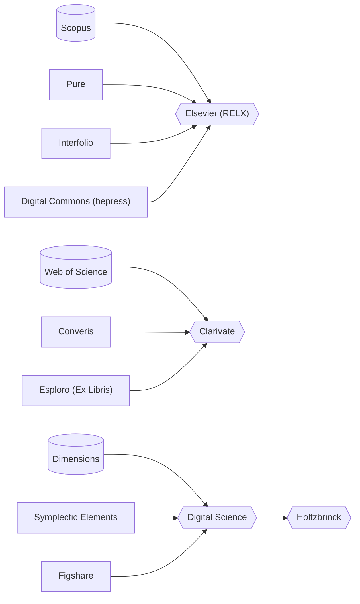

# Open Ecosystem Explorer — Technical Specification

**Status:** Draft v0.4 — implemented and validated (`npm run validate`, typecheck, unit/e2e/a11y suites pass); the simplification work listed in §12 is still open. Supersedes v0.3, which was written before any code existed.
**Format reference:** [`Data-Observatory/repository-crisis-scorecards-assesment`](https://github.com/Data-Observatory/repository-crisis-scorecards-assesment) `specs.md` — structure and rigour only. None of its content, scoring engine, or question bank carries over.
**Content source of truth:** *Manual breve del ecosistema de información de investigación*, Rodrigo Roa López de Heredia, Data Observatory, September 2026 (internal memo, Spanish). Appendix A is derived from it; memo sections are cited as **[M§n]**. Every factual claim taken from the memo has been checked against a primary source; corrections and their sources are logged in **A.4**, and the corrected value is what the spec states.
**Sections marked 🟡 require user confirmation before implementation.** All are enumerated in §12.

---

## 1. Overview & Goals

A **static, read-only, browsable knowledge map** of the research-information ecosystem: identifiers, registration agencies, indexes, institutional systems, regional infrastructure, standards, communities and coalitions — and the relationships between them.

**Scope:** a map of open science, open data and good data practice, and of the open software and licences they depend on. (Site name: *Open Ecosystem Explorer* / *Explorador del ecosistema abierto*.)

Individual entities are already catalogued elsewhere (re3data, FAIRsharing, ROR, OpenDOAR). What is poorly served is the **edge set**: who issues which identifier, who owns which index, which repository implements which schema, who governs what. This site makes the edge set legible.

The memo's practical rule [M§1] — *"cuando alguien mencione un nombre nuevo, pregúntese en qué capa está y quién lo gobierna"* — is the site's organising principle and drives two decisions: `layer` is a first-class facet (§5.1), and ownership/governance is a first-class relation (§5.3).

### Goals

- **G1 — Show the graph, not the list.** Every view is relationship-first.
- **G2 — Curated data as version-controlled plain text**, reviewable in a pull-request diff by a non-developer, and editable by an LLM coding agent without a human retyping YAML (§8.4).
- **G3 — Correctness enforced at build time.** A build *fails* — not warns — on a dangling reference, duplicate ID, out-of-vocabulary predicate, or domain/range violation.
- **G4 — Legible at every zoom level.** No hairball. Bounded per-context views with hard node budgets.
- **G5 — Diagram-optional accessibility.** Every diagram has a fully equivalent non-visual representation in the DOM (§9).
- **G6 — Simple to operate.** Static output, no server, no database, no runtime API calls; GitHub Pages; builds in under 60 s.
- **G7 — Provenance-bearing.** Every non-obvious assertion carries a source.
- **G8 — Data reusable independently of the site**, published as JSON/CSV.
- **G9 — Multilingual from day one.** Spanish and English ship in v1; a third language is prose files plus one config line, never a schema change (§5.7, §7.2).

**Non-goal summary:** no scoring, no assessment, no form, no user input, no account, no submission workflow. The reference project was ~90% scoring engine; none of that surface exists here.

---

## 2. Non-Goals / Out of Scope (v1)

| # | Excluded | Rationale |
|---|---|---|
| N1 | Scoring, ratings, maturity levels, rankings | The site describes; it does not evaluate. |
| N2 | Any form, questionnaire, or self-assessment | Explicit user decision: pure explorer. |
| N3 | Accounts, authentication, personalisation | No server, no need. |
| N4 | In-app content submission or editing | Contributions arrive as pull requests (§8). "Suggest an edit" deep-links to a pre-filled GitHub issue — a link, not a form. |
| N5 | Runtime harvesting from re3data / FAIRsharing / OpenAIRE / ROR APIs | v1 is a curated snapshot. External identifiers are stored so a future sync job stays possible (Q9). |
| N6 | Server-side rendering, databases, serverless functions | Static output only. |
| N7 | Full-text search over external documents | Search covers on-site fields only. |
| N8 | ~~Multilingual content~~ **— no longer excluded.** Spanish (default) and English ship in v1; the locale list is open (§5.7). What *is* excluded is machine translation, translation-workflow tooling, and locale-negotiating redirects (there is no server). | Q10 resolved. |
| N9 | `Person` entities | GDPR surface, high maintenance, low analytical value. Individuals appear only as prose. |
| N10 | Temporal/animated graph playback | `since`/`until` are captured; no UI in v1. |
| N11 | Automated graph analytics (centrality, community detection) | Build-time counts only. Note this excludes *computed* analytics, not the hand-written analyses of §5.6. |
| N12 | Comments, annotations, discussion | Use the GitHub repository. |
| N13 | Print/PDF report generation | Individual diagrams export as SVG/PNG (§6.7). |
| N14 | Bulk import / ETL from any upstream register | Content is curated once and edited incrementally (§8.3). Confirmed by Q2. |
| N15 | Open education, open hardware and open government (transparency, civic tech) | Outside the current scope (open science, open data, good data practice, and the open software and licences they depend on). Out of scope for now; revisit later. |

---

## 3. Content Authoring & Curation Policy

- **C1 — One fact, one place.** An attribute is stated in its entity's file and nowhere else. Derived facts (inverse relations, neighbour counts, `layer`, type totals) are computed at build time; a hand-written derived fact is a build error.
- **C2 — Every relation is authored once, in one canonical direction**, fixed by the predicate table (A.2). Authoring the inverse form is a build error (I7).
- **C3 — Descriptive, not evaluative.** No quality adjectives. `summary` states what a thing *is* and *does*. Status is factual (`active` / `deprecated` / `superseded`), never qualitative. This applies to the fault-line analyses (§5.6) too: they state structural facts (who owns what, what is downloadable), not verdicts.
- **C4 — Provenance required.** Every entity carries ≥1 `sources` entry with URL and `accessed` date. Relations whose truth is not self-evident from the target's homepage carry their own source.
- **C5 — Freshness tracked.** Every entity carries `lastReviewed`. The build warns at >18 months and the UI badges it.
- **C6 — Controlled vocabularies are closed.** Entity types, layers, predicates, tags, disciplines and statuses live in `src/content/vocab/*.yaml`. Adding a term requires a separate PR touching only vocabulary files.
- **C7 — Neutral inclusion criteria** 🟡 (Q4): the entity (a) has a stable public URL, (b) is referenced by ≥1 other entity in the graph *or* is a recognised registry, standards body or coalition, (c) is not a single project's internal tooling, and (d) falls within the stated scope (§1): open science, open data, good data practice, or the open software and licences they depend on, not open education, open hardware or open government (N15).
- **C8 — No personal data** (N9).
- **C9 — Corrections are first-class.** Every entity page links to a pre-filled GitHub issue for that entity ID. `CHANGELOG.md` records dataset changes by release.
- **C10 — Structural facts are never duplicated per language.** IDs, types, relations, external identifiers and dates exist once, in the locale-independent facts file. Only prose is translated (§5.7). A translation can therefore be stale, but it can never disagree with the graph.

---

## 4. Tech Stack & Project Structure

### 4.1 Recommendation: Astro 5 (static) + TypeScript strict + Zod + Mermaid 11

| Layer | Choice | Version |
|---|---|---|
| Site framework | Astro, `output: 'static'`, `i18n` routing | 5.x |
| Language | TypeScript, `strict`, `noUncheckedIndexedAccess` | 5.x |
| Content layer | Astro Content Collections (glob loader) | built-in |
| Schema validation | Zod (via `astro:content`) + custom graph invariants | 3.x |
| Diagrams | Mermaid, rendered **to static SVG at build time** | 11.x |
| Interactive graph | Cytoscape.js + `fcose`, one island on `/{locale}/map` (§6.2) | 3.x |
| Styling | Plain CSS with custom properties, no framework | — |
| Tests | Vitest (unit + invariants), Playwright + axe-core | — |
| Runtime / hosting | Node 22 LTS, npm; GitHub Pages via Actions | — |

### 4.2 Why Astro, and why not the alternatives

"Simpler website" should mean **what ships to the browser**, not the absence of a build step: hand-maintaining 50+ cross-linked HTML pages is more complexity, not less, and it makes G3 impossible.

- **Astro** ships zero client JS by default (an entity page ships no framework bytes); Content Collections are typed, schema-validated globs with build-time errors, which is exactly G2 + G3; file-based routing turns one `[locale]/entity/[id].astro` into every entity page in every language; islands confine interactivity to `/map`; a single plain-YAML document per file suits entities that need both fields and prose — prose is just a `body` field, not a second file format. Astro's built-in `i18n` routing gives G9 without a plugin.
- **Not SvelteKit** (the reference project's choice, correct *there* because that app was ~90% derived reactive state): this project has none — only list filtering and canvas panning. A viable second choice carrying weight it does not need. **Not Eleventy / Hugo / Jekyll:** workable; Astro wins on TypeScript shared across content schema, graph logic and templates. **Not a graph database:** violates G6 and N6; a few hundred KB of JSON fits in memory.
- **Not plain HTML + client-side Mermaid:** no build step means no validation, so a dangling reference reaches users instead of CI (fails G3); inverse relations must be hand-maintained in both directions (violates C1); client-side Mermaid costs ~500 KB of JS and a render flash.

### 4.3 Project structure

```
├── specs.md  README.md  CHANGELOG.md  CONTRIBUTING.md  LICENSE  LICENSE-DATA
├── astro.config.mjs  tsconfig.json  package.json
├── .github/  workflows/{ci,deploy,linkcheck}.yml · ISSUE_TEMPLATE/{new-entity,correction}.yml
├── prompts/  add-entity.md (the §8.4 template, kept next to the schema it references)
├── scripts/  validate.ts (invariant runner) · new-entity.ts (scaffold) · export-graph.ts
├── src/
│   ├── content.config.ts        # collection definitions + Zod schemas
│   ├── content/entities/        # ONE FACTS FILE PER ENTITY, flat, <id>.yaml — no prose body
│   ├── content/i18n/<locale>/   # <id>.yaml translated prose (body is a field, not a body), + views/ (§5.7)
│   ├── content/views/           # query + render + sources (§5.6), locale-independent
│   ├── content/vocab/           # entity-types.yaml (incl. the type→layer map), predicates.yaml,
│   │                            # tags.yaml, disciplines.yaml, statuses.yaml — per-locale labels
│   ├── i18n/                    # locales.ts (the open locale list) · ui/<locale>.json
│   ├── lib/                     # PURE TypeScript — rule A1
│   │   ├── model/ types.ts schema.ts · graph/ build-index neighbours inverse traverse stats
│   │   ├── i18n/resolve.ts      # entity + locale -> resolved prose, with fallback record
│   │   ├── views/query.ts · mermaid/ ids flowchart mindmap er layers budget
│   │   ├── a11y/describe.ts     # diagram -> accessible caption + table rows
│   │   └── invariants/          # rules.ts (I1..I31), run.ts
│   ├── components/              # .astro, presentation only; explorer/GraphCanvas.astro
│   │                            # is the ONLY island
│   └── layouts/  pages/  styles/
└── tests/  unit/ · invariants/ · snapshots/ · a11y/
```

### 4.4 Non-negotiable architectural rules

- **A1 — `src/lib/**` is pure.** No Astro imports, no DOM, no `fetch`, no filesystem, no `import.meta.env`. Consequence: the graph, view-query, i18n-resolution and Mermaid layers are unit-testable in plain Node, and `scripts/validate.ts` runs without Astro.
- **A2 — Mermaid *source generation* is a pure string function.** `buildFocusDiagram(index, id, labels, opts): string`, where `labels` is the resolved locale bundle. Rendering to SVG is a separate impure step, so diagrams are snapshot-testable without a browser.
- **A3 — Diagram generation is deterministic.** All iteration sorted by stable key (`id`, then predicate, then target `id`). Identical content and locale ⇒ byte-identical Mermaid source.
- **A4 — Content is the single source of truth.** No entity name, count, label or relation appears as a literal in a component, page or stylesheet. No UI string is hardcoded either: chrome text comes from `src/i18n/ui/<locale>.json`, vocabulary labels from the vocab files.
- **A5 — The `GraphIndex` is built once and frozen**, then passed down. Components never recompute neighbours or re-derive inverses. The index is locale-independent; locale is applied at render time.
- **A6 — Zero client JS is the default.** Budget: ≤50 KB gz on any route except `/map` (≤400 KB gz).
- **A7 — No network at runtime.** No CDN fonts, no analytics, no browser API calls.
- **A8 — Validation runs first.** `npm run build` invokes `npm run validate`; failure exits non-zero and produces no output.
- **A9 — Adding a locale touches no schema and no component.** It is one entry in `src/i18n/locales.ts`, one `ui/<code>.json`, one label per vocabulary term, and prose files. Anything that would need a code change to support a third language is a design defect (§5.7).

---

## 5. Content Data Model

Field names and enum members are concrete proposals derived from the source memo (Appendix A) and from the corrections in A.4. The overall shape — entities + typed directed relations + provenance — is the recommendation.

### 5.1 Core entity, `type` and the derived `layer`

`type` says what a thing is; `layer` says where it sits in the memo's stack [M§1]. **`layer` is derived, not authored**: it is declared once per type in `vocab/entity-types.yaml` and computed into `GraphIndex.byLayer`. Authoring it in an entity file is a build error (C1, I23). The five cross-cutting types (`standard`, `community`, `coalition`, `policy`, `organization`) map to the layer `cross-cutting` — the memo describes them as *"atravesando todo… tres cosas que no son software"* [M§1] — and render as a band rather than a stack row. The v0.5 thirteenth type, `concept` (an idea or term: *persistent identifier*, *open access*, *metadata*, *FAIR principles*, *repository*), maps to its own layer `concept`, rendered after the band. `cross-cutting` and `concept` form the non-stack group (`CrossCuttingLayer` in `types.ts`). Layer derivation is unchanged: `vocab/entity-types.yaml` gives each type its `layer`, `buildIndex` fills `byLayer` and `stats.byLayer` with **every** layer key (zero when empty), and diagrams skip a layer or type that has no entities yet.

```ts
/** Unique across ALL types. /^[a-z0-9]+(?:-[a-z0-9]+)*$/, 2..64 chars, == filename stem. */
export type EntityId = string;
/** The 21 predicates of Appendix A.2, which is the single definition of each. */
export type PredicateId = 'issues' | 'implements' | … | 'applies-to' | 'is-a' | 'related-to';

/** M§2–M§6. Derived from `type`, never authored. `regional` is the memo's own "capa
 *  regional": supra-institutional infrastructure operating across institutions and
 *  countries — a scope, not a geographic tag (that is `geography[]`). */
export type Layer = 'identifier' | 'agency' | 'index' | 'institutional-system' | 'regional';
export type CrossCuttingLayer = 'cross-cutting' | 'concept';   // the non-stack group

/** Definitions, subtype fields and examples per type: Appendix A.1. */
export type EntityType =
  | 'identifier' | 'agency' | 'index' | 'cris' | 'repository'
  | 'aggregator' | 'publishing-platform'                        // layered
  | 'standard' | 'community' | 'coalition' | 'policy' | 'organization'   // layer: cross-cutting
  | 'concept';                                                        // layer: concept

export type Status = 'active' | 'deprecated' | 'superseded' | 'planned' | 'unknown';
export type Confidence = 'asserted' | 'reported' | 'inferred';
/** The memo's second question — "quién lo gobierna" [M§1]. Required on every entity. */
export type Governance = 'commercial' | 'nonprofit' | 'community'
  | 'intergovernmental' | 'public-agency' | 'academic' | 'unknown'
  | 'not-applicable';   // concepts only: an idea has no governing body
/** Progressive disclosure tier; omitted => 'extended' (`DEFAULT_PROMINENCE`, read via `prominenceOf`). */
export type Prominence = 'core' | 'extended' | 'detail';
/** Separate from `governance`, which is what makes M§5's central distinction
 *  ("contenido abierto no es lo mismo que infraestructura abierta") queryable. */
export type OutputLicence = 'open' | 'partly-open' | 'closed' | 'not-applicable';
export type Codebase = 'open-source' | 'proprietary' | 'mixed' | 'not-applicable';

export interface Source { url: string; title?: string; accessed: string; note?: string }

export interface Relation {
  predicate: PredicateId;   // canonical direction only (I7)
  target: EntityId;         // must resolve (I3)
  note?: string;            // ≤140 chars — edge tooltip / table cell; translatable (§5.7)
  since?: string; until?: string;  // YYYY | YYYY-MM | YYYY-MM-DD; `until` renders dashed + grey
  confidence?: Confidence;  // default 'asserted'; otherwise ≥1 source required (I15)
  sources?: Source[];
  verified?: { date: string; url: string };  // WARN-gated on governance predicates (I32)
}

/** All optional; all format-validated against per-field regexes (I18). */
export interface ExternalIds {
  ror?: string; doi?: string; wikidata?: string; re3data?: string;
  fairsharing?: string; openaire?: string; spdx?: string; isni?: string;
}

/** THE FACTS FILE. Locale-independent in its entirety — see §5.7 and C10. */
export interface EntityBase {
  id: EntityId;                 // == filename stem
  type: EntityType;             // layer is derived from this, never authored
  name: string;                 // 2..80 chars, official name; per-locale override allowed (§5.7)
  aka?: string[];               // aliases/acronyms, ≤8, indexed for search
  url: string;                  // canonical https homepage
  identifiers?: ExternalIds;
  status: Status; governance: Governance;        // governance REQUIRED — M§1
  outputLicence?: OutputLicence; codebase?: Codebase;
  since?: string; until?: string;
  prominence?: Prominence;      // core = default view · extended (default) = on expand/search · detail = entity page / expert only
  tags: string[];               // ≥1, from vocab/tags.yaml
  disciplines?: string[]; geography?: string[];  // FORD; ISO 3166-1 alpha-2 / eu / latam / global
  relations: Relation[];        // outgoing, canonical direction only
  sources: Source[];            // ≥1 (I15)
  lastReviewed: string;         // YYYY-MM-DD
  isolated?: true;              // explicit opt-out of the no-orphans rule (I11)
  // This file has no `body` field (I31). `summary` and prose live in the i18n files.
}
```

### 5.2 Type-specific fields

`Entity` is a discriminated union on `type` over the thirteen interfaces below (`XxxEntity extends EntityBase`). Each field set is what the memo says is worth knowing about that kind of thing; **bold = required**, `?` = optional.

| Type | Fields |
|---|---|
| `identifier` [M§2] | **`identifies`**: object · person · organization · activity · sample · bibliographic · `isoStandard?` (`ISO 23527:2022` for RAiD, A.4) · `resolverUrl?` |
| `agency` [M§3] | **`registers`**: (publication · dataset · software · report · platform · sample · person)[] · **`feeModel`**: membership · per-object · free · mixed · unknown · `consortiumModel?: boolean` (DataCite's national-consortium model) · `waiverProgramme?: string` (Crossref GEM — 93 eligible countries as of 2026-09, Chile not among them; A.4) |
| `index` [M§4] | **`indexKind`**: bibliographic · citation · registry · directory · **`selectivity`**: editorial-board · algorithmic · inclusive · **`inclusionCriteria`**: published · partially-published · opaque · **`bulkDownload`**: full · partial · none · `coverageObjects?: string[]` · `coverageLanguages?: string[]` (ISO 639-1 or `multilingual`) · `knownGaps?: string` (≤200 chars, factual). The last four are exactly the memo's four tests for an index; `indexKind` distinguishes a citation index from a registry of infrastructure (re3data, OpenDOAR, FAIRsharing), which answer the same four questions with very different answers. |
| `cris` [M§5] | **`crisKind`**: commercial · open-source · national |
| `repository` [M§5] | **`repositoryKind`**: software-platform · hosted-service · institutional-instance · `certifications?`: (coretrustseal · wds · nestor-seal · iso-16363 · none)[] · `persistentIdScheme?: EntityId[]` (resolves to `identifier` entities, I21) · `accessModel?`: open · restricted · mixed · embargoed |
| `aggregator` [M§6] | **`aggregatorKind`**: harvesting-network · linking-service · federation · **`harvestProtocols`**: EntityId[] (resolves to `standard` entities — OAI-PMH, COAR Notify, ResourceSync) · `memberCountries?: string[]` · `objectScope?`: (article · thesis · dataset · journal)[] · `recordCount?: number` (requires a dated source) |
| `publishing-platform` [M§6] | **`platformKind`**: journal-programme · preprint-server · books-programme · **`fullTextHosted`**: boolean · **`admissionCriteria`**: published · partially-published · opaque · `markupStandard?: EntityId[]` (resolves to `standard` entities — JATS and its dialects) · `nationalCollections?: string[]` · `titleCount?: number` (requires a dated source) |
| `standard` [M§7] | **`standardKind`**: principles · metadata-schema · protocol · certification-criteria · framework · governance-criteria · serialisation · `specVersion?` · `specUrl?` · `machineReadable?: boolean` (ships an XSD / JSON-Schema / SHACL / OpenAPI artefact) · `requiresOpenness?: boolean` — `false` for FAIR, which is the memo's central political point |
| `community` [M§8] | **`communityKind`**: standards-body · technical-community · certification-body · confederation · `openMembership?: boolean` · `nationalChapters?: string[]` (e.g. CODATA Chile) |
| `coalition` [M§8] | **`coalitionKind`**: declaration · reform-movement · funding-initiative · network · `signatoryCount?: number` · `workingGroups?: string[]` (e.g. Barcelona Declaration WG4) |
| `policy` | **`policyKind`**: law · mandate · guideline · funder-requirement · strategy · recommendation · **`jurisdiction`**: string[] · **`bindingness`**: binding · conditional · advisory · `effectiveDate?` |
| `organization` | **`orgKind`**: company · nonprofit · foundation · university · research-institute · government-agency · intergovernmental · library · `country?` (ISO 3166-1 alpha-2) |
| `concept` | *(no type-specific fields; no `*Kind`)* — `governance` is `not-applicable`, `url` is the canonical reference page (e.g. the Wikipedia article), `identifiers.wikidata` is the only external id worth storing. Concrete things point at their concepts with `is-a`; concepts nest with `is-a` (subtype) and `part-of`. |

**What was dropped from v0.1 and why.** The old `tool` / `infrastructure` types are gone. Their boundary ("software you can run" vs "a service run for you") was the model's weakest join, and the memo does not draw it — it lists DSpace, Dataverse, InvenioRDM, Zenodo and Figshare in one breath [M§5]. That distinction now lives inside `repositoryKind` (`software-platform` vs `hosted-service`), where it is a field value rather than a categorisation decision. (Post-launch fix, per `model/subtypes.ts`: this and the equivalent per-type `*Kind` fields — `indexKind`, `crisKind`, `aggregatorKind`, `platformKind`, `standardKind`, `communityKind`, `coalitionKind`, `orgKind` — are surfaced in `/map`'s filters/tooltip, `/taxonomy`'s mindmap level, and `/entities/[type]`'s grouping, not just carried as inert data — the earlier gap that made e.g. Zenodo and Dataverse read as interchangeable despite `repositoryKind` already correctly distinguishing them.)

**What was added in v0.5: `concept`, `is-a`, `prominence`, predicate `family`.** A newcomer starts from ideas (*what is a persistent identifier?*), not from infrastructure, and the graph had no node for the idea. `concept` is a new type in its own layer; `is-a` (below) attaches every other type to it. `prominence` (`core` · `extended` · `detail`, default `extended`) is authored per entity and drives progressive disclosure in the UI; it never affects validation. Predicates gained a display `family` (A.2). The type and the predicate ship *declared but unpopulated*: both carry `pending: true` in their vocab file, which exempts them from I12 until the first instance exists (I12 then warns if the flag is left behind).

**What was added in v0.3 and why: `publishing-platform`.** See the Q1(a) decision in §12 and the reasoning in A.1. In short: SciELO and Redalyc host, mark up and publish the full text they expose, under their own admission criteria; OpenAIRE and LA Referencia harvest metadata for content they never hold. Those are different machines with different failure modes, and `aggregatorKind: publishing-platform` was hiding that inside a field.

### 5.3 Predicate metadata, and `owned-by` as a first-class relation

`vocab/predicates.yaml` declares per predicate: `family` (display group, `vocab/predicate-families.yaml`, ≤5, I35), `pending?`, `inverseLabel`, `domain`, `range`, `symmetric`, `acyclic`, `sameTypeOnly`, `crossTypePairs`, `maxOutDegree`, and display attributes. Full table in **A.2**.

```ts
export interface PredicateDef {
  id: PredicateId;
  label: LocaleMap;           // active voice, drawn on the edge: { es: 'es propiedad de', en: 'owned by' }
  inverseLabel: LocaleMap;    // passive, shown on the target's page
  domain: EntityType[]; range: EntityType[];
  symmetric: boolean; acyclic: boolean; sameTypeOnly: boolean;
  crossTypePairs?: [EntityType, EntityType][]; // narrow, explicit escape hatch from sameTypeOnly (I8) — not a range override, so typos are still caught. Currently only `interoperates-with`'s `[cris, index]`.
  maxOutDegree?: number;      // soft cap; exceeded => diagram collapses to a cluster node
  style: { color: string; line: 'solid' | 'dashed' | 'thick'; arrow: 'open' | 'closed' };
}
```

**Canonical direction (C2).** Every predicate is authored from the entity being described toward the anchor it depends on, conforms to, or belongs to. `figshare owned-by digital-science` is authored in `figshare.md`; `digital-science owns figshare` is never written and is a build error (I7). Inverses are derived at build time and rendered under `inverseLabel`. The reason is operational: adding an entity must be a **one-file pull request**, with no edits to five other files and no diff a reviewer has to reassemble.

**`owned-by` earns its own predicate**, distinct from `governed-by` (a formal governance body), `operated-by` (who runs it day to day) and `developed-by` (who writes the code). It means *corporate control of the product's roadmap and continuity* — the memo's own criterion, *"el criterio correcto no es la licencia del archivo, es quién gobierna la plataforma"* [M§5]. Range is restricted to `organization` with `orgKind: company` (I19).

It is the highest-value edge in the dataset, because rendering its subgraph turns the memo's second fault line — vertical integration [M§9] — from a paragraph into a picture. The version below uses the ownership facts verified in **A.4**, not the memo's shorter list; three of these edges (Interfolio, Digital Commons, Esploro) are not in the memo at all and make the pattern sharper:



Three parents, one edge type, and the concentration is visible without commentary — an index, a CRIS and a repository platform under each. It needs no new machinery: it is `/relations/owned-by`, a route already required for every predicate (§6.3). The claim is narrow — a picture of ownership, not an argument about it — but it is the clearest single thing the data model buys.

### 5.4 The derived index

```ts
export interface GraphEdge {           // one directed, resolved, deduplicated edge
  from: EntityId; to: EntityId; predicate: PredicateId;
  note?: string; since?: string; until?: string;
  confidence: Confidence; sources: Source[];
  derived: false;                      // true only on the synthesised inverse view
}

export interface GraphIndex {          // all members readonly; deep-frozen in dev
  entities: ReadonlyMap<EntityId, Entity>;
  byType: ReadonlyMap<EntityType, readonly EntityId[]>;               // sorted by name
  byLayer: ReadonlyMap<Layer | CrossCuttingLayer, readonly EntityId[]>; // derived, §5.1
  edges: readonly GraphEdge[];                                        // canonical, sorted
  outgoing: ReadonlyMap<EntityId, readonly GraphEdge[]>;
  incoming: ReadonlyMap<EntityId, readonly GraphEdge[]>;              // derived inverse view
  degree: ReadonlyMap<EntityId, { in: number; out: number }>;
  predicates: ReadonlyMap<PredicateId, PredicateDef>;
  components: readonly (readonly EntityId[])[];                       // weakly connected
  prose: ReadonlyMap<LocaleCode, ReadonlyMap<EntityId, ResolvedProse>>;  // §5.7
  stats: { entityCount; edgeCount; maxDegree; generatedAt; byType; byLayer; byPredicate;
    orphans: readonly EntityId[];
    translationCoverage: Record<LocaleCode, { present: number; missing: readonly EntityId[] }> };
}
```

`buildIndex(entities, prose, predicates, typeLayerMap): GraphIndex` is pure, deterministic, and the only place inverses, layers and prose fallbacks are resolved (A3, A5).

### 5.5 Build-time invariants

Each rule is a pure predicate in `src/lib/invariants/rules.ts`, exercised against real content by `tests/invariants/`, and run by `npm run validate` (which `npm run build` runs first, A8). **ERROR fails the build with a message naming file, field and offending value. WARN prints and continues.** Message quality is a requirement, not a nicety — see §8.4(b).

| # | Level | Invariant |
|---|---|---|
| I1 | ERROR | `id` matches `/^[a-z0-9]+(?:-[a-z0-9]+)*$/`, 2–64 chars, equals the filename stem. |
| I2 | ERROR | `id` is unique across **all** entity types. No type-scoped namespacing. |
| I3 | ERROR | No dangling references: every `relations[].target` resolves. |
| I4 | ERROR | No self-loops. |
| I5 | ERROR | No duplicate triples `(id, predicate, target)`. |
| I6 | ERROR | `predicate` ∈ `vocab/predicates.yaml`. Closed vocabulary. |
| I7 | ERROR | Canonical direction only. An inverse-form predicate (`owns`, `issued-by`, `implemented-by`, …) is rejected with a message naming the canonical form and the file it belongs in. |
| I8 | ERROR | Domain/range: `subject.type ∈ predicate.domain`, `target.type ∈ predicate.range`; where `sameTypeOnly`, also `subject.type === target.type`. |
| I9 | ERROR | Symmetric predicates authored once per unordered pair, on the lexicographically smaller `id`. |
| I10 | ERROR | Acyclic predicates form a DAG (`part-of`, `supersedes`, `profile-of`, `depends-on`, `owned-by`, `member-of`). Error prints the cycle path. |
| I11 | ERROR | No orphans: in-degree + out-degree ≥ 1 unless `isolated: true` with an explanatory `note`. |
| I12 | ERROR | Every declared `EntityType` has ≥1 instance and every declared predicate ≥1 edge. Unused vocabulary is removed or populated. An entry flagged `pending: true` (none at present: `concept`, `is-a` and `related-to` shed the flag once the concept layer was populated; the synthetic test fixtures re-apply it) is exempt until its first instance; a WARN is raised if the flag is then left behind. |
| I13 | ERROR | Every `tags[]`, `disciplines[]`, `status`, `governance` value exists in the corresponding vocab file. |
| I14 | ERROR | `summary` (in each locale file) is 40–200 chars, single-line, no Markdown syntax, not identical to `name`. |
| I15 | ERROR | `sources.length ≥ 1`; every `Source.url` is `https:`; `accessed` is a valid ISO date not in the future. Relations with `confidence !== 'asserted'` carry ≥1 source. |
| I16 | ERROR | `codebase: open-source` requires a licence-bearing `sourceUrl` or an explanatory note; SPDX identifiers validated against `spdx-license-ids`. |
| I17 | ERROR | `url` and all `Source.url` are syntactically valid absolute `https:` URLs. (Reachability checked weekly, non-blocking — §11.) |
| I18 | ERROR | Populated `identifiers.*` match their format regexes (§5.1). |
| I19 | ERROR | **`owned-by` targets an `organization` with `orgKind: company`.** Ownership by a non-company is `governed-by` or `operated-by`, not `owned-by`. |
| I20 | ERROR | `since` ≤ `until` where both present; valid partial ISO dates; neither >1 year in the future. |
| I21 | ERROR | EntityId-valued subtype fields resolve to an entity of the required type: `persistentIdScheme[] → identifier`, `harvestProtocols[] → standard`, `markupStandard[] → standard`. |
| I22 | ERROR | `governance: commercial` requires ≥1 outgoing `owned-by` edge, or a `note` on the entity explaining why none is recorded. Enforces the memo's central question at authoring time. |
| I23 | ERROR | `layer` is never present in an entity file — it is derived (§5.1, C1). |
| I24 | ERROR | Every `View.query` (§5.6) resolves against the current graph; `kind: 'explicit'` entity IDs must exist. |
| I25 | ERROR | A `View.query` resolving to zero entities is an error, not an empty page. |
| I26 | WARN | `lastReviewed` older than 18 months (also badged in the UI). |
| I27 | WARN | An `identifier` entity with no inbound `issues` edge. |
| I28 | WARN | Any generated diagram exceeds its node/edge budget (§6.4) before overflow collapsing; or the graph has >1 weakly connected component (prints each component's size and members). |
| I29 | ERROR | **Every entity and every view has a prose file in the default locale**, with a valid `summary`. A facts file without `content/i18n/<default>/<id>.yaml` fails the build (§5.7). |
| I30 | WARN / ERROR | **WARN** per missing non-default-locale prose file, aggregated as one line per locale (`en: 12 of 78 entities untranslated`) — or, when the strict-i18n switch `REQUIRE_FULL_I18N` is on, **ERROR** per missing file, reported on the entity's own file (default: off; see the note below the table). **ERROR** if a locale file declares a field outside the translatable set, or if a `relationNotes` key does not resolve to a relation authored in the facts file. |
| I31 | ERROR | An entity facts file carries a `body`, `summary` or `description` field. Prose exists only in `content/i18n/**` (C10). |
| I32 | WARN | Every edge of a governance predicate (`owned-by`, `governed-by`, `operated-by`, `developed-by`, `funded-by`) carries `relations[].verified: { date, url }` recording the primary source it was checked against. Added post-launch to make a relation-completeness audit scoped and trackable ("how many governance edges are unverified?"), independent of `confidence`/`sources` (I15), which gate on non-default confidence, not on governance predicates specifically. |
| I33 | WARN | Completeness floor: every `repository`/`index`/`aggregator`/`publishing-platform` has ≥1 of `{operated-by, developed-by, governed-by}`; every `standard` has ≥1 of `{developed-by, governed-by}`. An empty set here is far more often a research gap than a genuine fact. |
| I34 | WARN | Heuristic: an entity's `note`, `relations[].note` or `sources[].note` text mentions another entity by name (or `aka`, ≥3 chars, word-boundary match) with no relation connecting the two in either direction. Facts are sometimes written down in prose and never authored as an edge — this catches the pattern without blocking the build (noisy-tolerant by design). |
| I35 | ERROR | Every predicate declares a `family` present in `vocab/predicate-families.yaml` (display grouping, at most five families). |

`npm run validate` prints `N entities, M edges, X errors, Y warnings, translation coverage per locale` and groups errors by file. Exit codes: `0` clean, `1` errors, `2` runner crash.

**Strict i18n (`REQUIRE_FULL_I18N`).** The owner's target is 100% prose in every locale. Until the translations land, a missing non-default-locale file stays a WARN (I30) so the build is not broken. The switch is one constant, `REQUIRE_FULL_I18N` in `src/lib/invariants/config.ts` (default `false`), overridable per run by the environment variable of the same name. To flip it: run `REQUIRE_FULL_I18N=1 npm run validate` (or `=0` to force lenient) to preview; once every entity has `en` and `es`, change the constant to `true` so `npm run build` enforces it for good. In strict mode each missing file is an ERROR on the entity's facts file (`no 'en' prose file …`) and the aggregated WARN disappears. `tests/unit/invariants/concept-and-modes.test.ts` covers both modes.

### 5.6 Views: the memo's five fault lines as saved queries — CONFIRMED for v1

[M§9] lists five structural fault lines. Four are, in graph terms, **queries over fields the model already carries**; the fifth is prose. Rather than invent a `fault-line` entity type — which would put non-things into the node set and corrupt degree counts, orphan detection and every diagram — they live in a second content collection, `src/content/views/`: a declarative query plus provenance, with the analysis prose in the locale files. Views are never nodes and never have edges.

```ts
export interface View {              // prose (title/question/body) lives in content/i18n/<locale>/views/<id>.yaml
  id: string;
  query: ViewQuery;
  render: 'diagram' | 'table' | 'both';
  sources: Source[]; lastReviewed: string;
}
// per-locale file supplies: title, question (≤200 chars — what the view answers), body prose

/** Deliberately tiny and closed — three forms, no expression language. */
export type ViewQuery =
  | { kind: 'entities'; where: Record<string, string | string[]>[] }
  | { kind: 'predicate'; predicate: PredicateId; groupBy?: 'target' | 'source' }
  | { kind: 'explicit'; entities: EntityId[] };
```

| Fault line [M§9] | View | Query |
|---|---|---|
| 1 — open content vs open governance | `open-content-closed-governance` | `entities` where `outputLicence: open` ∧ `governance: commercial` |
| 2 — vertical integration | `vertical-integration` | `predicate: owned-by`, `groupBy: target` |
| 3 — cost of exit | `cost-of-exit` | `explicit` — not query-expressible; a curated set plus prose on identifiers as the lever |
| 4 — coverage bias | `index-coverage` | `entities` where `type: index` ∧ `indexKind: bibliographic|citation`, rendered as a table of `coverageLanguages`, `coverageObjects`, `bulkDownload`, `inclusionCriteria` |
| 5 — AI and training data | — | Prose only, no entity set. Not a view in v1. |

**Why v1 rather than deferred.** It costs one Zod schema, one small resolver (`src/lib/views/query.ts`) and one route template; diagram generation, budgets, accessible tables and export are reused unchanged. It also puts a load-bearing check on the schema: if fault line 1 cannot be expressed as a query, `governance` and `outputLicence` are not doing their job. The risk is the query language growing into a project; the mitigation is that it is closed at three forms and an empty result is a build error (I25).

### 5.7 Multi-locale content: shared facts, per-locale prose

**The problem to avoid.** The obvious approach — one complete file per entity per language — duplicates `relations`, `type`, `identifiers` and `status` into every locale, where they immediately begin to drift. A Spanish file saying `owned-by: digital-science` and an English file that lost the edge in translation would produce two different graphs from one dataset. A stale translation is a small problem; a locale-dependent graph is a fatal one. Hence C10.

**The model: one facts file, N prose files.** `src/content/entities/figshare.yaml` holds facts and relations with no prose and no `summary` (I31); `src/content/i18n/es/figshare.yaml` is required as the default locale (I29); `src/content/i18n/en/figshare.yaml` is optional (I30 warns); a new locale adds only more files of the second kind. Every prose file is a single, plain YAML document — there is no frontmatter/body split — and the prose text itself is just the `body` field, written as a YAML block scalar; it is never compiled as Markdown (rendered verbatim), so it is plain text, not a mini Markdown document.

```yaml
# src/content/i18n/en/figshare.yaml — the complete translatable surface. Nothing else is allowed (I30). `localNote` (added with the concept layer) is optional per locale, translatable, and rendered as a labelled callout under the summary; a concept's definition stays neutral/global and any Chile- or Latin-America-specific fact goes only there.
summary: Commercial repository platform that publishes content under open licences and mints DataCite DOIs for every record.
name: Figshare                 # optional override; omit unless the official name differs by language
aka: [figshare]                # optional
relationNotes:                 # optional; keys are "<predicate>@<target>" and must resolve (I30)
localNote: ...                 # optional; <=30 words (<=260 chars); the 'Local context' callout on the entity page. Only for a locally-specific fact about a global entity (concepts: the Chile/LatAm angle)
  owned-by@digital-science: Acquired in 2012; roadmap and continuity are decided by the parent company.
body: |
  Figshare publishes content under open licences and issues DOIs; its governance,
  roadmap and continuity are decided by a company. The distinction is the point.
```

**The locale list is data, not code.** `src/i18n/locales.ts` is the single declaration; the Zod locale enum, the routing config, the language switcher, the `hreflang` alternates and the sitemap all read from it (A9).

```ts
export const locales = [
  { code: 'es', label: 'Español', dir: 'ltr', default: true },
  { code: 'en', label: 'English', dir: 'ltr' },
] as const;                     // a third language is one more line here + prose files. No schema change.
export type LocaleCode = typeof locales[number]['code'];
```

**Default locale: `es`.** Three reasons, in order of weight. (1) The seed content is Spanish and the curator writes Spanish; the default is the locale I29 makes mandatory, and making the mandatory language one the curator does not draft in would block every new entity on a translation. (2) Fallback direction matters: an untranslated page falls back to the default, and falling back to the language an assertion was actually verified in is safer than falling back to a translation of it. (3) The memo's editorial argument — the regional layer, the LatAm gap one layer below publications [M§6] — addresses a Spanish-reading audience first. English is not second-class for this: `/en/` is a complete site, is what `hreflang` and the sitemap advertise, and is expected to reach full coverage. The choice is about which language is *required*, not which is *served*.

**Fallback behaviour.** `resolveProse(id, locale)` returns `{ prose, localeUsed, fallback: boolean }`. When a non-default locale is requested and missing, the page renders default-locale prose inside a `lang="es"` wrapper, preceded by a non-dismissible notice ("Esta ficha aún no está traducida al inglés / This entry is not yet translated into English — showing the Spanish original"), with a link to the GitHub issue template for translations. **Everything locale-independent still renders in full:** the attribute table, the relation tables, the diagrams, the external identifiers, the sources. Those were never language-dependent, and withholding them because prose is missing would be the wrong trade.

**Vocabulary, chrome and diagrams.** Each term in `vocab/*.yaml` carries `label: { es: …, en: … }` and an optional `definition` map, co-located with the term so a new vocabulary entry cannot ship label-less; UI chrome lives in `src/i18n/ui/<locale>.json`. Both are covered by a locale-completeness test (§11) rather than an invariant, because a missing UI string is a rendering defect, not a data defect. Diagrams are consequently per-locale: node labels come from `name` (locale-independent unless overridden) but edge labels and the legend do not, so `buildFocusDiagram` takes the resolved label bundle (A2) and the SVG cache key includes the locale. Cost is diagram count × locale count, which at ~90 entities and 2 locales sits well inside the §10 build budget.

---

## 6. Diagram Rendering & Interaction Model

### 6.1 Principle

**Mermaid is a build-time SVG compiler, not a client-side library.** Source is generated by pure functions (A2), rendered to inline SVG during the build, served as static markup. Consequences: no ~500 KB bundle, no render flash, no layout shift, works with JavaScript disabled, directly styleable and printable. Implementation: `rehype-mermaid` with `strategy: 'inline-svg'`, headless Chromium at build time, ~0.2–0.5 s per distinct diagram, content-hash cached with locale in the key (§5.7).

### 6.2 Scale: hybrid tier, confirmed

Mermaid's dagre layout stays legible to roughly 60 nodes / 100 edges. **Scale confirmed (Q3): 50–300 entities.** The A.1b additions bring the seed set to roughly 90–100 entities, comfortably inside the band and inside the confirmed tier.

| Total entities | `/map` | Everywhere else | Extra dependency |
|---|---|---|---|
| ≤ 120 | Mermaid, per-layer subgraphs | Mermaid | none |
| **120 – 600 ✅ confirmed** | **Cytoscape.js island, `/map` only** | Mermaid (focus, layer, type, taxonomy, predicate views — all bounded) | Cytoscape.js ~90 KB gz + fcose |
| > 600 | Cytoscape.js with layout precomputed at build time | Mermaid restricted to 1-hop focus views; paged tables become the primary index | + build-time layout step |

Build the Mermaid tier first regardless: the pure-function boundary (A2) means adding the canvas later is one island reading the same `GraphIndex`, with no rework of the data model, pages or other diagrams.

**Amendment, 2026-09-04 — interactivity overrides the entity-count gate.** The user directed that `/map` and every rendered diagram must be genuinely navigable (real pan/zoom/drag), not just click-navigate on a static SVG, and that `/map` become the site's primary entry point. This is decided, not open: `/map` now runs on Cytoscape.js + `cytoscape-fcose` (the "120–600" row's island) regardless of the 107-entity count sitting under the original 120-entity Mermaid-only threshold; `/entities` remains its accessible/no-JS equivalent per §9/A9.5, so `/map` degrades to an error notice + link there if JS fails, rather than needing no-JS parity itself. Every other diagram (focus, layer, type, taxonomy, predicate, model) keeps its build-time Mermaid SVG unchanged, but `Diagram.astro` now wraps it in `svg-pan-zoom` for real drag-pan/wheel-zoom, with explicit zoom-in/zoom-out/reset buttons and arrow-key/±/0 keyboard equivalents (WCAG 2.5.7) — click-to-navigate via Mermaid's `click` directive anchors is preserved underneath. The home page's primary call-to-action now leads directly into `/map`.

### 6.3 Diagram registry

All routes below are locale-prefixed (§7.2); the prefix is omitted here for readability.

| View | Route | Mermaid type | Content | Cap |
|---|---|---|---|---|
| **Focus** | `/entity/[id]` | `flowchart LR` | Entity + 1-hop neighbourhood, in and out, grouped by predicate. The default and most-used diagram. | 40 neighbours |
| **Neighbourhood** | `/entity/[id]?depth=2` | `flowchart LR` | Prerendered 2-hop variant behind a disclosure control; no client JS. | 60 nodes |
| **Layer stack** | `/layers` | `flowchart TB` with one `subgraph` per layer | The memo's four-layer model plus the regional layer, with the cross-cutting band alongside. The site's primary orientation diagram. | 60 nodes |
| **Type map** | `/entities/[type]` | `flowchart TB`, `subgraph` per related type | All entities of one type and their immediate connections. | 60 nodes |
| **Predicate map** | `/relations/[predicate]` | `flowchart LR` | Every edge of one predicate. `/relations/owned-by` is the vertical-integration picture (§5.3). | 60 nodes, else table-first |
| **View** | `/views/[id]` | `flowchart LR` or table | A resolved fault-line query (§5.6). | 60 nodes |
| **Taxonomy** | `/taxonomy` | `mindmap` | Layer → type → subtype → tag groups; drills into filtered indexes. | 5 levels |
| **Data model** | `/model` | `erDiagram` | The schema itself, generated from `vocab/predicates.yaml`, so it cannot drift from the validation rules. | — |
| **Lineage** | `/entity/[id]` (cond.) | `timeline` | `supersedes` chains and policy `effectiveDate` sequences; only when the chain has ≥2 members. | — |
| **Containment** | `/entity/[id]` (cond.) | `flowchart TB` | `part-of` tree as nested subgraphs; only when depth ≥1. | depth 4 |
| **Global map** | `/map` | §6.2 | Whole graph. | §6.2 |

### 6.4 Legibility budget and encoding

Hard caps enforced by `src/lib/mermaid/budget.ts`, checked by I28:

- **60 nodes / 100 edges** maximum per rendered diagram.
- **Neighbour collapsing:** more than `predicate.maxOutDegree` (default 5) neighbours via one predicate collapse into a cluster node (`12 standards ▸`) linking to the filtered list. The full set always remains in the accessible table (§9).
- **Shape encodes `layer`; fill hue encodes `type`.** Seven shapes, one per layer: `([stadium])` identifier · `[[subroutine]]` agency · `[(cylinder)]` index · `[rect]` institutional-system · `[/parallelogram/]` regional · `{{hexagon}}` cross-cutting · `(rounded)` concept. Thirteen types cannot map to thirteen legible shapes, so type is carried by a colourblind-safe fill **plus** the legend **plus** the accessible table, which names every node's type in text — no information is distinguishable by colour alone (WCAG 1.4.1).
- **Predicate** is encoded by line style (`-->` / `-.->` / `==>`) plus colour; `owned-by` is drawn thick, since it is the edge most often read on its own.
- **Edge labels** are drawn only when the predicate is not already unambiguous from line style and endpoint shapes; otherwise the legend carries it.
- **Inactive entities** (`status` ∈ {deprecated, superseded}) and expired relations (`until` past) render dashed and reduced-opacity, never by colour alone.
- Over budget after collapsing ⇒ the build emits the table as primary and the diagram behind a "view diagram" disclosure, with a warning (I28).

### 6.5 Node identifiers and click behaviour

- `src/lib/mermaid/ids.ts` maps entity IDs to `n_` + `id.replace(/-/g, '_')`; labels are always quoted (`n_zenodo["Zenodo"]`). The mapping is injective and reversible.
- Navigation uses `click <node> href "<locale-prefixed url>"`. Because diagrams are prerendered to inline SVG these become ordinary anchors — **keyboard-focusable, working without JavaScript, present in the tab order** — which client-side Mermaid click handlers are not. Focus order follows generation order (A3) and is therefore predictable. Links stay inside the current locale.
- Mermaid runs with `securityLevel: 'loose'` (required for click directives). Acceptable **only** because 100% of diagram source is generated at build time by our own pure functions from validated content; there is no user-input path into Mermaid. Revisit if that changes.

### 6.6 Interaction model (`/map` and index pages only)

- **Filtering** by layer, type, predicate, governance, tag, discipline, geography, status — held in URL query state (`/es/map?layer=index&governance=commercial`) so every view is linkable and the no-JS prerendered fallback stays coherent.
- **Search:** client-side fuzzy match over `name`, `aka`, `summary`, `tags` from a prebuilt index (≤80 KB), built **per locale** from that locale's resolved prose.
- **Focus mode:** select a node → that node plus its 1-hop neighbourhood, everything else dimmed to 15%, with a 1/2/3-hop depth control.
- **Pan/zoom** has button and keyboard equivalents (`+`/`-`/arrows/`0`) — WCAG 2.5.7. Drag is never the only way.
- **Reduced motion:** `prefers-reduced-motion: reduce` disables layout animation; layouts snap to final position.

### 6.7 Export

Every diagram carries "download SVG" and "copy Mermaid source". The source is exactly what generated the picture, so a reader can paste it into their own slides. This is deliberate: the site is a source of reusable diagrams, not only a destination.

---

## 7. Pages / Navigation

Every content route is locale-prefixed (§7.2). `{loc}` below stands for a code from `src/i18n/locales.ts`.

| Route | Purpose | Client JS |
|---|---|---|
| `/` | **Language gateway only.** A static page listing the available languages as plain links, with `<link rel="alternate" hreflang>` for each and an immediate (`0`-second) meta refresh to the default locale. No content of its own, so nothing is duplicated and nothing is hidden from a no-JS or screen-reader user. | none |
| `/{loc}/` | What this is, how to read it, live counts from `GraphIndex.stats`, the layer-stack diagram as the entry point, latest dataset changes. | none |
| `/{loc}/layers` | The memo's four-layer model plus the regional layer and the cross-cutting band: diagram, one section per layer, entity lists. The orientation page. | none |
| `/{loc}/map` | Global explorer (§6.2). Degrades to `/{loc}/entities` without JS. | island only |
| `/{loc}/map2` | "Essential concepts": a curated ~33-entity subset, for a first-time visitor before the full ~130-entity map. Rendered by its own component (`MapExplorerV2.astro`, separate from `/map`'s), not the same explorer restricted — a 2026-09-06 follow-up pass gave it a hierarchical tier+depth layout (4 tiers — principles/policies, then standards/specs, then institutions/agencies, then instruments, top to bottom, per the predicates' own real-world meaning and each `standard`/`coalition` entity's own subtype rather than `type` alone — replacing force-directed layer bands), class-box node rendering, tier-band groupings, an app-shell viewport (no page scroll), restored search, and a map2-only palette/shape tweak. Cross-links to/from `/{loc}/map`. | island only |
| `/{loc}/map3` | **Minimal map (Phase 2 candidate for `/map`, under owner review).** Plain nodes and labels on a Cytoscape `preset` layout computed at build time (`scripts/layout-graph.ts` → committed `src/generated/graph-layout.json`; anchors by stress minimisation on hop distance, the rest by a seeded force pass with anchors pinned and label-footprint separation; deterministic per A3, `npm run layout:check` guards staleness). Default view: the 15 anchors of `src/lib/map/anchors.ts` (12 core concepts + DOI, ORCID, ROR; defined in code, not in entity YAML), thin grey edges, one search box, a one-line hint, no panel or legend. A click centres the node, grows up to 6 ranked neighbours out of it, fades the rest to ~10% and opens a card (type chip, summary ≤25 words, up to 5 relations as sentences using predicate labels, "Ver ficha", and a Wikipedia link derived from the Wikidata QID when present); a `+N` badge reveals the remaining neighbours. Five node families (concept, identifier, service, rule, organisation/community) with one shape each, five predicate families as edge colour + line style shown only for the selection or on hover; labels by zoom. Keyboard: `/` search, arrows move between neighbours, Enter follows (or expands), Esc steps back. URL state `?n=<id>`, `?modo=experto`. Expert mode (also remembered in `localStorage`) shows the whole corpus with a type filter, a relation-family filter and a list view. Honours `prefers-reduced-motion` and `prefers-color-scheme` (colours from CSS tokens); the card becomes a bottom sheet under 640 px and the layout is transposed on portrait screens. `/map` and `/map2` are unchanged until the owner approves a swap. | island only |
| `/{loc}/entities` | Master index: sortable, filterable table of every entity (name, type, layer, governance, status, degree, `lastReviewed`). **Also the site-wide accessible equivalent of the global map** (§9). | ≤20 KB |
| `/{loc}/entities/[type]` | One page per entity type: type map + list + type-specific facets. 13 pages per locale (the `concept` page is empty until the first concept lands). | ≤20 KB |
| `/{loc}/entity/[id]` | **The core page.** Header, summary, prose (or the untranslated-fallback notice, §5.7), attribute table, focus diagram, relations grouped by predicate (outgoing then incoming) each with its accessible table, external identifiers, sources, `lastReviewed` badge, correction link, JSON/embed links. Layered per §7.1. | ≤5 KB |
| `/{loc}/relations` | The predicate vocabulary: definition, inverse label, domain/range, edge count. | none |
| `/{loc}/relations/[predicate]` | All edges of one predicate as diagram + table. 20 pages per locale. | none |
| `/{loc}/views`, `/{loc}/views/[id]` | The fault-line analyses (§5.6): prose, resolved query, diagram or table, sources. | none |
| `/{loc}/taxonomy`, `/{loc}/tags/[tag]` | Mindmap of layer → type → subtype → tags; per-tag entity sets with their interconnections. | none |
| `/{loc}/model` | The data model: `erDiagram`, field reference, and I1–I31 generated from `rules.ts` metadata, so published documentation cannot drift from enforced rules. | none |
| `/{loc}/search` | Full search UI; also a header widget everywhere. | ≤80 KB |
| `/{loc}/about`, `/{loc}/contribute`, `/{loc}/changelog` | Scope, inclusion criteria (C7), editorial policy (§3), source attribution, licence (Q5), how to cite; rendered `CONTRIBUTING.md` including the §8.4 prompt template; dataset releases. | none |
| `/data/graph.json`, `/data/entities.csv`, `/data/relations.csv`, `/entity/[id].json` | Exports — **locale-free**, carrying all locales' prose in a `prose: { es: …, en: … }` map. Stable, documented shape; per-entity JSON includes derived inverses. | — |
| `/404`, `/sitemap.xml`, `/robots.txt`, `/{loc}/feed.xml` | Near-match suggestions; sitemap lists every locale with `hreflang` alternates; one feed per locale carrying dataset changes. | — |

**Global chrome:** skip-to-content link; header with search, nav (Layers / Map / Entities / Relations / Views / About) and the **language switcher**; breadcrumbs (`Inicio › Índices › OpenAlex`); footer with licence, build timestamp, dataset version, repository link.

### 7.1 Progressive disclosure

Confirmed (Q4): one page with adjustable depth, not audience-specific pages. Every entity page renders **all three levels server-side in the static HTML, always**; the level control only changes what is expanded by default. Nothing is fetched or injected by JS.

| Level | Default | Contains |
|---|---|---|
| **Simple** | Expanded | Name, type and layer badges, one-line summary, `governance` badge, focus diagram, top 3–5 relations by predicate importance, plain-language "what this is". |
| **Standard** | Collapsed | Full prose, all relations grouped by predicate with their accessible tables, tags, discipline/geography facets. |
| **Technical** | Collapsed (nested) | Complete attribute table (§5.2), external identifiers, `sources[]` with accessed dates, per-relation `confidence`, `lastReviewed`, 2-hop diagram, raw JSON/embed links. |

- Implemented as nested `<details>`/`<summary>`; a ≤5 KB script reads `?detail=standard|technical` or a `localStorage` preference and pre-expands. With JS disabled everything is still in the DOM, one or two native disclosure clicks away.
- Levels are **strictly additive** — no fact appears at two levels.
- The accessible table required by §9 ships at **the level where its diagram appears**, never deferred to Technical.

### 7.2 Locale routing and the language switcher

**URL shape: path prefix for every locale, including the default.** `/es/entity/doi` and `/en/entity/doi`, configured as Astro `i18n: { defaultLocale: 'es', locales: [...], routing: { prefixDefaultLocale: true } }` with the list read from `src/i18n/locales.ts`.

Why not the alternatives. **A query parameter** (`/entity/doi?lang=en`) is not a distinct resource: static hosting serves one file per path, so a fully static build cannot vary on the query string, and search engines and caches treat the two languages as one page. **A subdomain** needs DNS and certificate work per language, which contradicts adding a language by adding files (A9), and is entangled with the still-open Q7. **An unprefixed default** (`/entity/doi` = Spanish, `/en/entity/doi` = English) saves five characters and costs URL stability: if the default locale ever changes, or a third language is added and the "neutral" root becomes ambiguous, every existing Spanish URL either breaks or lies about its language. Symmetric prefixes mean adding a locale never touches an existing URL.

**No locale negotiation, and a switcher that is markup.** There is no server (N6), so `Accept-Language` is never read and no redirect is computed at request time; `/` is a static gateway page (see the route table). The switcher in the global chrome is a plain server-rendered `<ul>` of `<a href>` — one link per locale, each pointing at *the same page in that locale*, computed at build time from the current route's parameters, with `hreflang` and `lang` on each link and `aria-current="true"` on the current one. It works with JavaScript disabled because it is not a control. Where the target locale has no prose for that entity the link still resolves and the page renders with the fallback notice (§5.7) rather than 404ing — which is why I30 is a warning, not an error. Every page also emits `<link rel="alternate" hreflang>` per locale plus `x-default` pointing at `/`, and `<html lang>` / `dir` from the locale record.

---

## 8. Content Authoring Format & Workflow

### 8.1 One plain-YAML document per file, everywhere

The reference project used JSON + Zod. This project uses YAML, for reasons specific to G2 — both a non-developer and an LLM agent must be able to add an entity by pull request. YAML supports `#` comments, which curated data needs; its failure mode is indentation (highlighted by editors) rather than a trailing comma; and diffs are line-oriented, so adding a relation is a one-line change — which also makes an agent's edit reviewable. JSON's stricter grammar buys nothing here because every field is validated by Zod plus the invariants regardless of serialisation — and YAML's footguns are closed by the schema (no field accepts a bare boolean where a string is expected, so the Norway problem cannot occur; `specVersion` is `z.string()`, so an unquoted `4.5` is rejected with a message telling the author to quote it). `graph.json` remains the distribution format; YAML is only the authoring format.

Every content file — facts, prose, views, vocab — is the *same* format: a single YAML document, no `---`-delimited frontmatter/body split. A facts file has no body at all (it never had one — I31); a prose file's description text is simply its `body` field, written as a YAML block scalar (`body: |`). That text is never compiled as Markdown — it is injected verbatim — so it is plain prose, not a Markdown document with a `.md` extension pretending to be one. Collapsing everything to one format and one extension (`.yaml`) also means editor tooling (`yaml-language-server`, via the `redhat.vscode-yaml` extension) actually applies: that extension activates on the `.yaml`/`.yml` language mode only, never on Markdown, so keeping prose in `.md` files would have silently defeated the schema-driven autocomplete described in §8.4(d) — one format avoids that trap rather than trading it for a second convention.

`vocab/*.yaml`, `views/*.yaml` and `i18n/**/*.yaml` all follow the same convention: pure YAML, one document per file.

### 8.2 File format

`src/content/entities/<id>.yaml` — filename **is** the ID (I1). Required fields are `type`, `name`, `url`, `status`, `governance`, `tags`, `relations`, `sources`, `lastReviewed`, plus the required subtype fields of §5.2; everything else is optional. There is no `body` field (I31). `summary` and prose go in `src/content/i18n/<locale>/<id>.yaml`, required for the default locale (I29). Worked examples: Appendix B.1.

### 8.3 Where the content comes from — CONFIRMED (Q2)

**There is no import pipeline and none is planned (N14).** The memo, plus the entities added in A.1b, is the seed content. It is converted to entity files **once**, by an LLM agent working from the frozen schema, and is thereafter maintained by hand-directed incremental edits. Nothing is synced from re3data, ROR, OpenAIRE or any other upstream register; external identifiers are stored (§5.1) only so that a future sync stays *possible*, which is a different commitment from planning one.

Two consequences the rest of the spec depends on. First, the entity set is expected to be **stable and slowly growing** — new actors appear occasionally; the taxonomy should not need to move. Second, and more important, **the edge set is where the ongoing work is.** Most future changes are relations added to existing entities as someone notices a connection, not new nodes. That is exactly the change an agent makes well and a build-time invariant checks well, and it is why §5.5 spends its budget on relation correctness (I3–I10, I19, I21, I22) rather than on field-level pedantry.

### 8.4 The authoring workflow: an LLM agent edits, the validator is the safety net, a human merges

The expected author of a change is **an LLM coding agent given the schema and the vocabulary**, not a person hand-typing YAML. The workflow is designed around that, and three things have to hold for it to be reliable.

**(a) Validation must be fast and must be run by the agent, not only by CI.** `npm run validate` is a thin Node entry point over `src/lib/invariants/run.ts`: it reads the content globs, parses YAML, runs the Zod schemas and I1–I31, and exits. It does **not** build the site, launch Chromium, render Mermaid or typecheck the components. Target: **under 3 seconds** on the full content set, so an agent can run it after every single edit and treat the exit code as ground truth. It is a hard requirement, not a performance aspiration: an agent that has to wait 45 s for a full build will batch its edits and lose the ability to attribute an error to the edit that caused it. `npm run validate -- --file src/content/entities/scielo.yaml` scopes graph-local checks to one file for the same reason. The instruction to the agent is therefore concrete: *edit one file, run validate, fix, repeat; do not open a PR with a non-zero exit code.*

**(b) Error messages are a machine-readable interface and are specified as such.** Every ERROR emits file path, field path (dotted, with array index), the offending value, the rule ID, and — this is the part that matters — **the correction**, drawn from the same vocabulary files that produced the failure. A raw Zod message is not acceptable output. Concretely:

```
ERROR I7  src/content/entities/digital-science.yaml  relations[0].predicate
  Unknown predicate 'implemented-by'. It is the INVERSE label of 'implements'. Relations
  are authored in the canonical direction only (C2): write `implements` in the file of the
  entity that conforms to the standard — here, src/content/entities/figshare.yaml — not the
  reverse in this file. Inverses are derived at build time; you never author them.
  Valid predicates with domain 'organization': owned-by, part-of, member-of, funded-by.

ERROR I8  src/content/entities/scielo.yaml  relations[2]
  Domain violation: `issues` requires subject.type ∈ [agency]; 'scielo' is a
  publishing-platform. Did you mean `implements` (→ standard) or `indexes` (→ repository,
  aggregator, index, publishing-platform)?  See A.2.
```

Each names the rule, the fix, and the closed set of legal alternatives, which is what lets an agent self-correct without a human round trip. The `--json` flag emits the same records as structured output. A test asserts that every ERROR-level rule in `rules.ts` carries a `hint` builder, so a new rule cannot ship with a bare message.

**(c) The prompt template is a file in the repository.** `prompts/add-entity.md`, also rendered at `/{loc}/contribute`, so it is versioned alongside the schema it describes and cannot rot silently:

> Add `<name>` to this repository as an entity.
> Read first: `specs.md` §5.1–5.2 (fields per type), `specs.md` A.2 (the 21 predicates, with domain and range), `src/content/vocab/*.yaml` (closed vocabularies — do not invent terms), and two existing files of the same `type` as models.
> Then: create `src/content/entities/<id>.yaml` with the facts and outgoing relations only, and `src/content/i18n/es/<id>.yaml` with `summary` and prose (`en` too if you can source it). Author relations in the canonical direction only; if a target entity does not exist, either add it in the same change or omit the relation. Every entity needs ≥1 `sources` entry with a real URL and today's `accessed` date — do not cite the memo for an external fact, cite the thing itself.
> Finally: run `npm run validate` and fix every ERROR before stopping. Report the WARN lines rather than suppressing them. Do not add a vocabulary term (that is a separate PR, C6), and do not edit any other entity's file to add the inverse relation.

**(d) Review stays human.** The gate does not move: CI runs validate → typecheck → unit tests → invariant tests → build → axe-core, all blocking, and a person merges. What changes is what the reviewer is reading for. Schema conformance, dangling references, direction and vocabulary are already guaranteed by the time the diff exists, so review is about the things a validator cannot see: is the `summary` descriptive rather than evaluative (C3), is the source the right source, is the relation *true*, and is the entity in scope (C7). A JSON Schema generated from the Zod schemas (`npm run schema:generate`, into `schema/entity.schema.json` and `schema/prose.schema.json`) and wired to `yaml-language-server` via `.vscode/settings.json` gives the same autocomplete and inline errors to a human editor and to an agent that reads LSP diagnostics — this only works because content files are plain `.yaml` (§8.1): `yaml-language-server` activates on that extension, never on Markdown. Issue templates remain for non-Git users, and `npm run new:entity -- --type=index --id=openalex` still scaffolds a commented template for anyone who prefers to start from one.

---

## 9. Accessibility

**Target: WCAG 2.2 Level AA on every route, in every locale, verified in CI.**

### 9.1 The diagram problem, and the hard requirement

Mermaid output is a known accessibility weak point: even with `accTitle`/`accDescr`, an SVG flowchart presents a screen reader with an unordered pile of text nodes conveying no relationships, gives a keyboard user no traversal, and reflows badly under zoom.

**Therefore: no information is diagram-only.** Every diagram is emitted by `Diagram.astro` as:

```html
<figure class="diagram">
  <div class="diagram__svg" role="img" aria-labelledby="d1-t" aria-describedby="d1-d">
    <!-- prerendered inline SVG, focusable anchors preserved --></div>
  <figcaption id="d1-t">Ownership of Digital Science products</figcaption>
  <p id="d1-d" class="visually-hidden">…generated by describe.ts…</p>
  <details class="diagram__data"><summary>View as table (7 relationships)</summary>
    <table><!-- subject | relationship | object | since | note --></table></details>
</figure>
```

- **A9.1** — Every `Diagram.astro` instance renders an equivalent `<table>` or nested `<ul>` in the **server-rendered DOM**. Not injected by JS, not `display:none`, not `aria-hidden`. A Playwright test asserts every `<figure class="diagram">` has a sibling data representation whose row count equals the source diagram's edge count.
- **A9.2** — The table is the *complete* edge set, including neighbours the diagram collapsed into a cluster node (§6.4). The accessible representation is never a lossy subset.
- **A9.3** — Caption and description come from `src/lib/a11y/describe.ts`, a pure function over the same edge list and label bundle that produced the diagram, so they cannot drift and are translated with it.
- **A9.4** — Where `part-of` is drawn as nested subgraphs, the equivalent is a **nested `<ul>`**: the tree structure is the information.
- **A9.5** — On `/map` the canvas is `aria-hidden="true"` and out of the tab order; the equivalent is `/{loc}/entities` plus per-entity relation tables, linked prominently ("Browse this data as a table"), not buried. Filter controls operate on both representations.
- **A9.6** — Because type is carried by colour (§6.4), every accessible table names each node's type and layer in text.

### 9.2 General conformance

| Criterion | Commitment |
|---|---|
| 1.4.3 / 1.4.11 Contrast | ≥4.5:1 text, ≥3:1 UI and graphical objects — including every diagram node fill/stroke pair and every edge against its background, light and dark. Palette validated in CI. |
| 1.4.1 Use of Colour | Layer is shape + colour; type is colour + legend + text in the accessible table. Nothing is colour-alone (§6.4). |
| 1.4.4 / 1.4.10 / 1.4.12 Resize, Reflow, Spacing | 200% zoom and 320 CSS px with no horizontal scroll; diagrams and tables scroll in their own `overflow-x: auto` container, the body never does; no fixed-height text containers. |
| 2.1.1 / 2.1.2 Keyboard | Everything operable by keyboard, no traps. Diagram nodes are anchors, focusable by default. The language switcher is a list of links. |
| 2.4.1 / 2.4.7 / 2.4.11 | Skip link on every page; visible 2 px focus ring at ≥3:1; sticky-header offset so focus is never obscured. |
| 2.5.7 / 2.5.8 | Pan/zoom has button and keyboard equivalents; all targets ≥24×24 CSS px, including diagram node hit areas. |
| 3.1.1 / 3.1.2 Language | `<html lang>` and `dir` from the locale record (§5.7). `lang` on every passage in another language — which is now systematic, not incidental: fallback prose is wrapped in `lang="es"` inside an English page, and entity names in a third language (SciELO, Redalyc, LA Referencia, ANID) are marked wherever they appear. |
| 3.2.3 / 3.2.4 / 4.1.2 / 4.1.3 | Identical nav order and component labels site-wide and across locales; semantic HTML first; `aria-live="polite"` for filter result counts. |
| 2.3.3 Animation | `prefers-reduced-motion` honoured (§6.6). |
| 3.2.5 On Request | The `/` gateway uses an immediate (0-second) meta refresh with visible language links as the manual alternative; no delayed refresh anywhere (F40/F41). |

### 9.3 Verification

- `axe-core` via Playwright on `/`, and on `/{loc}/`, `/{loc}/layers`, `/{loc}/entities`, `/{loc}/entity/openalex`, `/{loc}/entities/index`, `/{loc}/relations/owned-by`, `/{loc}/views/vertical-integration`, `/{loc}/taxonomy`, `/{loc}/model`, `/{loc}/map` — **for every locale, zero violations is a blocking gate.** One untranslated-fallback page is included in the set, since it is the only page mixing two languages.
- Manual keyboard-only and screen-reader (NVDA or VoiceOver) pass before each release, recorded in `CHANGELOG.md`.
- Automated check that every route renders usefully with JavaScript disabled, including the language switcher.

---

## 10. Deployment

- **Target:** GitHub Pages, static output from a GitHub Actions artefact. No server, no functions, no database (N6, G6).
- **Build:** `npm ci && npm run validate && npm run build` on Node 22. Target <60 s cold for ~200 entities × 2 locales excluding Mermaid rendering; <15 s incremental with content-hash diagram caching (locale in the key, §5.7).
- **Config:** `astro.config.mjs` sets `site`, `base` and `i18n` (the last read from `src/i18n/locales.ts`); all internal links use Astro path helpers and are locale-aware, so a project-page base path, a custom domain and a new language all work unedited. 🟡 Custom domain is Q7.
- **Trigger:** push to `main` deploys; PRs build and validate but do not deploy. 🟡 Per-PR previews recommended once external contributors arrive — a reviewer seeing the rendered page catches editorial problems a YAML diff hides, and this matters more now that the diff's author is usually an agent (§8.4d).
- **Caching:** fingerprinted assets `immutable, max-age=31536000`; HTML `max-age=0, must-revalidate` so corrections propagate immediately. No runtime telemetry (A7).
- **Failure mode:** a failing validate or a11y gate blocks deployment; the previous site stays live. Bad data cannot replace good data.
- **Versioning:** each deploy stamps dataset version and build timestamp into the footer and `graph.json`, so an export traces to a specific build and commit.

---

## 11. Testing Strategy

| Layer | Tool | Scope | Gate |
|---|---|---|---|
| **Content invariants** | Vitest + `rules.ts` | I1–I31 against **real** content. The project's primary correctness guarantee. | Blocking |
| **Error-message quality** | Vitest | Every ERROR rule produces a message naming file, field, value, rule ID and a correction; every rule has a `hint` builder (§8.4b). Snapshot-tested on adversarial fixtures. | Blocking |
| **Graph unit tests** | Vitest | `buildIndex`, inverse derivation, layer derivation, `neighbours(depth)`, cycle detection, components, degree, collapsing. Adversarial fixtures: cycles, duplicate triples, symmetric double-authoring, domain violations, deep `part-of`. | Blocking, **100% line + branch on `src/lib/graph/**` and `src/lib/invariants/**`** |
| **i18n resolution** | Vitest | `resolveProse` returns the requested locale when present, the default with `fallback: true` when absent, and never falls back for locale-independent fields; `relationNotes` keys bind to real relations; adding a fictional locale to the fixture config requires no schema change. | Blocking |
| **Locale completeness** | Vitest | Every vocabulary term and UI string has a label in every declared locale. | Blocking |
| **View queries** | Vitest | Each `ViewQuery` form resolves to the expected entity set on a fixture graph; empty results error (I25). | Blocking |
| **Mermaid snapshots** | Vitest | Generated source per diagram type (§6.3) per locale on a fixed fixture graph. Guards determinism (A3). | Blocking |
| **Schema tests** | Vitest + Zod | Each subtype accepts a valid minimal record and rejects each required-field omission and format violation with the expected message. | Blocking |
| **Type checking** | `astro check` + `tsc --noEmit` | Strict, `noUncheckedIndexedAccess`. | Blocking |
| **Rendering / e2e** | Playwright | Relation groups render; diagram SVG has an equal-length data table (A9.1); node click-through lands correctly and stays in-locale; the switcher round-trips between locales on the same entity; the fallback notice appears exactly when prose is missing; filters update count and URL; no-JS smoke pass. | Blocking |
| **Accessibility** | Playwright + axe-core | §9.3 route set × locales, zero violations. | Blocking |
| **Build** | Astro | Production build completes; no broken internal links in any locale. | Blocking |
| **External link health** | `lychee`, weekly | All `url` and `Source.url` resolve; opens a single tracking issue. | **Non-blocking** — third-party outages must not break our builds. |
| **Visual regression** | Playwright screenshots | Recommended once visual design settles; Mermaid version bumps silently change layout. | Non-blocking |

**Fixtures.** `tests/fixtures/` holds a synthetic graph covering all 12 populated entity types and 19 populated predicates (concept, `is-a` and `related-to` are exercised by `tests/unit/invariants/concept-and-modes.test.ts`), all 3 view-query forms and 3 locales (one of them deliberately incomplete), with invalid variants per invariant. Unit and snapshot tests use fixtures; invariant tests run against real content.

---

## 12. Open Items

**Q1 — Memo-derived taxonomy, `layer`, `owned-by`, and views. ✅ CONFIRMED (v0.3), resolved by research rather than by asking.**

- **(a) 12 types, 5 layers, layer derived from type.** Two sub-decisions, both on evidence:
  - **`cris` stays a separate type from `repository`.** A CRIS is an administrative register of research *activity* — projects, awards, staff, output metadata, assessment reporting — with its own international interchange model, CERIF, maintained by euroCRIS as an EU recommendation to member states; a repository is a deposit-and-preservation service for research *objects*, with PIDs, access models and trust certification. The diagnostic fields do not overlap at all (§5.2), and where the two converge institutionally it is by *integration* between two systems, not by being one. Folding CRIS into `repositoryKind` would put `certifications`, `persistentIdScheme` and `accessModel` on things that have none of them. Sources: [euroCRIS / CERIF](https://eurocris.org/services/main-features-cerif), [DCC on CERIF](https://www.dcc.ac.uk/resources/metadata-standards/cerif-common-european-research-information-format).
  - **`aggregator` splits; SciELO and Redalyc become `publishing-platform`.** The memo is right about the *layer* and wrong about the *type*. OpenAIRE and LA Referencia harvest metadata under common guidelines for content they do not hold — LA Referencia describes itself as harvesting from national nodes which themselves harvest from institutional repositories, on the OpenAIRE guidelines since 2016. SciELO describes itself as a *cooperative electronic publishing model and programme*, running sixteen national journal collections plus Preprints, Data and Books, with its own selection methodology and markup toolchain; Redalyc is a UAEM platform whose Marcalyc tool marks journals up in JATS XML and publishes them. Hosting full text, applying admission criteria and doing the typesetting are a different set of questions to ask an entity, so they get a different type with a different field set — not an `aggregatorKind` value hiding them. Both types stay in the `regional` layer, which the memo defines by scope rather than mechanism, so its grouping survives where it was right. The rejected alternative — one type plus a `regional: true` flag — fails because `geography[]` already carries region, and the flag would encode *where* an entity operates in the field meant to say *what it is*. Sources: [SciELO](https://www.scielo.org/en/about-scielo/program-publication-model-and-scielo-network/), [LA Referencia guidelines](http://www.lareferencia.info/en/services/directrices), [OpenAIRE/LA Referencia/COAR](https://www.openaire.eu/la-referencia-openaire-and-coar-committed-to-a-shared-vision-of-a-global-network-of-repositories), [Redalyc](https://www.redalyc.org/).
- **(b) `owned-by` stays a distinct predicate**, and the worked example now uses verified ownership (A.4): Scopus, Pure, Interfolio and Digital Commons under Elsevier (RELX); Web of Science, Converis and Esploro under Clarivate; Dimensions, Symplectic Elements and Figshare under Digital Science, wholly owned by Holtzbrinck, which also holds ~53% of Springer Nature. Every one of the three parents owns an index *and* a CRIS *and* a repository platform — a stronger version of the memo's point than the memo makes. `governance` + `outputLicence` + `codebase` stay as specified.
- **(c) Fault lines as views in v1** — unchanged from the prior draft, §5.6.

**Q2 — Content pipeline. ✅ CONFIRMED: no import, LLM-agent-assisted incremental curation.** Specified in §8.3 and §8.4, with N14 added. The seed content is converted once by an agent from the frozen schema; thereafter the user directs an LLM agent to edit YAML directly, and the schema plus I1–I31 is the safety net. Entity files remain one-file-per-change and a human merges every PR.

**Q3 — Scale. ✅ CONFIRMED: 50–300 entities**, locking the hybrid tier of §6.2. The A.1b additions put the seed set near 90–100. Edge density assumed moderate (~5–8 relations/entity); revisit the §6.4 budget once real entities exist.

**Q4 — Audience. ✅ CONFIRMED: all audiences via progressive disclosure**, specified in §7.1. Public-facing, so C7 applies at full strength.

**Q10 — Languages. ✅ CONFIRMED: multi-locale from day one, open-ended list.** Architecture in §5.7 (shared facts file + one prose file per entity per locale; `locales.ts` as the single open list; `es` default with documented reasoning; I29 hard error / I30 warning; fallback renders default prose with a notice and keeps all facts and diagrams) and §7.2 (symmetric `/{locale}/…` prefixes, static `/` gateway, no negotiation, switcher as plain links). N8 rewritten.

**Q5 — Licence. ✅ CONFIRMED: code MIT, data CC-BY-4.0**, in separate `LICENSE` and `LICENSE-DATA` files (matches the reference project's own code/content split, §13-equivalent). Attribution runs through the existing per-entity `sources[]` field — no new schema field needed, since this is original curation with cited sources rather than bulk reproduction of a restrictive third-party dataset. No DOI/Zenodo deposit for now — revisit alongside Q6 once there is a hosted, versioned release to attach one to.

**Q6 — Dataset versioning. ✅ CONFIRMED (default): Git history + `CHANGELOG.md`**, no in-app "what changed" view in v1. Common-case answer for a project this size; revisit if a DOI (Q5) or public releases (Q7) make an exposed version history worth building.

**Q7 — Domain and hosting. ✅ CONFIRMED: local only, no deployment target for now.** Build and run via `npm run build && npm run preview`; no GitHub Pages/custom-domain decision needed yet. `paths.base` stays env-driven (§4) regardless, so a hosting decision later is a config change, not a rebuild.

**Q8 — Visual identity. ✅ CONFIRMED (default): distinct minimal identity, not the reference project's branding.** System-font stack, no custom typography/logo work in v1, palette generated to satisfy §9.2 contrast and the 12-type/6-shape distinguishability requirement (§6.4) rather than a brand exercise. Revisit if/when a Data Observatory brand palette is supplied — it would need to be checked against those same two constraints before adoption, not applied as-is.

**Q9 — External identifier depth. ✅ CONFIRMED (default): link-out only in v1.** No runtime fetch of upstream metadata (would reopen N5). Matches the standing recommendation from the prior draft.

**Q11 — Confidence and disputed assertions. ✅ CONFIRMED (default): visual distinction, no hide-toggle; no separate contested mechanism.** `confidence: asserted | reported | inferred` (already in §5.2) renders `inferred` edges with the same dashed/reduced-opacity treatment §6.4 already uses for inactive entities — one visual convention, not two. Disagreement between sources is recorded as a free-text note on the relation (`relationNotes`, §5.7); a dedicated `contested: true` flag is deferred until a real case shows the note isn't enough.

**Q12 — Fault-line analyses ("Líneas de falla"). ⏸ PENDING — deferred to a later release (decided 2026-11-12).** The critical views (`vertical-integration`, `cost-of-exit`, `open-content-closed-governance`, `index-coverage`; §5.6) presuppose the vocabulary a newcomer is there to learn, and add information load to a site whose first priority is simplicity. They stay in the repository as data and prose, but are **out of the newcomer path** in the simplification release: no primary navigation entry, no home-page prompt, not linked from the default map. To be revisited once the concept layer and glossary exist, as an expert-mode section.

All five are defaults chosen for the common case, not irreversible — flagged for revisit if the project's needs outgrow them (e.g. going public reopens Q7/Q8; a source conflict that a note can't capture reopens Q11).

---

## Appendix A: Entity Taxonomy

Derived from the source memo, corrected against primary sources (A.4). Each row cites the memo section that justifies it.

### A.1 Entity types (13) and their derived layer

| Type | Layer (derived) | Definition | Subtype field | Examples |
|---|---|---|---|---|
| `identifier` | `identifier` | A permanent code pointing at a thing, and the commitment not to delete it. [M§2] | `identifies`: object · person · organization · activity · sample · bibliographic | DOI, ORCID iD, ROR, RAiD, IGSN, ISNI, ISBN, ISSN, Handle, ARK |
| `agency` | `agency` | A body that mints identifiers and holds their metadata. [M§3] | `feeModel`, `consortiumModel`, `waiverProgramme` | DataCite, Crossref, mEDRA, JaLC, ORCID |
| `index` | `index` | A database recording facts about research outputs and the infrastructure holding them — who published what, who cited whom, what exists where. [M§4] | `indexKind`, `selectivity`, `inclusionCriteria`, `bulkDownload` | Web of Science, Scopus, Dimensions, OpenAlex, Semantic Scholar, The Lens, OpenCitations, DOAJ, re3data, OpenDOAR, FAIRsharing, Latindex, Wikidata |
| `cris` | `institutional-system` | An institution's administrative register of its own research activity — projects, awards, staff, outputs, assessment reporting. Not a repository, not an index. Also called RIMS. [M§5] | `crisKind`: commercial · open-source · national | Pure, Converis, Symplectic Elements, Esploro, Interfolio |
| `repository` | `institutional-system` | Where objects are deposited and preserved — both the software and the running service. [M§5] | `repositoryKind`, `certifications`, `persistentIdScheme`, `accessModel` | DSpace, Dataverse, InvenioRDM, Zenodo, Figshare, Digital Commons, PANGAEA, OSF, arXiv |
| `aggregator` | `regional` | Infrastructure that harvests, links or federates metadata across institutions and countries for content it does not itself hold. [M§6] | `aggregatorKind`, `harvestProtocols`, `memberCountries`, `objectScope` | OpenAIRE, LA Referencia, CORE, BASE, EOSC, Espacio Ciencia, GBIF |
| `publishing-platform` | `regional` | A programme that hosts, marks up and publishes journals, preprints or books across institutions, under its own admission criteria. | `platformKind`, `fullTextHosted`, `admissionCriteria`, `markupStandard` | SciELO, Redalyc |
| `standard` | *(cross-cutting)* | A specification, set of principles, protocol, serialisation or certification criteria others conform to. [M§7] | `standardKind` | CoreTrustSeal, DataCite Metadata Schema, Dublin Core, DCAT, schema.org, RO-Crate, OAI-PMH, COAR Notify, CDIF, JATS, CERIF, OpenAIRE Guidelines, JSON-LD, Data Package |
| `community` | *(cross-cutting)* | A body that writes the rules or certifies against them. [M§8] | `communityKind` | CODATA, RDA, WDS, NISO, COAR, euroCRIS, FORCE11, W3C, ARK Alliance, EOSC Association |
| `coalition` | *(cross-cutting)* | A political grouping pushing change rather than writing specifications. [M§8] | `coalitionKind` | Barcelona Declaration, CoARA, DORA, Invest in Open Infrastructure, SCOSS, ICSTI, cOAlition S, AmeliCA |
| `policy` | *(cross-cutting)* | A normative instrument constraining behaviour. [M§7] | `policyKind`, `jurisdiction`, `bindingness` | ANID open-access policy, UNESCO Recommendation on Open Science |
| `organization` | *(cross-cutting)* | The actor behind the thing: company, non-profit, university, agency, intergovernmental body. | `orgKind`, `country` | Elsevier, RELX, Clarivate, Digital Science, Holtzbrinck, CERN, Harvard, LYRASIS, OurResearch, Allen Institute for AI, Cambia, ARDC, ANID, UAEM, California Digital Library, DONA Foundation, Open Knowledge Foundation, IS4OA, Jisc, Data Observatory |
| `concept` | `concept` | An idea or term — persistent identifier, open access, metadata, repository, and guiding principles such as FAIR, CARE, TRUST and POSI (principles, not conformance-tested standards) — of which concrete things are instances. Added v0.5; populated with 22 instances in the concept layer. | *(none)*; `governance: not-applicable` | persistent identifier, open access, diamond open access, metadata standard, preprint, research information system |

**Modelling notes.**
- **Layer is derived from type** (§5.1), declared once in `vocab/entity-types.yaml`. The memo treats layers as categories of thing, not properties of individual things, so deriving them keeps C1 intact.
- **`community` vs `coalition`** are kept apart because [M§1] separates them explicitly: *"las comunidades que escriben esos estándares, y las coaliciones políticas que empujan los cambios."*
- **The regional layer** [M§6] is the memo's own addition outside the four-layer stack. It is defined by *scope* — supra-institutional, cross-country — not by geography, which is `geography[]`. That is what lets OpenAIRE (Europe), LA Referencia (Latin America) and GBIF (global) share it without the word "regional" becoming a lie.
- **A thing and its operator are separate entities.** ORCID the identifier is not ORCID the non-profit agency; DOI the identifier is not DataCite or Crossref. This is what makes [M§1]'s two questions — which layer, who governs — answerable per node.

### A.1b Additions beyond the memo

Entities verified as real and current at 2026-09-03 and proposed for the seed set. Each becomes one facts file plus one `es` prose file (I29). The memo's own ~55 entities are unchanged.

| Name | Type | Layer | One line | Source |
|---|---|---|---|---|
| Handle System | `identifier` | identifier | Resolution protocol and prefix registry underneath DOI; Global Handle Registry administered by the DONA Foundation. | https://www.dona.net/handle-system |
| ARK | `identifier` | identifier | Fee-free persistent identifier scheme; NAAN registry and the N2T resolver stewarded by the ARK Alliance. | https://arks.org/about/ |
| ORCID (organisation) | `agency` | agency | Non-profit that registers ORCID iDs for researchers and holds their records — the agency behind the identifier the memo lists. | https://info.orcid.org/what-is-orcid/ |
| DOAJ | `index` (registry) | index | Community-curated index of vetted open-access journals, operated by IS4OA. | https://doaj.org/about/ |
| OpenDOAR | `index` (registry) | index | Global directory of open-access repositories; being separated out of the merged Sherpa services. | https://v2.sherpa.ac.uk/opendoar/ |
| re3data | `index` (registry) | index | Registry of research data repositories, widely used as the reference list for repository selection. | https://www.re3data.org/ |
| FAIRsharing | `index` (registry) | index | Curated registry of standards, databases and data policies, and their interrelations. | https://fairsharing.org/ |
| Open Policy Finder | `index` (registry) | index | Jisc service launched 4 Nov 2024 merging Sherpa Romeo, Juliet and Fact: publisher and funder open-access policies. | https://openpolicyfinder.jisc.ac.uk/ |
| OpenCitations | `index` (citation) | index | Not-for-profit infrastructure publishing open citation data as linked data. | https://opencitations.net/ |
| Latindex | `index` (registry) | index | Ibero-American regional information system for scholarly journals, a cooperative network of national centres since 1997. | https://www.latindex.org/ |
| Wikidata | `index` | index | Open multilingual knowledge base; bibliographic coverage via WikiCite, full dumps, CC0, and a de-facto identifier cross-walk. | https://www.wikidata.org/ |
| CORE | `aggregator` | regional | Aggregator of open-access full text harvested from repositories and journals, run by the Open University. | https://core.ac.uk/about |
| BASE | `aggregator` | regional | Bielefeld Academic Search Engine: multi-disciplinary OAI-PMH aggregator of repository content. | https://www.base-search.net/about/en/ |
| EOSC | `aggregator` (federation) | regional | European Open Science Cloud: federated infrastructure with an EU Node, re-procured in 2026 on a four-year framework. | https://open-science-cloud.ec.europa.eu/ |
| Espacio Ciencia | `aggregator` | regional | Chile's national access node, harvesting Chilean institutional repositories and the ANID Repository into one discovery point. | https://acceso-abierto.anid.cl/sobreespaciociencia/ |
| GBIF | `aggregator` | regional | Intergovernmental network publishing biodiversity occurrence data through national nodes; 25 years old in 2026. | https://www.gbif.org/what-is-gbif |
| PANGAEA | `repository` | institutional-system | Data publisher for earth and environmental science; a regular member of the World Data System. | https://www.pangaea.de/ |
| OSF | `repository` | institutional-system | Project, preprint and data platform operated by the non-profit Center for Open Science. | https://www.cos.io/products/osf |
| arXiv | `repository` | institutional-system | Preprint server for physics, mathematics and computer science, operated at Cornell Tech. | https://info.arxiv.org/about/ |
| Digital Commons (bepress) | `repository` | institutional-system | Hosted institutional-repository platform used by 500+ institutions; bepress acquired by Elsevier in 2017. | https://en.wikipedia.org/wiki/Digital_Commons_(Elsevier) |
| Esploro | `cris` | institutional-system | Ex Libris research-information platform; Ex Libris came to Clarivate with the ProQuest acquisition. | https://exlibrisgroup.com/products/esploro-research-services/ |
| Interfolio | `cris` | institutional-system | Faculty information, review and tenure system; acquired by Elsevier in 2022. | https://scholarlykitchen.sspnet.org/2022/04/25/elsevier-acquire-interfolio/ |
| JATS (NISO Z39.96) | `standard` | cross-cutting | XML tag suite for journal articles — the markup layer SciELO and Redalyc both build on, in different dialects. | https://www.niso.org/standards-committees/jats |
| CERIF | `standard` | cross-cutting | euroCRIS research-information exchange model, an EU recommendation to member states; classic CERIF frozen, CERIF 2.0 unapproved. | https://eurocris.org/services/main-features-cerif |
| OpenAIRE Guidelines | `standard` | cross-cutting | Application profiles for repositories, journals and CRIS exposing metadata; implemented by LA Referencia since 2016. | https://guidelines.openaire.eu/ |
| JSON-LD | `standard` (serialisation) | cross-cutting | W3C linked-data serialisation underpinning schema.org markup and RO-Crate. | https://www.w3.org/TR/json-ld11/ |
| Data Package | `standard` | cross-cutting | Frictionless JSON container spec for describing datasets; v2 released 26 June 2024, stewarded by the Open Knowledge Foundation. | https://datapackage.org/ |
| euroCRIS | `community` | cross-cutting | International membership organisation for research information; maintains CERIF. | https://eurocris.org/ |
| FORCE11 | `community` | cross-cutting | Scholarly-communication community in which the FAIR Guiding Principles were drafted and disseminated. | https://force11.org/ |
| W3C | `community` | cross-cutting | Standards body behind JSON-LD and DCAT, two of the schemas the memo's standards layer depends on. | https://www.w3.org/ |
| ARK Alliance | `community` | cross-cutting | Stewards the ARK spec, the NAAN registry and N2T, transferred from California Digital Library. | https://arks.org/ |
| cOAlition S | `coalition` | cross-cutting | Funder coalition behind Plan S and its immediate-open-access requirement. | https://www.coalition-s.org/ |
| AmeliCA | `coalition` | cross-cutting | Latin American non-commercial open-access initiative built around Redalyc and UNESCO. | https://amelica.org/ |
| UNESCO Recommendation on Open Science | `policy` | cross-cutting | 2021 global instrument adopted by UNESCO member states; advisory, and the reference text most regional policies cite. | https://www.unesco.org/en/open-science/about |
| ANID open-access policy | `policy` | cross-cutting | Chilean policy on open access to publications and research data from publicly funded projects, with its own implementation site. | https://acceso-abierto.anid.cl/ |
| DONA Foundation | `organization` | cross-cutting | Swiss foundation administering the Global Handle Registry and appointing its Multi-Primary Administrators. | https://www.dona.net/ |
| Open Knowledge Foundation | `organization` | cross-cutting | Non-profit stewarding Frictionless / Data Package and the Open Definition. | https://okfn.org/ |
| RELX | `organization` | cross-cutting | Listed parent of Elsevier — the top of the ownership chain the memo stops one level short of. | https://www.relx.com/ |

Four more `organization` / `community` entities arrive with the rows above as their `operated-by` / `governed-by` targets and need files of their own: **IS4OA** (operates DOAJ, https://is4oa.org/), **Jisc** (Open Policy Finder, historically OpenDOAR, https://www.jisc.ac.uk/), **EOSC Association** (governs the EOSC partnership with the European Commission, https://eosc.eu/) and **UAEM** (runs Redalyc, https://www.uaem.mx/).

*Candidates researched and deliberately excluded:* ROAR (Registry of Open Access Repositories) — current operational status could not be confirmed at 2026-09-03, so it is not asserted; GO FAIR and the PID Forum — not verifiable as currently active from a primary source in this pass, left for a later check rather than added from memory. Recorded so the omission is a decision rather than an oversight.

### A.2 Relation predicates (20)

Canonical direction is subject → object, subject being the entity described (C2). Inverses are derived, never authored. `pp` abbreviates `publishing-platform`.

| Predicate | Inverse label | Domain (subject) | Range (object) | Sym. | Acyc. | Notes |
|---|---|---|---|:--:|:--:|---|
| `issues` | issued by | agency | identifier | — | — | DataCite issues DOI and IGSN [M§3]. |
| `implements` | implemented by | repository, cris, index, aggregator, pp, agency | standard | — | — | Conforms to a specification. SciELO implements JATS. |
| `complies-with` | complied with by | * | standard, policy | — | — | Dataverse complies with Dublin Core [M§7]. |
| `depends-on` | depended on by | identifier, agency, index, cris, repository, aggregator, pp, standard | standard, agency, identifier, repository | — | ✓ | Technical/operational dependency. DOI depends on the Handle System. |
| `interoperates-with` | interoperates with | index, aggregator, repository, cris, pp | same, or a `crossTypePairs`-whitelisted cross-type pair (currently `[cris, index]` only — Pure↔Scopus-style integrations) | ✓ | — | LA Referencia ↔ OpenAIRE [M§6]. Author on the smaller ID (I9). |
| **`owned-by`** | **owns** | identifier, agency, index, cris, repository, aggregator, pp, organization | organization (`orgKind: company`, I19) | — | ✓ | **Corporate control of roadmap and continuity** [M§5, M§9]. Drives `/relations/owned-by` (§5.3). |
| `governed-by` | governs | any non-`organization` type | organization, community, coalition, agency | — | — | Formal governance where distinct from ownership. Range includes `agency` — e.g. a standard governed by the agency that publishes it (DataCite Metadata Schema governed-by DataCite, Appendix B). |
| `operated-by` | operates | identifier, agency, index, cris, repository, aggregator, pp | organization, community, agency, aggregator | — | — | Day-to-day operation. RAiD is operated by ARDC as ISO-appointed Registration Authority [M§2, A.4]; Zenodo by CERN with OpenAIRE [M§5]; Redalyc by UAEM. Range includes `agency`/`aggregator` — e.g. ROR operated by DataCite. |
| `developed-by` | develops | repository, cris, standard, identifier, pp | organization, community, agency, aggregator | — | — | Who builds it. Dataverse at Harvard, InvenioRDM at CERN [M§5]. Range includes `agency`/`aggregator` — e.g. OpenAIRE Guidelines developed by OpenAIRE. |
| `funded-by` | funds | * | organization, coalition | — | — | LA Referencia is funded by member-country contributions [M§6]. |
| `member-of` | has member | organization, repository, aggregator, pp, agency, index, community, coalition, standard | community, coalition, aggregator, agency, organization | — | ✓ | Chile participates in LA Referencia through ANID [M§6]. Range widened to `agency` and `organization` (owner decision) so that membership organisations such as DataCite (members: Crossref, CERN, arXiv, ...) and the International DOI Foundation (members: the DOI registration agencies) are expressible. Genuine memberships only: signatories of declarations are `endorsed-by` (signatory convention below). |
| `part-of` | has part | * | * | — | ✓ | `sameTypeOnly`, max depth 4. Digital Science is part of Holtzbrinck [M§4]. |
| `supersedes` | superseded by | * | * | — | ✓ | `sameTypeOnly`; drives the lineage timeline. Open Policy Finder supersedes Sherpa Romeo. |
| `profile-of` | has profile | standard | standard | — | ✓ | An application profile of another standard. OpenAIRE Guidelines are a profile of Dublin Core. |
| `indexes` | indexed by | index, aggregator, pp | repository, aggregator, index, pp | — | — | Harvesting and aggregation. LA Referencia indexes SciELO's national collections. |
| `certified-by` | certifies | repository, aggregator, pp | organization, community, standard | — | — | CoreTrustSeal, WDS [M§7, M§8]. |
| `endorsed-by` | endorses | standard, policy, coalition | organization, community, coalition, agency, aggregator, index, repository, pp, cris | — | — | Public endorsement, adoption by vote, or signing/supporting a declaration or initiative. **Signatory convention** (below): the declaration is the subject. Range covers every type that can sign or support, e.g. Crossref, OpenAIRE and OpenAlex on the Barcelona Declaration. |
| `mandates` | mandated by | policy, coalition | standard, identifier, policy | — | — | The ANID policy mandates OAI-PMH exposure [M§7]. |
| `applies-to` | subject to | policy | organization, repository, cris, aggregator, pp | — | — | Scope of a policy. |
| `is-a` | includes | any (all 13 types) | concept | — | ✓ | Classification (added v0.5). DOI is-a persistent identifier; diamond open access is-a open access. Concept → concept is a subtype link. Acyclic but a concept may have several parents; **transitivity is not required** — consumers follow chains, the validator never infers `a is-a c`. `part-of` and `supersedes` also accept concept ↔ concept (sameTypeOnly). |
| `related-to` | relates to (symmetric) | any (all 13 types) | concept | — | — | Association with a concept where `is-a` would be wrong: SciELO *relates to* diamond open access (it operates the model, it is not a kind of it); FAIR *relates to* research data management. Symmetric, not acyclic, `maxOutDegree` 5 (raised from 3 at the owner's decision, so that core concepts such as open access and open science can name their mandate/policy kin). A concept ↔ concept pair is authored once on the lexicographically smaller id (I9); a thing → concept edge is authored on the thing (the reverse is not a legal edge, so I9 does not apply). Every edge carries a short `note` saying how the two relate. Added after the concept layer was populated, at the owner's decision. |

**Signatory convention (owner decision, 2026-11-13).** Signing or supporting a declaration or initiative is not membership. The signatories and supporters of a declaration (DORA, the Barcelona Declaration, and the like) are recorded with `endorsed-by`, authored on the declaration as subject (`barcelona-declaration endorsed-by crossref`; the derived inverse reads "Crossref endorses the Barcelona Declaration"). `member-of` is reserved for genuine organisational membership (CoARA, RDA, COAR, W3C, DataCite, the International DOI Foundation, ...), and is never used to point at a declaration. Where a source distinguishes signatories from supporters, say so in the edge `note` (both are `endorsed-by`). A test (`tests/unit/graph/relation-conventions.test.ts`) fails if a `member-of` edge targets a `coalition` with `coalitionKind: declaration`.

**Display families (`family:` in `predicates.yaml`, labels in `vocab/predicate-families.yaml`, I35).** Metadata only — the fine-grained predicate stays authoritative and is shown on hover / in expert mode. Five families:

| Family (`id`) | ES / EN label | Predicates |
|---|---|---|
| `behind` | Quién está detrás / Who is behind it | `issues`, `owned-by`, `governed-by`, `operated-by`, `developed-by`, `funded-by` |
| `builds-on` | Se apoya en / Builds on | `implements`, `depends-on`, `complies-with`, `profile-of`, `certified-by` |
| `connects` | Se conecta con / Connects to | `interoperates-with`, `indexes`, `member-of`, `part-of` |
| `shapes` | Orienta / Shapes | `mandates`, `applies-to`, `endorsed-by`, `supersedes` |
| `kind` | Es un/a / Is a | `is-a`, `related-to` |

(`issues` is folded into `behind` — the agency standing behind an identifier — to stay within five families; splitting it out later is a one-line vocab change.)

**Rejected deliberately:** an unrestricted `related-to` between any two things (if a relationship cannot be named it should not be an edge — the concept-scoped `related-to` above is allowed only because it targets a concept and must carry a naming `note`), `uses` (ambiguous between `depends-on` and `implements`), `similar-to` (subjective, violates C3), `competes-with` (an interpretation, not a fact; belongs in a view's prose).

### A.3 Controlled vocabularies

- `vocab/entity-types.yaml` — the 13 types of A.1 **and the type → layer map**, which is the only place layer is stated. Each type carries per-locale `label` and `definition`.
- `vocab/predicate-families.yaml` — the ≤5 display families of A.2 (`behind`, `builds-on`, `connects`, `shapes`, `kind`), each with per-locale `label` and `definition`.
- `vocab/predicates.yaml` — A.2; single source for I6–I10, the `/model` `erDiagram`, and diagram edge styling. `label` / `inverseLabel` are locale maps (§5.3).
- `vocab/tags.yaml` — 🟡 namespaced and closed. Proposed namespaces: `function:` (identification, registration, indexing, deposit, preservation, aggregation, publishing, evaluation, certification), `openness:` (open-content, open-source, open-governance, bulk-downloadable), `region:` (latam, europe, global, chile), `theme:` (vertical-integration, exit-cost, coverage-bias, ai-training-data — the tags that feed §5.6). Target 40–80 terms; a tag on fewer than 2 entities is flagged in review.
- `vocab/disciplines.yaml` — 🟡 OECD FORD level 2, ~40 terms; a recognised classification beats an ad-hoc list because it makes the dataset comparable.
- `vocab/statuses.yaml` — `active`, `deprecated`, `superseded`, `planned`, `unknown`.

### A.4 Fact-check log against the source memo

Every claim below was checked against a primary source on **2026-09-03**. Where the memo and the source disagree, the spec states the source's value. This table is itself content: it becomes `sources[]` entries on the relevant entities.

| Memo claim | Verdict | Corrected / confirmed value | Source |
|---|---|---|---|
| Crossref GEM: "99 eligible countries", Chile not among them | **Corrected (count), confirmed (Chile)** | **93** eligible countries listed as of 2026-09; 18 added effective 1 Jan 2026. Chile is **not** eligible; the only South American/Caribbean-basin entries are Guyana, Suriname and Belize. Waives membership *and* content-registration fees; Similarity Check and Metadata Plus still charged. | https://www.crossref.org/gem/ · https://www.crossref.org/blog/the-gem-program-year-three-and-program-expansion-for-2026/ |
| RAiD is an ISO standard | **Confirmed** | ISO **23527:2022**. ARDC is the ISO-appointed Registration Authority for RAiD globally. | https://www.iso.org/standard/75931.html · https://www.raid.org/ |
| A RAiD "global operating alliance" formed around August 2026 | **Corrected (date), confirmed (existence)** | The **Global RAiD Operating Alliance** was established at the RAiD international partners meeting in Utrecht, **14–16 April 2026**, and publicly announced on **20 May 2026**; the widely circulated ARDC news item dates from August 2026, which is likely the source of the memo's date. Founding partners: ARDC, SURF (NL), Digital Research Alliance of Canada, San Diego Supercomputer Center. | https://www.raid.org/news-events/news/2026-08-global-raid-operating-alliance |
| DataCite: membership plus a context-adjusted fee, no per-DOI charge | **Confirmed, with figures** | €2,000/yr membership (direct or consortium lead); consortium organisations pay €0 membership; a shared infrastructure fee of **€200–700** scaled by socioeconomic context; no per-DOI fee up to **100,000** DOIs/yr, tiered above that. For-profit members are banded by revenue (€1,000–10,000). | https://datacite.org/fees/ |
| POSI has three evaluation criteria | **Confirmed (structure), updated (version)** | Three sections — **governance, sustainability, insurance** — is correct. The current release is **v2.0, October 2025**, with **20** principles (7 / 8 / 5), superseding the 16 commitments of v1 that Crossref's 2020 board-adoption post assessed itself against. | https://openscholarlyinfrastructure.org/ · https://www.crossref.org/blog/crossrefs-board-votes-to-adopt-the-principles-of-open-scholarly-infrastructure/ |
| Scopus and Pure are Elsevier | **Confirmed, and extended** | Both current Elsevier (RELX) products. Elsevier **also** owns bepress/Digital Commons (2017) and Interfolio (2022) — an index, a CRIS, a faculty system and a repository platform in one portfolio. | https://www.elsevier.com/products/pure · https://scholarlykitchen.sspnet.org/2022/04/25/elsevier-acquire-interfolio/ |
| Web of Science and Converis are Clarivate | **Confirmed, and extended** | Converis is a current Clarivate product (no end-of-life announcement found — see below). Clarivate **also** holds Ex Libris **Esploro** via the 2021 ProQuest acquisition. | https://clarivate.com/products/scientific-and-academic-research/research-funding-and-analytics/converis/ |
| Dimensions, Symplectic Elements and Figshare are Digital Science | **Confirmed** | All three are Digital Science brands, alongside Altmetric, Overleaf, ReadCube, Writefull, IFI CLAIMS and metaphacts. Digital Science is **100% owned by Holtzbrinck Publishing Group**, which holds a **53%** share in Springer Nature. Leadership changed 1 Aug 2026 (Stephen Leicht CEO); ownership did not. | https://www.digital-science.com/press-releases/digital-science-appoints-stephen-leicht-as-ceo/ |
| OpenAlex → OurResearch; Semantic Scholar → Allen Institute for AI; The Lens → Cambia | **Confirmed** | All three operators current. | https://openalex.org/ · https://www.semanticscholar.org/about · https://www.lens.org/ |
| SciELO and Redalyc belong with OpenAIRE and LA Referencia in the regional layer | **Layer confirmed, type corrected** | Same layer, different type — see the Q1(a) decision in §12 and the `publishing-platform` row in A.1. | see §12 Q1(a) |
| — (not in the memo) | **Could not verify** | No announcement of a Converis end-of-life or retirement date was found; the spec therefore records no such claim. Commentary describes Clarivate as working to combine Converis and Esploro, which is a market observation, not a product announcement, and is not modelled. | — |
| — (not in the memo) | **Freshness flag** | euroCRIS states the classic CERIF model is not being further developed and that CERIF-Core / CERIF 2.0 is not yet approved as the official standard. Model CERIF with `status` reflecting this and re-check. | https://eurocris.org/ · https://github.com/EuroCRIS/CERIF-Core |

---

## Appendix B: Worked Example

Seven real entities — one of each layered type plus a standard and a commercial parent — chosen to render the vertical-integration edge concretely. Two are shown in full, split into facts and prose per §5.7. Prose bodies are elided as `…` but required in the default locale (I29).

### B.1 Source files

```yaml
# src/content/entities/doi.yaml — facts [M§2], the whole file
type: identifier
name: DOI
aka: [Digital Object Identifier]
url: https://www.doi.org
status: active
governance: nonprofit
identifies: object
resolverUrl: https://doi.org/
tags: ["function:identification", "region:global"]
lastReviewed: 2026-09-03
relations:
  - { predicate: depends-on, target: handle-system, note: "DOI names are Handles; resolution runs on the Handle System." }
sources: [{ url: "https://www.doi.org/the-identifier/what-is-a-doi/", accessed: 2026-09-03 }]
```
```yaml
# src/content/i18n/es/doi.yaml — prose, default locale (REQUIRED, I29); body is plain text, not Markdown
summary: Identificador persistente de un objeto — artículo, dataset, informe, plataforma o software — que resuelve a su ubicación actual.
body: |
  El DOI es el identificador persistente más conocido y el que Data Observatory ya acuña…

# src/content/i18n/en/doi.yaml — same fields in English (optional; I30 warns if absent)
```

```yaml
# src/content/entities/figshare.yaml — facts [M§5], and the fault-line-1 case
type: repository
name: Figshare
url: https://figshare.com
status: active
governance: commercial          # with outputLicence: open, this is fault line 1
outputLicence: open
codebase: proprietary
repositoryKind: hosted-service
persistentIdScheme: [doi]
accessModel: open
tags: ["function:deposit", "openness:open-content", "theme:vertical-integration"]
lastReviewed: 2026-09-03
relations:
  - { predicate: owned-by,   target: digital-science }
  - { predicate: implements, target: datacite-metadata-schema }
sources: [{ url: "https://knowledge.figshare.com/", accessed: 2026-09-03 }]
```

The remaining five files have the same shape; only their distinguishing fields are listed.

| File | Key fields | Relations |
|---|---|---|
| `datacite.yaml` [M§3; fees per A.4] | `type: agency`, `governance: nonprofit`, `since: 2009`, `identifiers: { ror: 04wxnsj81 }`, `registers: [dataset, software, report, platform, sample]`, `feeModel: membership`, `consortiumModel: true` | `issues: doi` (note: "€2,000 membership plus a €200–700 infrastructure fee scaled by context; no per-DOI charge below 100,000/yr") |
| `digital-science.yaml` [M§4, M§5; A.4] | `type: organization`, `governance: commercial`, `orgKind: company`, `country: GB` | `part-of: holtzbrinck` ("wholly owned; Holtzbrinck also holds 53% of Springer Nature") |
| `datacite-metadata-schema.yaml` [M§7] | `type: standard`, `governance: nonprofit`, `standardKind: metadata-schema`, `specVersion: "4.6"`, `machineReadable: true`, `requiresOpenness: false` | `governed-by: datacite`, `depends-on: doi` |
| `dimensions.yaml` [M§4] | `type: index`, `governance: commercial`, `outputLicence: partly-open`, `codebase: proprietary`, `indexKind: bibliographic`, `selectivity: inclusive`, `inclusionCriteria: partially-published`, `bulkDownload: none`, `coverageObjects: [article, grant, patent, clinical-trial]` | `owned-by: digital-science` |
| `symplectic-elements.yaml` [M§5] | `type: cris`, `governance: commercial`, `codebase: proprietary`, `crisKind: commercial` | `owned-by: digital-science` |

*(`holtzbrinck` and `handle-system` are referenced above and would be additional files. In the real repository their absence fails I3 — which is what that invariant is for.)*

### B.2 Generated focus diagram — `/es/entity/figshare`

`buildFocusDiagram(index, 'figshare', labels.es, { depth: 1 })`. Shape encodes layer, fill encodes type (§6.4); solid arrows are authored, dotted arrows are derived inverses, `owned-by` is thick. The `/en/` render is identical but for the edge labels, which come from the locale bundle.

```mermaid
flowchart LR
  n_figshare["Figshare"]:::repository
  n_digital_science{{"Digital Science"}}:::organization
  n_datacite_metadata_schema{{"DataCite Metadata Schema"}}:::standard
  n_dimensions[("Dimensions")]:::index
  n_symplectic_elements["Symplectic Elements"]:::cris

  n_figshare ==>|es propiedad de| n_digital_science
  n_figshare -->|implementa| n_datacite_metadata_schema
  n_dimensions -.->|es propiedad de| n_digital_science
  n_symplectic_elements -.->|es propiedad de| n_digital_science

  click n_figshare href "/es/entity/figshare"     %% …one `click` per node, all five emitted
  classDef repository   fill:#1f6feb22,stroke:#1f6feb,stroke-width:2px;
  classDef index        fill:#0e707022,stroke:#0e7070,stroke-width:2px;
  classDef cris         fill:#1a7f3722,stroke:#1a7f37,stroke-width:2px;
  classDef standard     fill:#8250df22,stroke:#8250df,stroke-width:2px;
  classDef organization fill:#bf8b0022,stroke:#bf8b00,stroke-width:2px;
```

Dimensions and Symplectic Elements appear on Figshare's page as siblings under the same parent, although each edge is authored once in its own file. That is C2 and I7 working: one authored edge, several rendered views, no duplication, no drift — and one authored edge, two rendered languages.

### B.3 Mandatory accessible equivalent (§9, A9.1)

Server-rendered alongside the diagram, not injected by JavaScript. Type is named in text per A9.6.

| Subject (type) | Relationship | Object (type) |
|---|---|---|
| Figshare (repository) | owned by | Digital Science (organization) |
| Figshare (repository) | implements | DataCite Metadata Schema (standard) |
| Dimensions (index) | owned by | Digital Science (organization) |
| Symplectic Elements (CRIS) | owned by | Digital Science (organization) |

Description from `describe.ts`: *"Figshare, a repository in the institutional-system layer, commercially governed, has 2 outgoing and 0 incoming relationships. Its owner, Digital Science, also owns Dimensions (index) and Symplectic Elements (CRIS)."*

### B.4 View — `/es/views/open-content-closed-governance`

Fault line 1 [M§9], from the query table in §5.6. Query and provenance are locale-independent; title, question and body are not.

```yaml
# src/content/views/open-content-closed-governance.yaml
query: { kind: entities, where: [{ outputLicence: open, governance: commercial }] }
render: both
lastReviewed: 2026-09-03
sources: [{ url: "https://…", title: "Manual breve del ecosistema de información de investigación", accessed: 2026-09-03 }]
```
```yaml
# src/content/i18n/es/views/open-content-closed-governance.yaml
title: Contenido abierto, gobernanza cerrada
question: ¿Qué plataformas publican contenido con licencias abiertas mientras una sola empresa decide su hoja de ruta y su continuidad?
body: |
  El criterio correcto no es la licencia del archivo, es quién gobierna la plataforma.
```

Against the seven entities above the result set is `[figshare]`, rendered as a table of name, type, layer, `outputLicence`, `governance` and the `owned-by` target.

### B.5 Data-model diagram — `/{loc}/model`

Generated from `vocab/predicates.yaml` as an `erDiagram`, one relationship line per predicate with domain and range as the entities and cardinality from `sameTypeOnly` / `maxOutDegree` — e.g. `AGENCY }o--o{ IDENTIFIER : "issues"`, `REPOSITORY }o--|| ORGANIZATION : "owned-by"`. Because it is generated from the same file that drives I6–I10, the published documentation cannot drift from the enforced rules.

---

*End of specification. Nothing here is implemented. Sections marked 🟡 and every open question in §12 require confirmation before implementation begins.*
